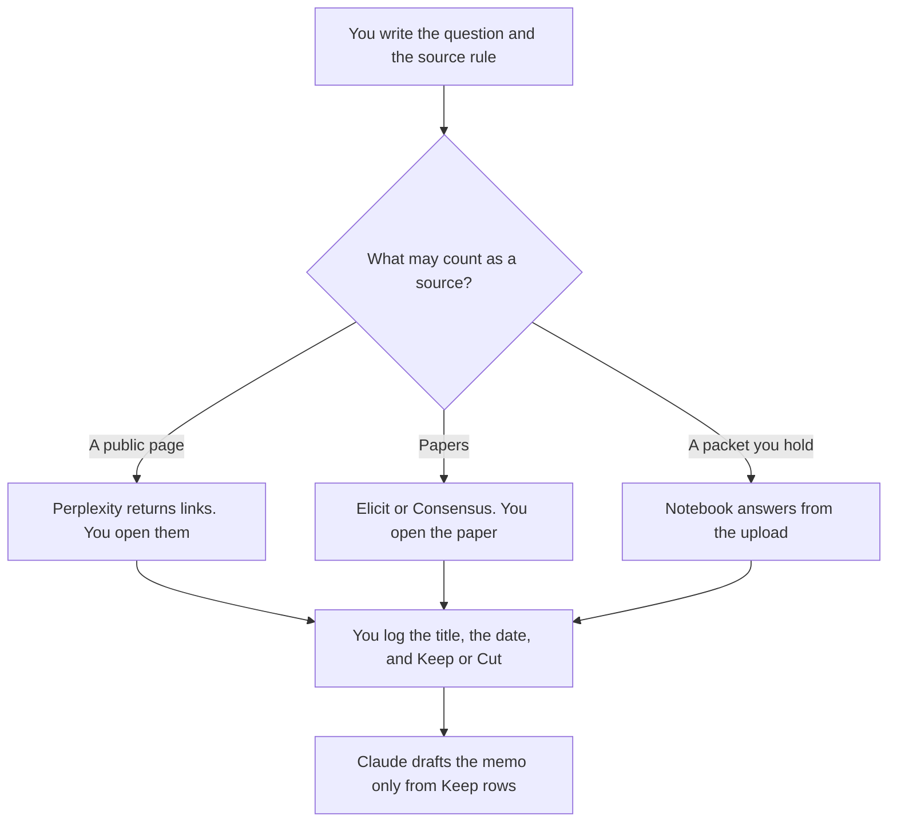

**Research ops should use AI to keep a protocol: the question, the kind of source that may answer it, and a log of what a person opened.** The model may format the log and draft a memo from findings you paste. It may not decide the conclusion, add a source you did not open, or call a search "a review." Literature tools are inputs. The protocol is the record that those inputs were allowed.

The market-research habit on the public web is [how to use Perplexity for market research](/blog/how-to-use-perplexity-for-market-research-2026/). The claim-by-claim check is [how to fact-check AI writing](/blog/how-to-fact-check-ai-writing-2026/). Whether a passage supports a sentence is [what AI groundedness is](/blog/what-is-ai-groundedness-2026/). The packet you upload, as a product, sits next to the protocol. It does not replace it.

Prices are US list prices excluding tax from directory pages checked October 16, 2026. Published October 24, 2026. We did not score research quality. A fluent memo with no log is not a finding.

## The ops job

| The job | Start here | First paid step | The limit |
|---|---|---|---|
| The protocol: question, source rule, owner, log | [Notion AI](/tools/notion-ai/) | Business is $20 a seat a month | A source the model suggested is not in the log until you open it |
| A public page, with a citation | [Perplexity](/tools/perplexity/) | Pro is $17 a month billed annually | You open the page and write the date |
| Papers, when the question is the literature | [Elicit](/tools/elicit/) | Plus is $11 a user a month billed annually | Free search is not a systematic review |
| A cited pass over peer-reviewed results | [Consensus](/tools/consensus/) | Pro is $12 a month billed annually ($144 a year) | You still open the paper that carries the claim |
| A packet you already collected | [Gemini Notebook](/tools/gemini-notebook/) | Free with a Google account. AI Plus is $4.99 | The notebook may use only what you uploaded |
| The memo from findings you pasted | [Claude](/tools/claude/) | Pro is $20 a month, or $17 billed annually | No finding enters that was not in the paste |

The source rule is a sentence you can apply: "pricing pages we opened this month," or "peer-reviewed papers, not blogs," or "only the PDFs in this folder." A rule that says "reputable sources" is not a rule. The model will treat it as permission.

## What you are paying for

**Notion Business** holds the protocol and the log. Each row is a source a person opened, a date, and Keep, Cut, or Conflict. The model may add a blank row. It may not mark Keep. The seat article is [Notion AI pricing explained](/blog/notion-ai-pricing-explained-2026/).

**Perplexity Pro at $17 a month billed annually** is the lookup when the source is the public web. Max at $167 is for heavy Computer use, not for a protocol you have not written. The invoice is [Perplexity pricing explained](/blog/perplexity-pricing-explained-2026/). Enterprise Pro at $40 a user a month is the admin row, not a quality row.

**Elicit Plus at $11**, billed annually, is the step up from free search when a person is extracting tables from papers. Pro at $39 billed annually is the directory's systematic-review tier. Do not buy Pro because a memo needs to sound thorough. The invoice is [Elicit pricing explained](/blog/elicit-pricing-explained-2026/).

**Consensus Pro** at $12 a month billed annually adds unlimited Pro messages and 15 Deep reviews, against Free's 10 Pro messages and 3 Deep reviews, on the card. Deep at $65 a month is a volume tier. The invoice is [Consensus pricing explained](/blog/consensus-pricing-explained-2026/).

**Gemini Notebook** is the path when the sources are files you uploaded and the answer has to cite those files. Google AI Plus at $4.99 raises notebook limits on that product's card. The Gemini app's 2x line is a different meter, explained in [Gemini pricing explained](/blog/gemini-pricing-explained-2026/).

**Claude Pro** writes the memo from Keep rows only. If a row says Conflict, the memo says Conflict and stops. The review is [Claude review](/blog/claude-review-2026/).

A prompt that holds the line:

"Draft the research memo from the Keep rows I pasted. Quote the source and the date for each point. Do not add a source, a number, or a recommendation. If a point has no source in the paste, write Missing."

## What not to automate

Do not let an agent mark the protocol complete. Do not paste a vendor's benchmark in as a finding unless you opened it and logged it, with the date. Do not treat a Notebook answer as permission to skip the log. The log is how someone else can rerun the question. A conclusion with no log is a paragraph.

## FAQ

### How is this different from fact-checking a draft?

Fact-checking starts from sentences someone already wrote and deletes the ones you cannot source. Research ops starts from a question and writes down which sources were allowed before anyone drafts the sentence. The memo comes last. If you only have a draft, use the fact-check workflow.

### Do we need Elicit and Consensus?

No. Elicit when you are extracting structured fields from papers. Consensus when you want a cited pass over the literature and you will open the papers that matter. Two subscriptions for the same question, with two logs, is how the protocol splits. Pick the one your source rule names.

### Can the model update the log next month?

It can list the rows whose dates are older than the window you set. It cannot re-open the pages. A person re-opens them, or the row stays stale on purpose and the memo says so. Freshness of a retrieved page is a separate idea: [what retrieval freshness is](/blog/what-is-retrieval-freshness-2026/).

### Who owns the question?

A person named on the protocol. A shared "research" owner means the log will not be updated. The question can be small. The owner still has a name. When the question changes, start a new protocol or date the edit. Silent edits make the log describe a question you are no longer asking.

## Last verified

October 16, 2026 for Notion AI, Perplexity, Elicit, Consensus, Gemini Notebook, and Claude. Published October 24, 2026.

**Sources:** [Notion pricing](https://www.notion.com/pricing), [Perplexity pricing](https://www.perplexity.ai/pro), [Elicit pricing](https://elicit.com/pricing), [Consensus pricing](https://consensus.app/pricing/), [Gemini Notebook](https://workspace.google.com/products/gemini-notebook/), [Claude pricing](https://claude.com/pricing).

*Published by Andrew for [AI Tools Optimizer](https://aitoolsoptimizer.com).*

[Perplexity](/tools/perplexity/) is in the [research and search directory](/tools/category/research-search/). Directory pages may use affiliate links. A purchase through them may earn us a commission at no extra cost to you.
