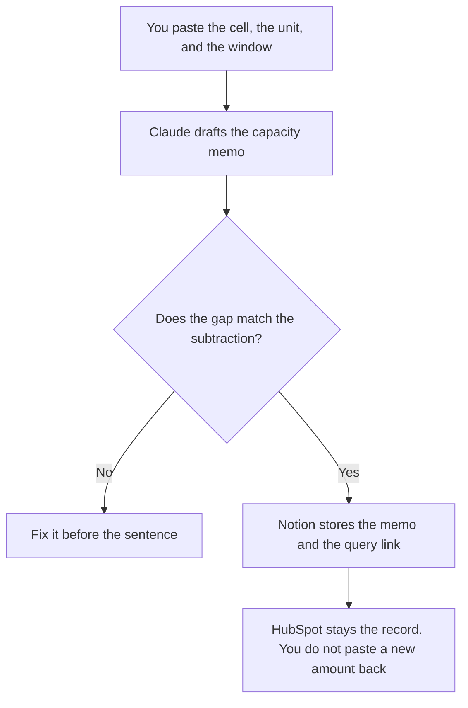

**A revenue ops analyst should use AI to draft a capacity memo from numbers they already measured, format the query result, and write one sentence that cites the cell.** The model does not set the forecast. The metric dictionary and the funnel sentence are a sibling job: [best AI tools for RevOps analysts](/blog/best-ai-tools-for-revops-analysts-2026/). This page is the money gap: capacity versus demand, the quota exception after a person decides, and the CRM figure they do not overwrite.

The memo itself is [how to write a capacity risk memo with AI](/blog/how-to-write-a-capacity-risk-memo-with-ai-2026/). The exception form is [how to create a quota exception request with AI](/blog/how-to-create-a-quota-exception-request-with-ai-2026/). The stage rules, which this analyst does not rename, are [best AI tools for sales ops](/blog/best-ai-tools-for-sales-ops-2026/).

Claude's prices are from claude.com/pricing on October 24, 2026. Hex, Notion, and HubSpot prices are from directory pages checked October 16. HubSpot's Starter figure was labeled limited-time. Published October 24, 2026. We did not score forecast accuracy. This page is not finance advice.

## The revenue ops analyst's week

| The job | Start here | First paid step | The limit |
|---|---|---|---|
| The capacity memo | [Claude](/tools/claude/) | Pro is $17 a month billed annually, or $20 monthly | No figure that was not in the paste |
| The query behind the cell | [Hex](/tools/hex/) | Professional is $36 an editor a month | The result is the source. The chat does not "know" last quarter |
| The page finance will open | [Notion AI](/tools/notion-ai/) | Business is $20 a seat a month | Plus at $10 is not the full AI tier |
| The CRM number | [HubSpot](/tools/hubspot/) | Free tools are $0. Starter was $7 or $10 a seat on a limited-time offer that day | The record wins. A generated sentence does not edit the amount |

RevOps analysts on the other page own the definition of the metric and the sentence under a chart. Revenue ops analysts on this page own the capacity gap and the forecast commentary that has to match a cell finance or the CRM already produced. If you are still naming the event, you are on their page. If you are explaining why the number does not cover the quarter, you are here. Sales ops owns the stage. Do not use this stack to rename a stage.

## What you are paying for

**Claude Pro** is the memo in a Project, so this month's unit matches last month's. The review is [Claude review](/blog/claude-review-2026/). ChatGPT Plus at $20, on the October 16 card, is enough for one memo from a short paste. This page starts with Claude because the unit has to survive more than one memo.

**Hex Professional** is the notebook where the cell was calculated. Community is free, with a smaller history, on that card. Team is $75 an editor a month if you need schedules and alerts. An alert on the bill itself is [what an AI cost anomaly alert is](/blog/what-is-ai-cost-anomaly-alert-2026/). The invoice is [Hex pricing explained](/blog/hex-pricing-explained-2026/).

**Notion Business** holds the memo, the exception request, and the link to the query. The chat is not the system of record. The invoice is [Notion AI pricing explained](/blog/notion-ai-pricing-explained-2026/).

**HubSpot's free tools** are the CRM if you do not already have one. The $7 or $10 Starter line was a limited-time offer on October 16. Confirm checkout before you put that number in an annual plan. The invoice is [HubSpot pricing explained](/blog/hubspot-pricing-explained-2026/).

A prompt that holds the line:

"Draft the capacity sentence from the two numbers and the unit I pasted. Show the subtraction. Do not explain the cause. Do not recommend a hire."

## What not to automate

Do not let a model set forecast category. Do not backfill a quota from a title. Do not paste a rep's compensation into the prompt so the gap "looks real." The OKR that should use the same target, if leadership wants one, is [Gemini vs ChatGPT for OKR drafts](/blog/gemini-vs-chatgpt-for-okr-drafts-2026/).

## FAQ

### How is this different from the RevOps analyst page?

That page owns the metric dictionary, the query habit, and the sentence under a funnel chart. This page owns capacity versus demand, the exception after a decision, and the forecast sentence that cites a cell. If the dictionary and the cell disagree, fix the dictionary or the query before you publish the memo.

### How is this different from sales ops?

Sales ops owns stage names and the rules that move a deal. Revenue ops analysts read the amount those stages already hold. They do not invent a stage to make the gap smaller.

### Do I need Hex and a CRM?

You need the system that produced the number, and the CRM if the number is a CRM amount. Two notebooks that both "round" the same cell will disagree. Cite one cell.

### Who may send the memo?

The owner named on it. A clean subtraction is not a decision to hire, to cut a territory, or to buy a larger model plan.

## Last verified

October 24, 2026 for Claude. October 16, 2026 for Hex, Notion, and HubSpot. Published October 24, 2026.

**Sources:** [Claude pricing](https://claude.com/pricing), [Hex pricing](https://hex.tech/pricing), [Notion pricing](https://www.notion.com/pricing), [HubSpot pricing](https://www.hubspot.com/pricing).

*Published by Andrew for [AI Tools Optimizer](https://aitoolsoptimizer.com).*

[Hex](/tools/hex/) is in the [data and analytics directory](/tools/category/data-analytics/). Directory pages may use affiliate links. A purchase through them may earn us a commission at no extra cost to you.
