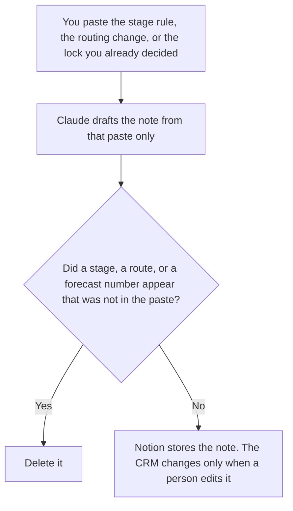

**A revenue ops lead should use AI to draft the note for a stage-definition change, a routing change, or a forecast lock, from a decision the lead already made.** The model does not rename a stage, move a deal, or set the number. The analyst's capacity memo is [best AI tools for revenue ops analysts](/blog/best-ai-tools-for-revenue-ops-analysts-2026/). The systems you buy, the list and the CRM, are [best AI tools for RevOps](/blog/best-ai-tools-for-revops-2026/). This page is the person who signs the rule.

The memo the analyst may already have written is [how to write a capacity risk memo with AI](/blog/how-to-write-a-capacity-risk-memo-with-ai-2026/). The stage rules this lead does not hand to a model to invent are [best AI tools for sales ops](/blog/best-ai-tools-for-sales-ops-2026/).

Claude's prices are the October 24, 2026 read of claude.com/pricing recorded in [Claude pricing explained](/blog/claude-pricing-explained-2026/). Notion is the October 16 directory card. HubSpot's seat and credit figures are the October 16 directory record in [HubSpot pricing explained](/blog/hubspot-pricing-explained-2026/) and [HubSpot AI pricing explained](/blog/hubspot-ai-pricing-explained-2026/). A fetch of HubSpot's pricing HTML returned HTTP 401 on October 24, so those figures stay on the directory record. Gong has no public dollar, as [Gong pricing explained](/blog/gong-pricing-explained-2026/) records. Published October 24, 2026. We did not score forecast accuracy. This page is not finance advice.

## The lead's week

| The decision | Start here | First paid step | The limit |
|---|---|---|---|
| The note that records a stage or routing change you already approved | [Claude](/tools/claude/) | Pro is $17 a month billed annually, or $20 monthly | No stage name you did not paste |
| The log the next lead will open | [Notion AI](/tools/notion-ai/) | Business is $20 a seat a month | Plus at $10 is not the full AI tier |
| The CRM that remains the system of record | [HubSpot](/tools/hubspot/) | Free CRM is $0. Starter was a limited-time $7 or $10 a seat | Professional and Enterprise have no public sticker on that card. Do not invent one |
| Call intelligence, if you already have a quote | [Gong](/tools/gong/) | Custom. No dollar on the directory card | Do not multiply a rumor into a budget line. A transcript tool is not this signature |

A note that says the forecast is "at risk" has added a judgment when you did not write one. If the lock is a number, the number is the one you pasted. If you did not paste a number, the line says Forecast figure not in this note. The analyst's page is where a capacity gap is drafted from measurements. The lead's page is where a rule change is recorded after the lead decides. The CRM is edited by a person. The note is not a field update.

HubSpot's AI, called Breeze on the October 16 card, has no separate sticker. Extra credits were listed at $10 per 1,000. Plans include some credits. The card does not print how many each edition includes. A Starter promo is not a Breeze price, and it was labeled limited-time. Confirm the button before you quote $7 or $10.

## What you are paying for

**Claude Pro** holds the decision sentence so a later note does not widen the stage definition. Team standard seats are $20 a seat a month billed annually, or $25 monthly, when the note is a company record, as recorded in [Claude Team pricing explained](/blog/claude-team-pricing-explained-2026/). The review is [Claude review](/blog/claude-review-2026/).

**Notion Business** is the log: the rule, the date, the owner. The invoice is [Notion AI pricing explained](/blog/notion-ai-pricing-explained-2026/).

**HubSpot's free CRM** is the system of record when you do not yet have a Professional quote. The AI meter is [HubSpot AI pricing explained](/blog/hubspot-ai-pricing-explained-2026/). Spend controls belong on before an agent edits fields. This page does not turn an agent on.

**Gong** stays a custom quote: per-user licenses plus a platform fee, on the directory card, with no dollar. If the lead only needed a transcript, [Fathom pricing explained](/blog/fathom-pricing-explained-2026/) is a public list. Do not describe Fathom Business as Gong.

A prompt that holds the line:

"Draft the note from the stage rule, the routing change, or the forecast lock I pasted. If a figure is missing, write Forecast figure not in this note. Do not rename a stage. Do not move a deal. Do not add a route."

## What not to automate

Do not let a model rename stages to "match the industry." Do not lock a forecast from a draft that added a number. Do not let a CRM agent write fields because the note looks finished. The lead signs the rule. The CRM changes when a person changes it.

## FAQ

### How is this different from the revenue ops analyst page?

That page is the measurement: a capacity memo from numbers the analyst pasted, a query, and a sentence that cites the cell. This page is the signature: the stage rule, the routing change, and the lock the lead already decided. An analyst can write the memo without changing a stage. A lead can record a rule change without writing the capacity memo. Link them. Do not merge the files.

### How is this different from the RevOps buying guide?

That page is which system to buy: a list, the CRM, routing, a notebook for the funnel. This page assumes the CRM exists and asks how the lead records a rule. Use that page when you are choosing Clay, HubSpot, or a router. Use this page when you are writing down a change.

### How is this different from sales ops?

The sales-ops page is the operational shelf beside the rep, including stage hygiene as a team practice. This page is the lead's note for one change they have already approved. A sales-ops workflow can propose a change. It does not sign this note. The lead does.

### Who may change the CRM?

A person, after the note is accepted. Forecast figure not in this note stays out of the CRM. A stage name that was not in the paste is not renamed. Gong's quote, if you have one, is not a substitute for the note.

## Last verified

October 24, 2026 for Claude, via the pricing article. October 16, 2026 for Notion, HubSpot, and Gong, with HubSpot's public pricing HTML returning HTTP 401 on October 24. Published October 24, 2026.

**Sources:** [Claude pricing](https://claude.com/pricing), [Notion pricing](https://www.notion.com/pricing), [HubSpot pricing](https://www.hubspot.com/pricing), [Gong](https://www.gong.io/pricing).

*Published by Andrew for [AI Tools Optimizer](https://aitoolsoptimizer.com).*

[HubSpot](/tools/hubspot/) is in the [sales directory](/tools/category/sales/). Directory pages may use affiliate links. A purchase through them may earn us a commission at no extra cost to you.
