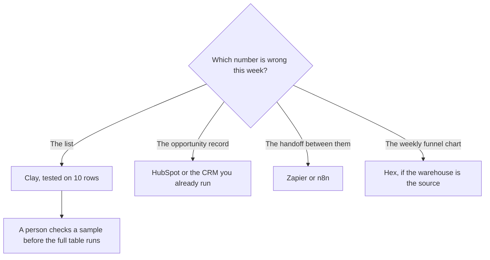

**RevOps should buy the tool that matches the operational job: enrich a list, keep the CRM as the system of record, route a record, or explain a funnel number.** A rep's dialer is a sales purchase. This page is the system behind the rep. The rep-facing stack is [best AI tools for sales teams](/blog/best-ai-tools-for-sales-teams-2026/). The weekly workflow that is not revenue-specific is [best AI tools for ops teams](/blog/best-ai-tools-for-ops-teams-2026/).

Clay and Hex prices below were read on their pricing pages October 24, 2026. The other prices are US list prices from directory pages checked October 16, 2026. n8n stays in euros. Published October 24, 2026. We did not score data accuracy or forecast quality.

## The RevOps job

| Job | Start here | First paid step | The limit |
|---|---|---|---|
| A table that waterfalls providers and researches a row | [Clay](/tools/clay/) | Launch headlines at $167 a month on the annual toggle. Free is 500 actions and 100 data credits a month, 200 rows a table | The action slider and the data-credit slider are both the invoice |
| The CRM the opportunity has to land in | [HubSpot](/tools/hubspot/) | Free CRM. A limited-time Starter from $7 per seat per month was on the October 16 card | Confirm the offer. It was labeled limited-time |
| A contact database with seats and sequences | [Apollo.io](/tools/apollo-io/) | Basic is $49 per seat per month billed annually. Free is 900 credits per seat per year and 2 sequences | Credits do not roll over. All seats on one account share a plan |
| Sending infrastructure, after you may email the list | [Instantly](/tools/instantly/) | Growth is $47 a month on one of two tabs. Read [Instantly pricing explained](/blog/instantly-pricing-explained-2026/) before you quote $47 | A tool does not create permission to email |
| The funnel number in a warehouse | [Hex](/tools/hex/) | Professional is $36 per editor per month. Team is $75 | Medium compute is included. Larger profiles are hourly |
| A route you can draw, in dollars | [Zapier](/tools/zapier/) | Professional is $19.99 a month annually, 750 tasks | A long path can be many tasks |
| A route billed per full run | [n8n](/tools/n8n/) | Starter is €20 a month billed annually, 2,500 executions | This page does not convert euros |

Clay's sliders are [Clay pricing explained](/blog/clay-pricing-explained-2026/). Hex's compute line is [Hex pricing explained](/blog/hex-pricing-explained-2026/).

## The list and the CRM stay different

Clay's annual toggle on October 24 showed Growth at $446 a month when you need CRM auto-sync, HTTP, and webhooks. Launch at $167 is the research table before those connections are the reason you pay. Unlimited seats mean the invoice does not care how many operators log in. It cares how many rows they enrich. Test ten rows, then run the table. A waterfall can pay two providers for one cell.

Apollo is the database when RevOps wants seats, sequences, and a dialer in the same login the reps already open. Clay is the custom column Apollo does not have. Paying for both is normal. Paying for both to do the same email lookup is how the month doubles. The sales article separates them from the rep's call notes.

HubSpot remains the system of record if that is where the pipeline is managed. Breeze, HubSpot's AI layer, sits on that CRM. The October 16 card's Starter offer started at $7 a seat and was marked limited-time. Do not put $7 in an annual budget without opening the page. Free CRM is the part you can plan on. Syncing Clay into HubSpot is a Growth feature on Clay's card, or a Zapier task if you are not on Growth yet.

Instantly is the sender. Quote the tab you mean. The pricing article exists because two plans can both look like $47. RevOps owns deliverability and the list source. The copy of the email is a marketing job.

## Routing and the number

Zapier Professional is the path a non-developer will maintain: form to CRM, closed-won to a channel, a paid invoice to a sheet. Make Core from $9 a month annually is the branchier canvas. n8n is the execution-priced option when someone will own it. The comparison is [Zapier vs Make vs n8n](/blog/zapier-vs-make-vs-n8n/). An agent belongs on the step you cannot draw, with a person approving anything that emails a customer. That product, if you need it, is [Lindy](/tools/lindy/), from $49.99 per user per month on the October 24 FAQ. The invoice is [Lindy pricing explained](/blog/lindy-pricing-explained-2026/).

Hex is for the funnel question that already lives in a warehouse. Professional at $36 is one editor and five published apps. Team at $75 is schedules and shared apps. A CSV and a one-off question can stay in a spreadsheet tool: [best AI for Excel and Google Sheets](/blog/best-ai-for-excel-and-google-sheets-2026/). [Gong](/tools/gong/) is a custom quote for conversation intelligence. RevOps explains that quote. This page does not invent a Gong price.

A small RevOps stack: HubSpot or the CRM you have, Clay free until 200 rows block you, Zapier for one route, and Hex only when the warehouse is real. Add Apollo when the database is the hole. Add Instantly when sending is the hole and the list is lawful to email.

## FAQ

### What should RevOps automate first?

The route with a known trigger and a known destination: a form into the CRM, an enrichment of ten rows you can check, a weekly export. Leave forecasting narratives and outbound copy until the record is clean.

### Clay or Apollo?

Clay when the column is custom and a person will build the table. Apollo when the team wants a seat, a sequence, and a database. Use Clay on top of Apollo when the waterfall has to try several providers. Do not buy Clay for a list of twenty names you already know.

### Is Hex a CRM?

No. Hex reads the data you connect and publishes an analysis. The opportunity still lives in the CRM. An editor seat is the wrong place to be the system of record.

### How do I keep AI from emailing the list?

Put a person on the send, and use a tool whose approval rule you have read. Enrichment is not permission. The guardrail pattern is [what AI guardrails are](/blog/what-is-ai-guardrails-2026/).

## Last verified

October 24, 2026 for Clay's pricing page and Hex's pricing page, and for Lindy's $49.99 FAQ line. October 16, 2026 for HubSpot, Apollo, Zapier, Make, and n8n in the directory. Published October 24, 2026.

**Sources:** [Clay pricing](https://www.clay.com/pricing), [Hex pricing](https://hex.tech/pricing/), [Apollo pricing](https://www.apollo.io/pricing), [HubSpot pricing](https://www.hubspot.com/pricing).

*Published by Andrew for [AI Tools Optimizer](https://aitoolsoptimizer.com).*

[Clay](/tools/clay/) is in the [sales directory](/tools/category/sales/). [HubSpot](/tools/hubspot/) is in the [marketing directory](/tools/category/marketing-seo/). Directory pages may use affiliate links. A purchase through them may earn us a commission at no extra cost to you.
