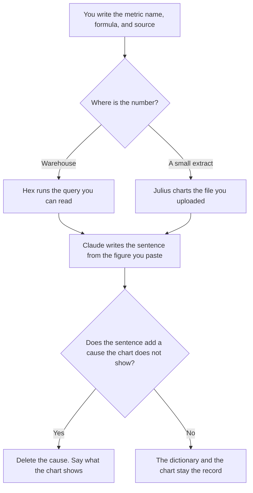

**A RevOps analyst should use AI to format a metric definition, a query, and a sentence under a number finance or the CRM already produced.** The enrichment table and the route between tools are the RevOps systems page. The stage names are sales ops. This page is the person who has to explain why the funnel chart moved. We did not score forecast accuracy. The model does not get to invent the number.

The systems shelf is [best AI tools for RevOps](/blog/best-ai-tools-for-revops-2026/). The stage rules are [best AI tools for sales ops](/blog/best-ai-tools-for-sales-ops-2026/). The general notebook habit is [best AI tools for data analysts](/blog/best-ai-tools-for-data-analysts-2026/). The coverage map those definitions should match is [how to create a sales territory plan with AI](/blog/how-to-create-a-sales-territory-plan-with-ai-2026/).

Prices are US list prices excluding tax from directory pages checked October 16, 2026. HubSpot's Starter figure was labeled limited-time. Published October 24, 2026.

## The analyst's job

| The job | Start here | First paid step | The limit |
|---|---|---|---|
| The metric dictionary: name, formula, owner, source | [Notion AI](/tools/notion-ai/) | Business is $20 a seat a month | A metric the model invented does not enter the dictionary |
| The warehouse query and a published chart | [Hex](/tools/hex/) | Professional is $36 per editor a month | Medium compute is included. Larger profiles are hourly |
| A CSV extract, when you do not have the warehouse | [Julius AI](/tools/julius-ai/) | Plus is $20 a month, or $16 billed annually, for 2,000 credits | The file is the population. It is not the CRM |
| The sentence under a chart you already trust | [Claude](/tools/claude/) | Pro is $20 a month, or $17 billed annually | Paste the numbers. The model does not remember last quarter |
| The opportunity record you are explaining | [HubSpot](/tools/hubspot/) | Free CRM. A limited-time Starter from $7 or $10 per seat a month was on the card | Confirm the offer. The CRM is the record, not the narrative |

RevOps the function buys Clay, routing, and the CRM. The analyst on this page reads those systems and writes down what a metric means. If your week is building the list, use the RevOps page. If your week is explaining the chart, use this one.

## What you are paying for

**Notion Business at $20 a seat** holds the dictionary. Each metric has one formula, one owner, and one source system. A "revenue" that means bookings in one row and collections in another is two metrics. The model may format the row. It may not merge them. The home of the fact is [what a system of record for AI is](/blog/what-is-a-system-of-record-for-ai-2026/). A named input shared by a model and a report is [what an AI feature store is](/blog/what-is-ai-feature-store-2026/).

**Hex Professional at $36 per editor** is the notebook when the warehouse is the source. Team is $75 per editor a month. Community is free with an agent trial and small compute. The invoice, including hourly compute, is [Hex pricing explained](/blog/hex-pricing-explained-2026/).

**Julius Plus** is the path for an export someone already pulled. Do not ask it to estimate the rest of the funnel outside the file. The review path for analysts who live in sheets is [best AI for Excel and Google Sheets](/blog/best-ai-for-excel-and-google-sheets-2026/).

**Claude Pro** writes the weekly sentence from figures you paste: what changed, by the definition in the dictionary, and what you are not claiming. A cause you did not test stays out. The review is [Claude review](/blog/claude-review-2026/).

**HubSpot** is where the opportunity sits. The analyst reads it. A narrative that disagrees with the CRM is a bug in the narrative or a bug in the CRM, and a person decides which. The Starter offer is [HubSpot pricing explained](/blog/hubspot-pricing-explained-2026/).

A prompt that holds the line:

"Write the weekly note from the metric definitions and the figures I pasted. Use only those figures. Do not add a cause, a forecast, or a recommendation. If a definition and a figure disagree, write Conflict and stop."

## What not to automate

Do not auto-publish the sentence into the board deck. The board packet is a different file, and the figures there have to be the ones you pasted: [Gamma vs Plus AI for board decks](/blog/gamma-vs-plus-ai-for-board-decks-2026/). Do not let an assistant change a stage definition to make a chart smoother. Stage changes are sales ops. Do not treat a finance close as a CRM report. The books are [best AI tools for finance ops](/blog/best-ai-tools-for-finance-ops-2026/).

## FAQ

### How is this different from the RevOps roundup?

That page is the operational stack: enrich a list, keep the CRM, route a record, chart the funnel. This page is the analyst who defines the metric and writes the sentence. One person may do both. The tools and the failure modes differ. A Clay credit and a metric dictionary are not the same purchase.

### Can the model reconcile CRM and warehouse?

It can format a diff you already computed. It cannot decide which system is right. Write Conflict, then the owner of each source decides. A blended number with no owner is how the board sees two revenues.

### Do we need Hex and Julius?

No. Hex when the warehouse is the source. Julius when you have a file and no warehouse seat. Two tools charting the same metric is the drift you are trying to avoid.

### Can this note include a forecast?

Only a forecast a person who is allowed to forecast has already signed, pasted as a figure. This page does not build the forecast. A sentence that "implies" the quarter will land somewhere is the sentence to delete.

## Last verified

October 16, 2026 for Notion AI, Hex, Julius, Claude, and HubSpot. Published October 24, 2026.

**Sources:** [Notion pricing](https://www.notion.com/pricing), [Hex pricing](https://hex.tech/pricing/), [Julius pricing](https://julius.ai/pricing), [Claude pricing](https://claude.com/pricing), [HubSpot CRM Starter](https://www.hubspot.com/products/crm/starter).

*Published by Andrew for [AI Tools Optimizer](https://aitoolsoptimizer.com).*

[Hex](/tools/hex/) is in the [data and analytics directory](/tools/category/data-analytics/). Directory pages may use affiliate links. A purchase through them may earn us a commission at no extra cost to you.
