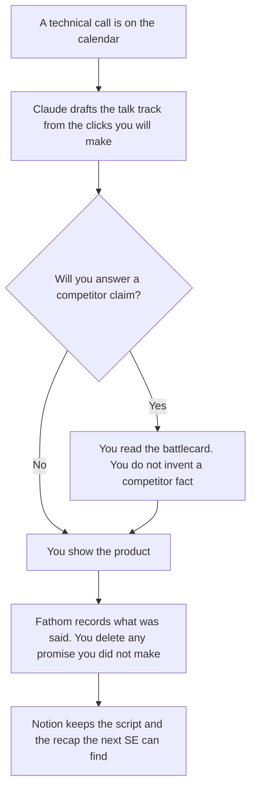

**A sales engineer should use AI to draft the talk track from clicks they will actually make, the objection line from a battlecard they already have, and the recap from words the buyer said.** The branch, the doc-cited answer, and the POC note are a different page: [best AI tools for solutions engineers](/blog/best-ai-tools-for-solutions-engineers-2026/). The account executive's shelf is [best AI tools for sales teams](/blog/best-ai-tools-for-sales-teams-2026/).

The clicks are [how to create a demo script with AI](/blog/how-to-create-a-demo-script-with-ai-2026/). The card you may say out loud is [how to create a competitive battlecard with AI](/blog/how-to-create-a-competitive-battlecard-with-ai-2026/). A questionnaire or an RFP is [how to write an RFP response with AI](/blog/how-to-write-a-rfp-response-with-ai-2026/).

Prices are US list prices excluding tax from directory pages checked October 16, 2026. A live fetch of vendor pricing pages on October 24, 2026 returned HTTP 401, so this page stays on the directory record. Published October 24, 2026. We did not score win rates.

## The customer-facing hour

| The job | Start here | First paid step | The limit |
|---|---|---|---|
| The talk track, from the clicks you listed | [Claude](/tools/claude/) | Pro is $20 a month, or $17 billed annually | No click, limit, or SLA you did not paste |
| A short leave-behind | [Gamma](/tools/gamma/) | Plus is $9 a seat a month | The architecture has to match the doc |
| The recap of what the buyer said | [Fathom](/tools/fathom/) | Free includes unlimited recordings and instant summaries | Premium is $16 a month billed annually, or $20 monthly, for advanced summaries and AI action items |
| The battlecard and the script the next SE inherits | [Notion AI](/tools/notion-ai/) | Business is $20 a seat a month | Plus at $10 is not the full AI tier |

The solutions-engineer page is the repo, the proof, and the POC log. Use it when the deal needs a diff or a notebook. Use this page when you are about to talk, and the risk is a sentence the buyer will repeat. An SLA you did not paste is [a hallucination](/blog/what-is-ai-hallucination-2026/) they will put in the notes. The check is [how to fact-check AI writing](/blog/how-to-fact-check-ai-writing-2026/).

## What you are paying for

**Claude Pro** holds the script and the objection answers next to the battlecard text you are allowed to paste. Free can format one outline. The review is [Claude review](/blog/claude-review-2026/).

**Gamma Plus** is $9 a seat a month, with 1,000 credits on the directory card. Pro is $18 a seat a month. A leave-behind that adds a diagram the doc does not support is the slide you delete. The investor-deck comparison is a different job. For a short technical leave-behind, Plus is the first paid card. [Pitch](/tools/pitch/) Plus is $10 a seat a month billed yearly if the team already builds decks there. Do not buy both for one call.

**Fathom Free** is enough for a recording and an instant summary, on the directory card. Premium is the step when you want the advanced summary and AI action items. The sales-call comparison with Otter is [Otter vs Fathom for sales calls](/blog/otter-vs-fathom-for-sales-calls-2026/). **Otter** Pro is $8.33 a user a month billed annually if that is the recorder the team already runs. Do not add a second notetaker for one demo.

**Notion Business** is where the accepted script and the battlecard live. The invoice is [Notion AI pricing explained](/blog/notion-ai-pricing-explained-2026/).

**Gong** does not publish a dollar, on the directory card. If the company already owns it, the recap may already be there. Read [Gong pricing explained](/blog/gong-pricing-explained-2026/) before you quote a seat. This page does not invent one.

A prompt that holds the line:

"Draft the talk track from the clicks and the limits I pasted. Do not add a click. If a limit is missing, write Limit missing. Do not mention a competitor I did not paste."

## What not to automate

Do not let the model answer a security question from memory. Paste the approved sentence or say you will follow up. Do not send the recap until you have removed any promise the summary added. Do not build a one-off demo environment with production data so the call "feels real." If the proof needs a repo, use the solutions-engineer page and [Cursor](/tools/cursor/) Plus at $8 a month, or $80 a year, and review the diff.

## FAQ

### How is this different from the solutions engineer page?

That page is the demo branch, the answer that cites a doc, and the POC note with an owner. This page is the talk track, the objection you are allowed to say, and the recap. Many people hold both titles. The artifacts are still different, and the solutions page should stay the one that mentions the repo.

### Do I need Fathom Premium?

Free includes unlimited recordings, transcripts, and instant summaries, on the October 16 directory card. Premium at $16 a month billed annually is the card for advanced summaries and AI action items. A recap you will rewrite anyway can stay on Free.

### Can Gamma write the architecture?

It can lay out sentences you pasted. A box that was not in the doc is a new claim. Delete it. The script article is the source for the clicks. The slides follow the script.

### Who sends the recap?

The sales engineer or the account executive, whoever the team named. The notetaker does not send it. A promise that appears only in the AI summary is the line you remove before anyone outside the company sees it.

## Last verified

October 16, 2026 for Claude, Gamma, Fathom, Notion, Pitch, Otter, Gong, and Cursor. Published October 24, 2026.

**Sources:** [Claude pricing](https://claude.com/pricing), [Gamma pricing](https://gamma.app/pricing), [Fathom pricing](https://fathom.ai/pricing), [Notion pricing](https://www.notion.com/pricing).

*Published by Andrew for [AI Tools Optimizer](https://aitoolsoptimizer.com).*

[Claude](/tools/claude/) is in the [chatbots and assistants directory](/tools/category/chatbots-assistants/). Directory pages may use affiliate links. A purchase through them may earn us a commission at no extra cost to you.
