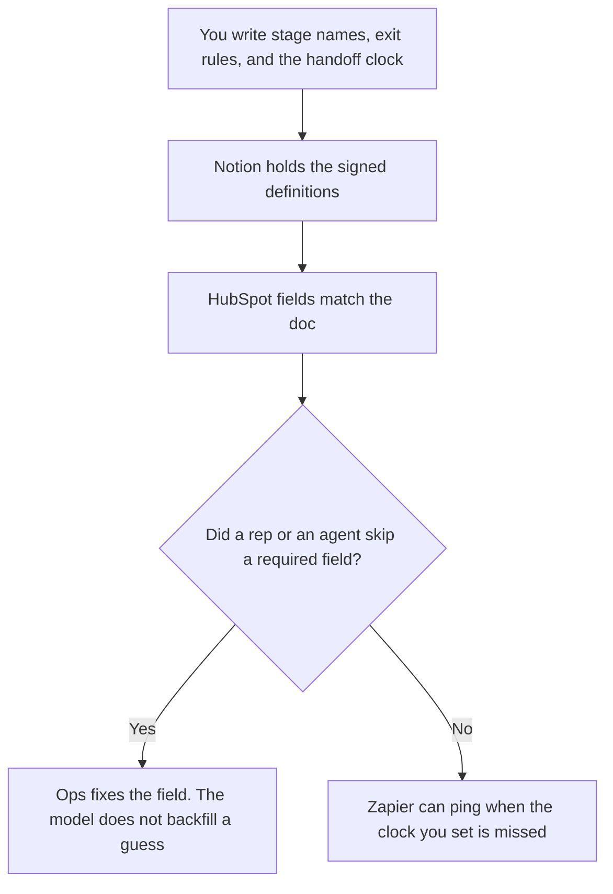

**Sales ops should use AI to format stage rules, field definitions, and handoff clocks you already decided, inside the CRM that stays the system of record.** A rep's list and a warehouse model are other jobs. The rep stack is [best AI tools for sales teams](/blog/best-ai-tools-for-sales-teams-2026/). The enrichment and routing stack is [best AI tools for RevOps](/blog/best-ai-tools-for-revops-2026/). We did not score forecast accuracy. The lead who drafts the note for a stage change or a forecast lock, from a decision they already made, is [best AI tools for revenue ops leads](/blog/best-ai-tools-for-revenue-ops-leads-2026/).

The discovery questions the stages should match are [how to create a sales discovery script with AI](/blog/how-to-create-a-sales-discovery-script-with-ai-2026/). A required field an agent invents is [what an AI hallucination is](/blog/what-is-ai-hallucination-2026/).

Prices are US list prices excluding tax. HubSpot's Starter figure is the October 16, 2026 directory record, and it was labeled limited-time. Gong has no public price. Published October 24, 2026.

## The ops job

| The job | Start here | First paid step | The limit |
|---|---|---|---|
| The CRM where stages and required fields live | [HubSpot](/tools/hubspot/) | Free CRM. Starter was $7 or $10 a seat a month on a promo | Professional and Enterprise are a quote. Do not invent the sticker |
| The definition doc: what each stage means, and the exit rule | [Notion AI](/tools/notion-ai/) | Business is $20 a seat a month | The doc and the CRM must say the same thing. One of them is a copy |
| A clean draft of rules you already use | [Claude](/tools/claude/) | Pro is $20 a month, or $17 billed annually | The model formats. It does not add a stage |
| A notice when a handoff clock is missed | [Zapier](/tools/zapier/) | Professional is $19.99 a month billed annually, 750 tasks | The clock is yours. The Zap only notifies |
| Call evidence for a stage you defined as "we met" | [Gong](/tools/gong/) | Custom. Per-user licenses plus a platform fee | No public dollar. A transcript is not a stage change |
| A contact database, if ops also administers the seat | [Apollo.io](/tools/apollo-io/) | Basic is $49 a seat a month billed annually | Credits expire. The list job is the sales-team page |

Sales ops owns the definitions. RevOps on this site owns the enrichment table and the warehouse number. If your company uses one title for both, still keep two lists: what a stage means, and how a row gets enriched. Mixing them is how a Clay column becomes a forecast category.

## What you are paying for

**HubSpot.** Free tools are a real CRM. The October 16 card showed Starter at $7 or $10 a seat as a limited-time offer. Professional and Enterprise are sales-led. Credits were listed at $10 per 1,000. Cap them before an agent writes a stage or a forecast category. The invoice is [HubSpot pricing explained](/blog/hubspot-pricing-explained-2026/).

**Notion Business at $20 a seat** holds the stage dictionary: the name, the exit evidence, the required fields, the clock. Plus at $10 is not the full AI tier. If the dictionary and the CRM disagree, stop and pick the signed one. The record rule is [what a system of record for AI is](/blog/what-is-a-system-of-record-for-ai-2026/).

**Claude Pro** formats the dictionary from bullets you pasted. It may flag a stage with no exit rule. It may not invent the rule. The review is [Claude review](/blog/claude-review-2026/). The person who signs a stage is [what human-in-the-loop AI is](/blog/what-is-human-in-the-loop-ai-2026/).

**Zapier Professional at $19.99 a month annually** is the ping. Free is 100 tasks. Do not let the Zap move the stage. A missed clock is a message to a person. Team is $69 billed annually. Enterprise is custom.

**Gong** is the quote you request when "a recorded meeting happened" is evidence for a stage. The pricing explainer is [Gong pricing explained](/blog/gong-pricing-explained-2026/). Until you have the quote, do not put a dollar in the plan.

**Apollo** is optional on this page. Buy it when ops administers the database seat. The credits and the rollover rule are [Apollo.io pricing explained](/blog/apollo-io-pricing-explained-2026/). The demand program that spends those credits is [best AI tools for demand gen](/blog/best-ai-tools-for-demand-gen-2026/).

A prompt that holds the line:

"Format a stage dictionary from the names, exit rules, required fields, and clocks I pasted. Do not add a stage. If an exit rule is missing, write Missing. Do not describe a forecast category I did not name."

## What not to automate

Do not let an agent set forecast category from a transcript. Do not backfill a closed-lost reason the rep did not pick. Do not add a stage because a template online had seven. The RACI for who may change a stage is [how to create a RACI chart with AI](/blog/how-to-create-a-raci-chart-with-ai-2026/). The health rubric, if customer success owns a different score, is [how to write a customer health score rubric with AI](/blog/how-to-write-a-customer-health-score-rubric-with-ai-2026/).

## FAQ

### Is this RevOps?

On this site, RevOps is the enrichment table, the route, and the warehouse number. Sales ops is the stage, the field, and the handoff clock. Buy Clay from the RevOps page when the table is the job. Buy the CRM discipline here.

### Can we run sales ops on free HubSpot?

Yes, while the pipeline fits free tools. Move to a paid edition when a required field, a permission, or an agent you need is gated, and get the price from checkout or a quote. Do not budget a Professional dollar this page refused to invent.

### Should AI clean dirty fields?

It can list fields that break a rule you wrote, the way a spreadsheet cleanup should. It should not guess the right industry or the right stage. The cleanup habit is [Gemini vs ChatGPT for spreadsheet cleanup](/blog/gemini-vs-chatgpt-for-spreadsheet-cleanup-2026/). A person writes the correction.

### Do we need Gong to have stages?

No. Stages need a definition and a CRM. Gong is evidence for a stage you already defined as a meeting. If you cannot get a quote, keep the stage rule based on a field a person sets.

## Last verified

October 16, 2026 for HubSpot, Notion AI, Claude, Zapier, Gong's pricing model, and Apollo.io. HubSpot Starter was a promotion. Gong has no public dollar. Published October 24, 2026.

**Sources:** [HubSpot pricing](https://www.hubspot.com/pricing), [Notion pricing](https://www.notion.com/pricing), [Zapier pricing](https://zapier.com/pricing), [Gong pricing](https://www.gong.io/pricing).

*Published by Andrew for [AI Tools Optimizer](https://aitoolsoptimizer.com).*

[HubSpot](/tools/hubspot/) is in the [sales directory](/tools/category/sales/). Directory pages may use affiliate links. A purchase through them may earn us a commission at no extra cost to you.
