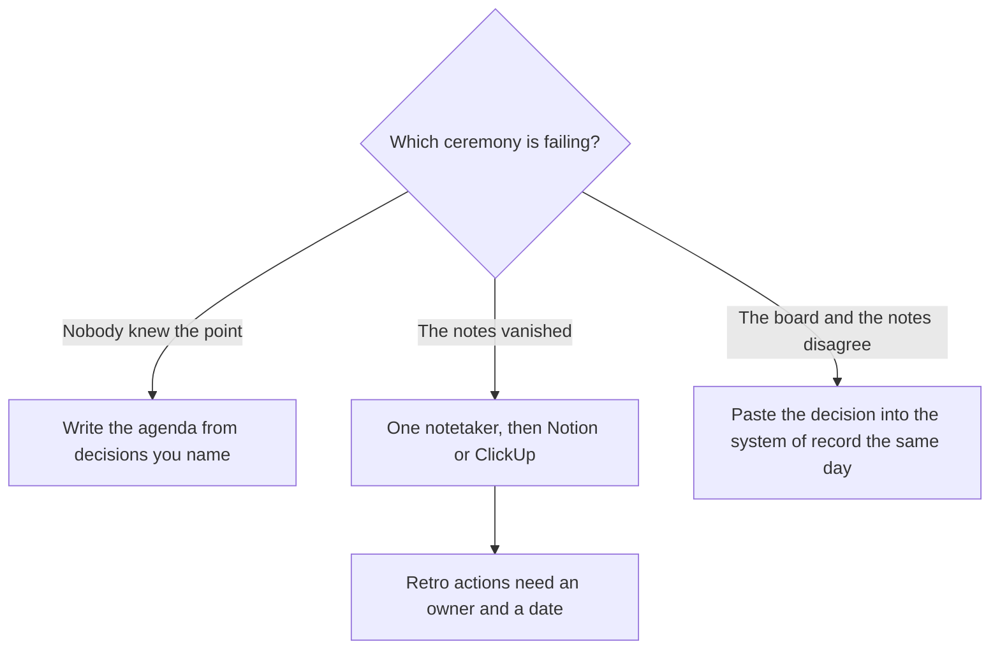

**A scrum master should buy the tool that matches the ceremony they already run: the agenda, the notes, or the board.** An agent that writes velocity and a morale score from a transcript is not a facilitation tool. It is a rumor with a chart. This page is the sprint. The manager next to the team is [best AI tools for engineering managers](/blog/best-ai-tools-for-engineering-managers-2026/). The product partner is [best AI tools for product managers](/blog/best-ai-tools-for-product-managers-2026/). The coach who drafts a note from what people said, and does not add a maturity score, is [best AI tools for agile coaches](/blog/best-ai-tools-for-agile-coaches-2026/).

Prices are US list prices excluding tax from directory pages checked October 16, 2026, with Fathom and Otter figures from their pricing explainers. Published October 24, 2026. We did not measure team throughput.

## The ceremony, then the tool

| Ceremony | Start here | First paid step | The limit |
|---|---|---|---|
| Planning, standup, review, retro agenda | [Claude](/tools/claude/) or [ChatGPT](/tools/chatgpt/) | Pro or Plus is $20. Claude Pro is also $17 billed annually | You name the decisions. The model times them |
| The notes | [Granola](/tools/granola/), [Fireflies](/tools/fireflies-ai/), [Fathom](/tools/fathom/), or [Otter](/tools/otter-ai/) | Granola Business is $14. Fireflies Pro is $10 annual. Fathom Free records. Otter Pro is $8.33 annual | One bot. Consent. No second notetaker |
| The board and the wiki | [Notion AI](/tools/notion-ai/) or [ClickUp Brain](/tools/clickup-brain/) | Notion Business is $20 a seat. ClickUp Brain is from $9 on top of a ClickUp plan | The number lives in one system |
| The review deck | [Gamma](/tools/gamma/) | Plus is $9 a seat, or $108 a year | The deck is not the increment |
| The release the review points at | A changelog a person edits | The writing seats above | The model does not decide what shipped |

## The agenda and the retro

Write the agenda before you invite the model to be creative. The workflow is [how to create meeting agendas with AI](/blog/how-to-create-meeting-agendas-with-ai-2026/). A retro has its own shape: what to keep, what to change, and an owner. That workflow is [how to run a retro with AI](/blog/how-to-run-a-retro-with-ai-2026/). A quarterly target is not a retro. If the team is setting numbers, the workflow is [how to write OKRs with AI](/blog/how-to-write-okrs-with-ai-2026/), and the number still comes from a person.

[Claude](/tools/claude/) is the better first draft when you are revising a long planning doc. [ChatGPT](/tools/chatgpt/) Plus is the better first draft when the scrum master also lives in that seat for other work. Go at $8 covers a light week. Do not buy Pro at $100 to facilitate. The summary habit after the ceremony is [Claude vs ChatGPT for summaries](/blog/claude-vs-chatgpt-for-summaries-2026/).

## The notes and the board

Pick one notetaker. [Granola](/tools/granola/) Business at $14 fits a facilitator who types and wants history past 30 days. [Fireflies](/tools/fireflies-ai/) Pro at $10 annual fits a bot on the calendar. Monthly is $18, which is the toggle to notice. [Fathom](/tools/fathom/) Free includes unlimited recordings and transcripts. Premium is $20, or $16 billed annually. [Otter](/tools/otter-ai/) Basic is 300 minutes. Pro is $16.99 a month or $8.33 billed annually. Business is $30, or $19.99 billed annually, on the Otter pricing explainer. The comparison is [Fireflies alternatives](/blog/fireflies-alternatives-2026/) and [how to summarize meetings with AI](/blog/how-to-summarize-meetings-with-ai-2026/).

Take the actions into the system the team already updates. [Notion AI](/tools/notion-ai/) Business at $20 a seat is the wiki and the decision log. [ClickUp Brain](/tools/clickup-brain/) from $9 sits on ClickUp. Unlimited is $7 per user billed yearly. If the sprint lives in ClickUp, do not keep a second truth in Notion. The comparison is [Notion AI vs ClickUp Brain](/blog/notion-ai-vs-clickup-brain-2026/). The home for the working agreements is [how to build an internal wiki with AI](/blog/how-to-build-an-internal-wiki-with-ai-2026/).

[Gamma](/tools/gamma/) Plus at $9 is enough for a review deck of decisions and demos. It is not a substitute for the increment. The card is [Gamma pricing explained](/blog/gamma-pricing-explained-2026/).

What shipped, as a list the team will not argue with later, is [how to write a changelog with AI](/blog/how-to-write-a-changelog-with-ai-2026/). The story form is [how to write release notes with AI](/blog/how-to-write-release-notes-with-ai-2026/).

## What not to automate

Do not ask a model to score a person's performance from standup transcripts. Do not publish a velocity number the model computed from a messy board. Do not add a second bot because the first summary felt thin. Facilitation is the job. The draft is the aid. The line is [what human-in-the-loop AI is](/blog/what-is-human-in-the-loop-ai-2026/).

A coding assistant for the scrum master who also reviews a diff is a different purchase. The manager's version of that choice is on the engineering-manager page. The editor split is [Cursor vs GitHub Copilot](/blog/cursor-vs-github-copilot-2026/).

## FAQ

### What should a scrum master pay for first?

The ceremony that is actually breaking. Lost notes: Granola, Fireflies, Fathom, or Otter. Aimless planning: Claude or ChatGPT, used with the agenda workflow. A board nobody trusts: Notion or ClickUp, whichever is already the system of record. One tool, then a second only after the first is in the ritual.

### Is Fathom's free plan enough?

The pricing explainer records unlimited recordings and transcripts on Free, with Premium at $16 annually for the advanced summary and action-item lines. If Free's summary is enough and you paste actions into the board the same day, you do not need a second paid notetaker.

### Can AI run the standup?

It can draft a prompt for what each person might update, from the board you pasted. It cannot replace the conversation. An unread generated standup is a status report. Call it that, or do not send it.

### How many AI tools belong in one retro?

One notetaker, one writing seat, and the board. A fourth tool that "finds insights" will be a second opinion nobody asked for. The retro guide is enough structure.

## Last verified

October 16, 2026 for Claude, ChatGPT, Granola, Fireflies, Notion, ClickUp, and Gamma prices. Fathom and Otter figures match their pricing explainers. Published October 24, 2026.

**Sources:** [Notion pricing](https://www.notion.com/pricing), [ClickUp pricing](https://clickup.com/pricing), [Fireflies pricing](https://fireflies.ai/pricing).

*Published by Andrew for [AI Tools Optimizer](https://aitoolsoptimizer.com).*

[Notion AI](/tools/notion-ai/) and [ClickUp Brain](/tools/clickup-brain/) are in the [productivity and notes directory](/tools/category/productivity-notes/). Directory pages may use affiliate links. A purchase through them may earn us a commission at no extra cost to you.
