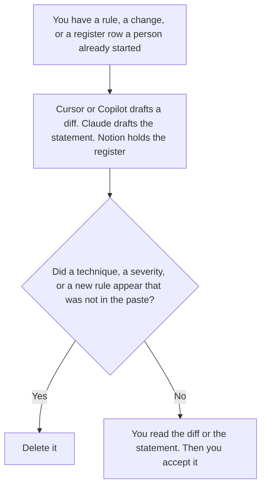

**A security engineer should use AI to draft a control statement from a rule they already wrote, to format a diff they will read, and to keep a register of those controls with an owner and a date.** The model does not pick a severity, and it does not suggest how to break a control. The shift that triages an alert is [best AI tools for security ops](/blog/best-ai-tools-for-security-ops-2026/). The runbook shelf is [best AI tools for security ops docs](/blog/best-ai-tools-for-security-ops-docs-2026/).

The scheduled test of rules you already wrote is [what AI red teaming is](/blog/what-is-ai-red-teaming-2026/). The grid of who may open which corpus is [how to write an AI access control matrix with AI](/blog/how-to-write-an-ai-access-control-matrix-with-ai-2026/). The questions you send a vendor are [how to write an AI vendor security questionnaire with AI](/blog/how-to-write-an-ai-vendor-security-questionnaire-with-ai-2026/).

This page is the engineer's files. It does not include attack techniques, exploit steps, or test payloads.

Cursor's Plus price is the October 24, 2026 help-center figure recorded in [Cursor pricing explained](/blog/cursor-pricing-explained-2026/). Claude's prices are the October 24 read of claude.com/pricing recorded in [Claude pricing explained](/blog/claude-pricing-explained-2026/). Notion and GitHub Copilot prices are from directory pages checked October 16, 2026, as [GitHub Copilot pricing explained](/blog/github-copilot-pricing-explained-2026/) records them. Published October 24, 2026. We did not score detection products. A green suggestion is not a control you have accepted.

## The engineer's three files

| The file | Start here | First paid step | The limit |
|---|---|---|---|
| A diff in the repo, which you will read | [Cursor](/tools/cursor/) | Plus is $8 a month, or $80 a year | Plus omits Cloud Agents on the October 24 help page. You still read the change |
| The control statement, from a rule you wrote | [Claude](/tools/claude/) | Pro is $17 a month billed annually, or $20 monthly | A new rule is not a paraphrase |
| The register: control, owner, date | [Notion AI](/tools/notion-ai/) | Business is $20 a seat a month | Plus at $10 is not the full AI tier. A blank owner stays blank |
| Completions in the editor you already use on GitHub | [GitHub Copilot](/tools/github-copilot/) | Pro is $10 a month | Business is $19. Enterprise is $39. Neither writes the rule |

The security-ops page is the triage note, the access list from an export, and the handoff. This page assumes that shift exists or that someone else owns it. The engineer writes the control and the change that implements a rule a person already named. Cursor Plus at $8 is the editor seat on the October 24 help page. Teams is $30, $100, or $200 a seat a month when the company needs a list price. Those company rows are [Cursor Business pricing explained](/blog/cursor-business-pricing-explained-2026/) and [Cursor Enterprise pricing explained](/blog/cursor-enterprise-pricing-explained-2026/).

Claude Pro holds the accepted wording of a control so a later edit cannot soften it. A control that says "deny when the tenant id is missing" stays those words. The retrieval rule is [what an AI retrieval tenant scope is](/blog/what-is-ai-retrieval-tenant-scope-2026/). The model does not widen the scope to make a test pass.

GitHub Copilot Pro at $10 is the individual seat on the October 16 card. Business at $19 and Enterprise at $39 are the company rows in the pricing article. Use them when the company needs those controls. They are not a reason to skip the diff. A vendor whose pricing URL no longer shows a table is [Tabnine Enterprise pricing explained](/blog/tabnine-enterprise-pricing-explained-2026/). This page does not invent that dollar.

The register says the control id, the owner, and the date you accepted it. Owner not set stays in the row. The questionnaire you send a vendor is a different file. The register is yours.

## What you are paying for

**Cursor Plus** is the diff. The review is [Cursor review](/blog/cursor-review-2026/).

**Claude Pro** is the control statement. The review is [Claude review](/blog/claude-review-2026/).

**Notion Business** is the register. The invoice is [Notion AI pricing explained](/blog/notion-ai-pricing-explained-2026/).

**Copilot Pro** is completions on the GitHub seat. The company dollar, if you need it, is Business at $19 or Enterprise at $39 on the October 16 card.

A prompt that holds the line:

"Draft the control statement, the diff description, or the register row from the rule I pasted. If an owner is missing, write Owner not set. Do not add a technique. Do not add a severity."

## What not to automate

Do not let an agent apply a security change because a suggestion looked strict. Do not ask for attack steps so the control can be "tested" in the chat. Do not mark a register row accepted because the sentence is long. The engineer owns the diff. The security owner named on the register accepts the control.

## FAQ

### How is this different from the security ops page?

That page is the shift: a triage note, an access list, a handoff. This page is the engineer writing a control, reading a diff, and keeping the register. You can refuse to let a model investigate an alert and still use it to format a control you already wrote.

### How is this different from security ops docs?

That page is the runbook and the status note. This page is the control itself and the change that carries it. A runbook can point at the register. It does not replace the rule.

### How is this different from a vendor questionnaire?

The questionnaire is what you ask another company. The register is what you say about your own controls. Do not paste a vendor's answer into your register and call it your control.

### Who may merge?

The person who owns the change, after they read the diff. Owner not set stays on the register. A suggested control is not a rule you have accepted, and this page does not include a way to break one.

## Last verified

October 24, 2026 for Cursor's help page and for Claude, via the posts cited above. October 16, 2026 for Notion and GitHub Copilot. Published October 24, 2026. We did not score detection products. This page contains no attack steps.

**Sources:** [Cursor pricing](https://cursor.com/help/account-and-billing/pricing), [Claude pricing](https://claude.com/pricing), [Notion pricing](https://www.notion.com/pricing), [GitHub Copilot plans](https://github.com/features/copilot/plans).

*Published by Andrew for [AI Tools Optimizer](https://aitoolsoptimizer.com).*

[Cursor](/tools/cursor/) is in the [coding directory](/tools/category/coding/). Directory pages may use affiliate links. A purchase through them may earn us a commission at no extra cost to you.
