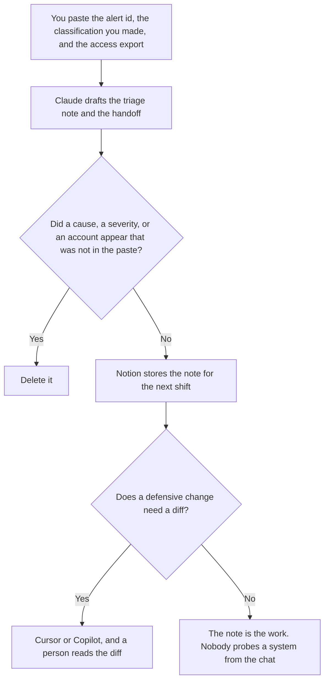

**A security operations reviewer should use AI to format a triage note from an alert a person already classified, an access list from an export a person already ran, and a handoff that does not invent a cause.** The model does not decide severity, and it does not investigate by trying anything against a system. The documentation shelf, which is the runbook and the status note, is [best AI tools for security ops docs](/blog/best-ai-tools-for-security-ops-docs-2026/). The people who carry production after a bad ship are [best AI tools for SRE teams](/blog/best-ai-tools-for-sre-teams-2026/). The engineer who drafts a control statement from a rule they already wrote, and does not pick a severity, is [best AI tools for security engineers](/blog/best-ai-tools-for-security-engineers-2026/).

The hour of an incident is [what AI incident response is](/blog/what-is-ai-incident-response-2026/). The page on-call opens for a known procedure is [what an AI runbook is](/blog/what-is-an-ai-runbook-2026/).

This page is workflow. It does not cover attack techniques, exploit steps, or how to test a defense by trying to break it.

Claude's prices are from claude.com/pricing on October 24, 2026. Notion, Cursor, and GitHub Copilot prices are from directory pages checked October 16, 2026, except Cursor's Teams seats, which are from the help center fetched October 24. Published October 24, 2026. We did not score detection products.

## The shift

| The job | Start here | First paid step | The limit |
|---|---|---|---|
| The triage note and the handoff | [Claude](/tools/claude/) | Pro is $17 a month billed annually, or $20 monthly | No severity you did not assign |
| The page the next shift opens | [Notion AI](/tools/notion-ai/) | Business is $20 a seat a month | Plus at $10 is not the full AI tier |
| A diff in a defensive control you already own | [Cursor](/tools/cursor/) | Plus is $8 a month, or $80 a year. Teams is the company seat | You review the diff. The model does not merge it |
| The company coding seat, when IT asked for indemnity | [GitHub Copilot](/tools/github-copilot/) | Business is $19 a user a month | A personal Pro seat is a different decision |

A triage note that explains "how the attacker got in" without a finding you pasted is a story. If the classification is unknown, the note says unknown. The next shift inherits the unknown. They do not inherit a theory.

## What you are paying for

**Claude Pro** is the shared wording for the note. Team standard seats are $20 a seat a month billed annually, or $25 monthly, when the note is a company record. The review is [Claude review](/blog/claude-review-2026/). The Team invoice is [Claude Team pricing explained](/blog/claude-team-pricing-explained-2026/).

**Notion Business** holds the handoff. The invoice is [Notion AI pricing explained](/blog/notion-ai-pricing-explained-2026/).

**Cursor** is the editor when you are changing a control you already operate, and you will read the diff. Teams seats are $30, $100, or $200 a seat a month on the October 24 help page. The company-seat article is [Cursor business pricing explained](/blog/cursor-business-pricing-explained-2026/). The individual ladder is [Cursor pricing explained](/blog/cursor-pricing-explained-2026/).

**GitHub Copilot Business** is the company coding seat at $19 a user a month on the October 16 card, with IP indemnity on that card. The invoice is [GitHub Copilot Business pricing explained](/blog/github-copilot-business-pricing-explained-2026/). Pick one coding seat for the change. The triage note does not require either.

A prompt that holds the line:

"Draft the triage note from the alert id, the classification, and the access list I pasted. If the classification is missing, write Classification not set. Do not add a cause. Do not add an account. Do not suggest a test against a live system."

## What not to automate

Do not ask a model to find a way in, confirm a weakness, or draft an exploit. Do not paste secrets, session tokens, or a full directory export into a personal account. Do not raise severity because the paragraph sounds urgent. The reviewer assigns severity. The next shift reads what was assigned.

## FAQ

### How is this different from the security ops docs page?

That page is the runbook, the status note, and the flag record. This page is the shift: the triage note, the access list, and the handoff. The same person may write both. The templates stay different so a living procedure does not get rewritten as if it were one alert.

### How is this different from the SRE page?

SRE work is the production incident: the timeline, the comms, the follow-ups. Security ops here is the review of an alert and an access list a person already has. An incident can start from an alert. The incident timeline is still its own document. This page does not replace it.

### Do I need a coding seat to triage?

No. The note is Claude and Notion. A coding seat matters when a defensive control you already own needs a diff. The diff is reviewed by a person. A chat is not a change.

### Who may close the alert?

The reviewer your process names. A formatted note is not a close. A missing classification stays missing. Nothing on this page is a scanning or attack workflow.

## Last verified

October 24, 2026 for Claude, including Team seat prices, and for Cursor's Teams seats. October 16, 2026 for Notion, Cursor Plus, and GitHub Copilot. Published October 24, 2026.

**Sources:** [Claude pricing](https://claude.com/pricing), [Notion pricing](https://www.notion.com/pricing), [Cursor pricing](https://cursor.com/help/account-and-billing/pricing), [GitHub Copilot](https://github.com/features/copilot).

*Published by Andrew for [AI Tools Optimizer](https://aitoolsoptimizer.com).*

[Claude](/tools/claude/) is in the [chatbots and assistants directory](/tools/category/chatbots-assistants/). Directory pages may use affiliate links. A purchase through them may earn us a commission at no extra cost to you.
