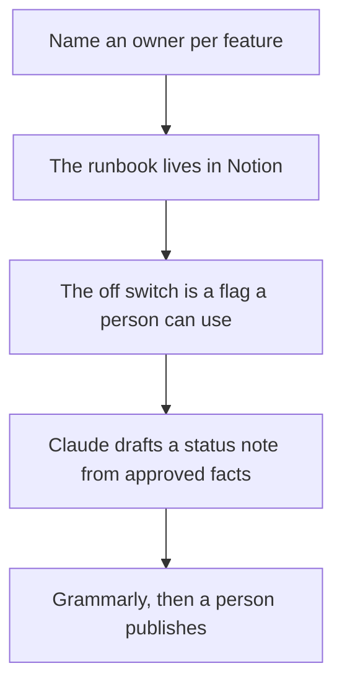

**A security operations team should use AI to keep three documents true: the runbook for a model-backed feature, the customer status note, and the record of which flag turns that feature off.** This page is documentation and workflow. It does not cover attack techniques, exploit steps, or how to test a defense by trying to break it.

The page the on-call opens is [what an AI runbook is](/blog/what-is-an-ai-runbook-2026/). The path on a bad day is [what AI incident response is](/blog/what-is-ai-incident-response-2026/). The people who also carry production are [best AI tools for SRE teams](/blog/best-ai-tools-for-sre-teams-2026/).

Prices are US list prices excluding tax from directory pages checked October 16, 2026. Published October 24, 2026. We did not score detection or response products. No offensive-security tool is recommended here.

## The docs job

| The job | Start here | First paid step | The limit |
|---|---|---|---|
| The runbook and the timeline | [Notion AI](/tools/notion-ai/) | Business is $20 a seat a month | Plus at $10 is not the full AI tier |
| A draft of the status note from facts you paste | [Claude](/tools/claude/) | Pro is $20, or $17 billed annually | It may not invent a cause |
| A shared seat when the notes are confidential | [ChatGPT](/tools/chatgpt/) | Business is $20 a user a month billed annually, minimum two | Plus is not an admin system of record |
| The public sentence | [Grammarly](/tools/grammarly/) | Pro is $12 a member a month billed annually | It will not know your severity rules |
| The switch the runbook names | Your feature-flag system | A product decision, not a chat seat | The model does not get to flip it |
| The charts the runbook links | The monitors you already run | Write the threshold down | A generated "healthy" line is not a monitor |

## What to pay for

**The system of record.** Notion Business is the seat if the on-call wiki is Notion. One database of runbooks beats a folder of private chats. The invoice is [Notion AI pricing explained](/blog/notion-ai-pricing-explained-2026/). The habit is [what a system of record for AI is](/blog/what-is-a-system-of-record-for-ai-2026/).

**The draft.** Claude Pro is enough to turn a timeline into a first status note. Paste the facts. Delete any root cause that is not in the log. ChatGPT Business is the admin alternative when counsel wants a company seat and no training on business data by default. The ladders are [Claude review](/blog/claude-review-2026/) and [ChatGPT Go vs Plus vs Pro](/blog/chatgpt-go-vs-plus-vs-pro-2026/).

**The sentence customers read.** Grammarly Pro will not invent your policy. The writing habit is [how to write a status update with AI](/blog/how-to-write-a-status-update-with-ai-2026/). The check is [how to fact-check AI writing](/blog/how-to-fact-check-ai-writing-2026/).

**The controls the docs point at, without turning this page into a build guide.** Turning a model off is [what AI feature flags are](/blog/what-is-ai-feature-flags-2026/). The promise you can check is [what AI SLA monitoring is](/blog/what-is-ai-sla-monitoring-2026/). Traces and cost are [what AI observability is](/blog/what-is-ai-observability-2026/). A dollar ceiling is [what an AI budget cap is](/blog/what-is-ai-budget-caps-2026/). Untrusted text stays in its own lane; the policy-level description is [what a prompt injection defense is](/blog/what-is-a-prompt-injection-defense-2026/). Read those as documentation boundaries. Do not treat them as instructions for an exercise against a live system.

The person who publishes the note is [what human-in-the-loop AI is](/blog/what-is-human-in-the-loop-ai-2026/). Writers who keep the longer docs are [best AI tools for technical writers](/blog/best-ai-tools-for-technical-writers-2026/).

## What not to automate

Do not let a model declare an incident's cause. Do not paste credentials, customer payloads, or exploit details into a prompt. Do not let a chatbot flip a production flag. Do not publish a postmortem that adds events the timeline does not have.

## FAQ

### Is this a list of security products?

No. It is a docs stack for teams who already operate a service. Detection and response platforms are a different purchase, and this page does not rank them.

### What should a two-person team buy first?

Notion or the wiki you have, plus Claude or ChatGPT for drafts you will edit. Add Grammarly when a public sentence ships every week. Skip a second chatbot before the runbook has an owner.

### Can AI write the runbook from a ticket?

It can fill the headings from facts you paste: owner, flag name, customer lines, prompt version. It cannot discover the flag by browsing production. The structure is the runbook article linked above.

### Where do legal and security review the customer note?

In the wiki, with a named approver, before it hits a status page. A chat reply is not the approval.

## Last verified

October 16, 2026 for Notion, Claude, ChatGPT, and Grammarly. Published October 24, 2026.

**Sources:** [Notion pricing](https://www.notion.com/pricing), [Claude pricing](https://claude.com/pricing), [Grammarly Pro](https://support.grammarly.com/hc/en-us/articles/115000090011-How-much-does-Grammarly-Pro-cost).

*Published by Andrew for [AI Tools Optimizer](https://aitoolsoptimizer.com).*

[Notion AI](/tools/notion-ai/) is in the [productivity and notes directory](/tools/category/productivity-notes/). Directory pages may use affiliate links. A purchase through them may earn us a commission at no extra cost to you.
