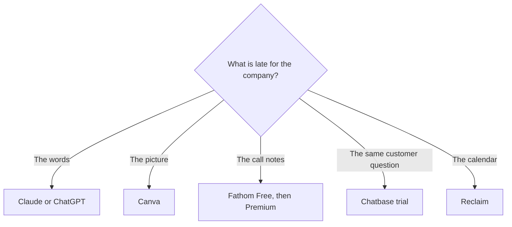

**A solopreneur should pay for the tool that runs the company this week: the offer, the calendar, the support inbox, or the recording.** A freelancer's stack is built around a client deliverable. This page is the operating list for a person who is the business. If you bill someone else for a proposal or a podcast edit, use [best AI tools for freelancers](/blog/best-ai-tools-for-freelancers-2026/) and come back here for the company around that work.

Prices are US list prices excluding tax. Most figures are from directory pages checked October 16, 2026. Fathom, Chatbase, and Instantly were read from pricing pages on October 24, 2026. Published October 24, 2026. The "only one subscription" map is [which AI subscription is worth paying for](/blog/which-ai-subscription-is-worth-paying-for/).

## The company, one job at a time

| Company job | Use | Pay when |
|---|---|---|
| The offer, the email, the first draft of the page | [Claude](/tools/claude/) or [ChatGPT](/tools/chatgpt/) | The free cap hits in a work week. Claude Pro is $20/month or $17 annual. ChatGPT Plus is $20. Go is $8 |
| The picture of the offer | [Canva](/tools/canva/) | You need the brand kit. Pro is $18/month or $180/year. Free publishes a lot |
| A one-page explanation or a short deck | [Gamma](/tools/gamma/) | Free credits run out and do not refresh. Plus is $9/seat/month |
| Notes from a sales call | [Fathom](/tools/fathom/) | You need action items. Premium is $16/month annually. Free already lists unlimited recordings |
| A calendar that defends focus time | [Reclaim](/tools/reclaim-ai/) | Lite is free. Starter is $10/seat/month |
| A support bot on your own site | [Chatbase](/tools/chatbase/) | The trial shows the answers are ones you would send. Hobby is $32/month yearly, 700 credits |
| Outbound, only with a list you may email | [Instantly](/tools/instantly/) | Outreach Growth is $47/month for 5,000 emails and 1,000 contacts |
| A video of you, cut by the transcript | [Descript](/tools/descript/) | You will publish. Hobbyist is $16/month annually |

## Spend $20 before you spend $47

The first paid seat, for most one-person companies, is the writing assistant. Claude Pro or ChatGPT Plus at $20 a month covers the offer page, the onboarding email, and the post. The editing standard is [how to write a blog post with Claude](/blog/how-to-write-a-blog-post-with-claude-2026/). A content calendar for that writing is [how to build an AI content calendar](/blog/how-to-build-an-ai-content-calendar-2026/). You do not need Jasper's $59 seat until a second person must match a stored voice. You are the voice.

Canva Free is the design tool until a brand kit or a resize is the weekly pain. Gamma Plus at $9 is the deck. Buying both Pro plans in week one is how a pre-revenue company acquires a software budget and no published page.

Fathom Free is the meeting tool to try before any notetaker subscription. Premium at $16 annually is the action-item layer. The invoice is [Fathom pricing explained](/blog/fathom-pricing-explained-2026/). If you refuse a bot, [Granola](/tools/granola/) Basic keeps 30 days of history, and Business is $14 a user a month.

## Support, time, and money

**Chatbase is the support experiment, not a personality.** Hobby at $32 a month billed yearly includes 700 message credits and one agent. There is a 7-day trial and no permanent free plan on the page we read. Point it at help articles you have written. The build is [how to build a support chatbot with Chatbase](/blog/how-to-build-a-chatbot-with-chatbase-2026/). A site with a handful of emails a week does not need a bot. A site where you answer the same question daily does. Branding removal is $1,188 a year. Leave the logo until the bot earns its place. The credit math is [Chatbase pricing explained](/blog/chatbase-pricing-explained-2026/).

**Reclaim is the calendar.** Starter at $10 a seat a month is a small bill next to a chat seat, and it is still optional. Use it when meetings eat the day you meant to spend on the product. [Motion](/tools/motion/) Pro AI is $19 a seat a month if you want the other calendar product in the directory. Pick one.

**Instantly is optional and easy to start too early.** Outreach Growth at $47 assumes a list you have a lawful basis to email. The credits tab is a different $47. Read [Instantly pricing explained](/blog/instantly-pricing-explained-2026/) before you buy "leads" because the company feels quiet. A better page converts the traffic you already have. The sequence, when you are ready, is [how to write cold emails with Instantly](/blog/how-to-write-cold-emails-with-instantly-2026/).

**Invoices stay a human send.** The workflow with a person on the send button is [how to automate invoices with AI](/blog/how-to-automate-invoices-with-ai-2026/). A model can draft the line items from your notes. You confirm the amount.

**Descript is the company video**, the demo and the explainer, once a month of Hobbyist media hours matches how you record. Filler removal, after the real cut, is [how to remove filler words with Descript](/blog/how-to-remove-filler-words-with-descript-2026/). Skip it if you do not publish video.

## A month under $50

Claude Pro at $20, Canva Free, Fathom Free, and a sheet for the calendar. Add Gamma Plus at $9 when you are sending a deck every week. Add Reclaim at $10 when the calendar is the bottleneck. Add Chatbase only after the help articles exist. That is $20, or $39 with Gamma and Reclaim. Instantly, Descript, and a second chatbot are the month a specific job shows up, not the month you incorporate.

## FAQ

### How is this different from the freelancer list?

The freelancer list is organized by the deliverable a client is waiting on. This list is organized by running your own offer, calendar, support, and outbound. One person can be both. Pay for the job that is late, and do not buy both stacks by default.

### What is the one AI subscription a solopreneur should keep?

The writing assistant you will edit, Claude or ChatGPT, if you have to name one. The reasoning is [which AI subscription is worth paying for](/blog/which-ai-subscription-is-worth-paying-for/).

### Do I need a CRM?

[HubSpot](/tools/hubspot/) has a free CRM. Add it when contacts are falling out of your inbox. A sequencer without a list of people you may email is the tool to delay.

### Should a solopreneur use an AI avatar?

When you will not appear on camera and you still need a presenter. [HeyGen](/tools/heygen/) Creator is $29 a month. A recording of your screen in Descript is often the clearer demo of a product you built.

## Last verified

October 16, 2026 for Claude, Canva, Gamma, Reclaim, Descript, and Granola. October 24, 2026 for Fathom, Chatbase, and Instantly. Published October 24, 2026.

**Sources:** [Claude pricing](https://claude.com/pricing), [Canva pricing](https://www.canva.com/pricing/), [Fathom pricing](https://www.fathom.ai/pricing), [Chatbase pricing](https://www.chatbase.co/pricing), [Instantly pricing](https://instantly.ai/pricing).

*Published by Andrew for [AI Tools Optimizer](https://aitoolsoptimizer.com).*

[Claude](/tools/claude/) is in the [chatbots directory](/tools/category/chatbots-assistants/). [Fathom](/tools/fathom/) is in the [meetings directory](/tools/category/meetings-transcription/). Directory pages may use affiliate links. A purchase through them may earn us a commission at no extra cost to you.
