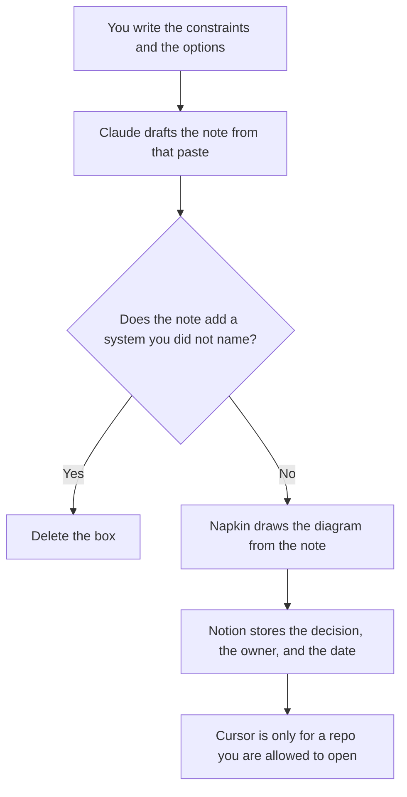

**A solutions architect should use AI to draft an architecture note from constraints they already wrote, turn that note into a diagram they can edit, and file the decision with an owner and a date.** The demo and the POC write-up are a different job: [best AI tools for solutions engineers](/blog/best-ai-tools-for-solutions-engineers-2026/). The talk track and the objection are [best AI tools for sales engineers](/blog/best-ai-tools-for-sales-engineers-2026/). This page is the shape of the system: what is in bounds, what is out, and what was decided.

The long design note is [Claude vs ChatGPT for RFC drafts](/blog/claude-vs-chatgpt-for-rfc-drafts-2026/). A security exception, if the design needs one, is [how to write a security exception request with AI](/blog/how-to-write-a-security-exception-request-with-ai-2026/).

Claude's prices are from claude.com/pricing on October 24, 2026. Napkin, Notion, and Cursor prices are from directory pages checked October 16, 2026. Published October 24, 2026. We did not score architectures or deal outcomes.

## The architecture hour

| The job | Start here | First paid step | The limit |
|---|---|---|---|
| The note: context, constraints, options, decision | [Claude](/tools/claude/) | Pro is $17 a month billed annually, or $20 monthly | No requirement you did not paste |
| A diagram from that note | [Napkin AI](/tools/napkin-ai/) | Plus is $9 a person a month | The diagram does not add a box |
| The decision record the next person will open | [Notion AI](/tools/notion-ai/) | Business is $20 a seat a month | Plus at $10 is not the full AI tier |
| A sample repo you were allowed to read | [Cursor](/tools/cursor/) | Plus is $8 a month, or $80 a year | You review any diff. The note is not a commit |

Solutions engineers prove the product in a deal. Sales engineers carry the talk track. Implementation consultants configure what was sold: [best AI tools for implementation consultants](/blog/best-ai-tools-for-implementation-consultants-2026/). If you are still choosing the boundary, you are on this page. If you are clicking through a demo, you are on theirs.

## What you are paying for

**Claude Pro** holds the constraints in a Project so the next option does not forget a limit you already set. Max at $100 or $200 is for people who live in Claude all day. An architecture note does not require it. The review is [Claude review](/blog/claude-review-2026/).

**Napkin Plus** turns a paragraph into an editable visual, on the October 16 card. Free includes 500 AI credits a week. Pro is $22 a person a month and adds custom branding. A diagram that adds a queue you did not name is wrong, even if it looks clean. The invoice is [Napkin AI pricing explained](/blog/napkin-ai-pricing-explained-2026/). [Figma](/tools/figma/) Professional is $16 a Full seat a month billed annually when the diagram has to live in the design system. The invoice is [Figma pricing explained](/blog/figma-pricing-explained-2026/). Use one home for the picture.

**Notion Business** is the decision log. The decision cell says who chose, and the date. An empty decision stays "Decision open." The invoice is [Notion AI pricing explained](/blog/notion-ai-pricing-explained-2026/).

**Cursor Plus** is for a reference repo the customer or your team already shared. It is not a way to browse a system you were not given. The ladder is [Cursor pricing explained](/blog/cursor-pricing-explained-2026/).

A prompt that holds the line:

"Draft the architecture note from the constraints and options I pasted. Do not add a component. If no option is chosen, write Decision open. Do not invent a latency number."

## What not to automate

Do not let a model pick the option because it is "simpler." Do not paste production credentials to make the diagram specific. Do not send the note to a buyer as a promise. A promise is a commercial document. This note is a technical record. The tearsheet of public competitor facts, if you need one beside the decision, is [Perplexity vs ChatGPT for competitive tearsheets](/blog/perplexity-vs-chatgpt-for-competitive-tearsheets-2026/).

## FAQ

### How is this different from the solutions engineer page?

That page is the demo, the doc-cited answer, and the POC note. This page is the boundary of the system and the decision. The same person sometimes does both. The demo script should not smuggle in a component the architecture note marked out of bounds.

### Do I need Napkin and Figma?

No. Napkin is a fast diagram from text. Figma is the shared design file. Pick the one the next architect will open. Two pictures of the same system will drift.

### Can the model estimate cost or latency?

Only from numbers you pasted. A blank performance cell stays blank. A made-up millisecond will be copied into a statement of work.

### Who may mark the decision made?

The owner named on the record. A model does not close an option because the diagram looks finished. If the owner is missing, the note says Owner missing.

## Last verified

October 24, 2026 for Claude. October 16, 2026 for Napkin, Notion, Cursor, and Figma. Published October 24, 2026.

**Sources:** [Claude pricing](https://claude.com/pricing), [Napkin pricing](https://www.napkin.ai/pricing), [Notion pricing](https://www.notion.com/pricing), [Cursor pricing](https://cursor.com/help/account-and-billing/pricing).

*Published by Andrew for [AI Tools Optimizer](https://aitoolsoptimizer.com).*

[Claude](/tools/claude/) is in the [chatbots and assistants directory](/tools/category/chatbots-assistants/). Directory pages may use affiliate links. A purchase through them may earn us a commission at no extra cost to you.
