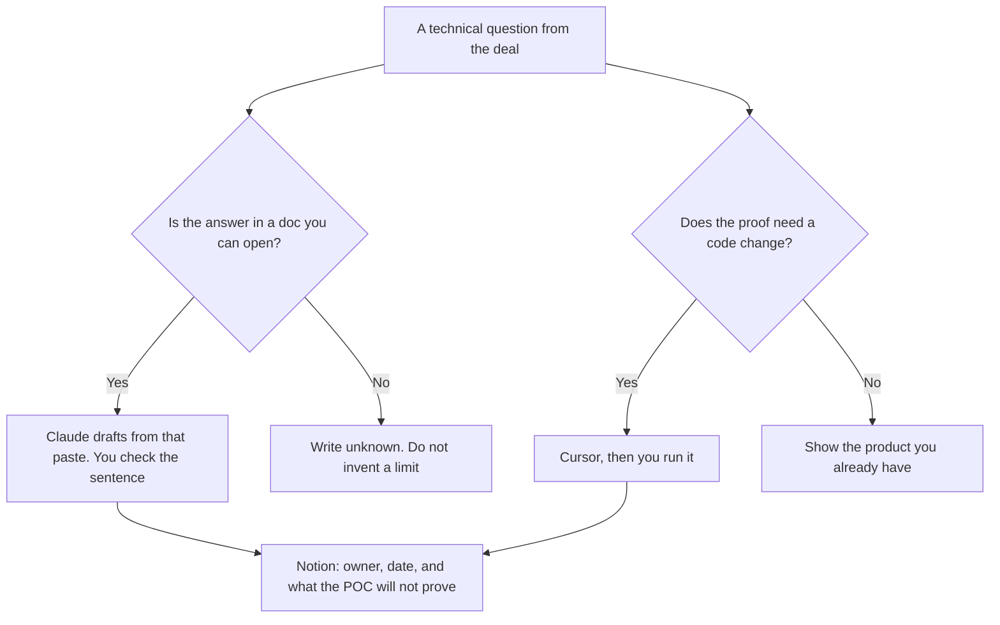

**A solutions engineer should use AI to keep three things true: the demo matches a branch you can review, the technical answer cites a doc you opened, and the POC note names an owner and a date.** The account executive's one-pager is a different job. The engineering manager's staffing plan is a different job. This page is the technical evaluation in a deal: the question, the proof, and the write-up. The architecture note and the decision record, which are not the demo, are [best AI tools for solutions architects](/blog/best-ai-tools-for-solutions-architects-2026/).

The AE shelf is [best AI tools for sales teams](/blog/best-ai-tools-for-sales-teams-2026/). The demo talk track is [how to create a demo script with AI](/blog/how-to-create-a-demo-script-with-ai-2026/). A security questionnaire or an RFP is [how to write an RFP response with AI](/blog/how-to-write-a-rfp-response-with-ai-2026/). The discovery questions before you build anything are [how to create a sales discovery script with AI](/blog/how-to-create-a-sales-discovery-script-with-ai-2026/).

Prices are US list prices excluding tax from directory pages checked October 16, 2026. Published October 24, 2026. We did not score demo win rates or code quality.

## The solutions job

| The job | Start here | First paid step | The limit |
|---|---|---|---|
| A change in the demo repo | [Cursor](/tools/cursor/) | Plus is $8 a month, or $80 a year | You still read the diff |
| A written answer from docs you paste | [Claude](/tools/claude/) | Pro is $20 a month, or $17 billed annually | It may not invent a limit or an SLA |
| Notes from the technical call | [Granola](/tools/granola/) | Business is $14 a user a month | Basic is free, with 30 days of history |
| The POC log | [Notion AI](/tools/notion-ai/) | Business is $20 a seat a month | Plus at $10 is not the full AI tier |
| A short technical deck | [Gamma](/tools/gamma/) | Plus is $9 a seat a month | The architecture must match the doc |
| A data POC in a notebook | [Hex](/tools/hex/) | Professional is $36 an editor a month | Team at $75 is the schedule, if the POC must refresh |

An SLA the model added is [a hallucination](/blog/what-is-ai-hallucination-2026/) the buyer will put in the order form. The check is [how to fact-check AI writing](/blog/how-to-fact-check-ai-writing-2026/).

## What to pay for

**The demo branch.** Cursor Plus at $8 a month is enough for a solutions engineer who lives in that editor. Premium at $30 is 4x Plus usage on the card. Teams seats are $30, $100, or $200. If the team standard is GitHub, [GitHub Copilot](/tools/github-copilot/) Pro is $10 a user a month, and Business is $19. Do not buy both on day one. The editor comparison is [Cursor vs GitHub Copilot](/blog/cursor-vs-github-copilot-2026/). A failing test inside the demo is [ChatGPT vs Claude for Python debugging](/blog/chatgpt-vs-claude-for-python-debugging-2026/), when the stack is Python. The invoice is [Cursor pricing explained](/blog/cursor-pricing-explained-2026/).

**The answer.** Claude Pro, in a Project that holds the docs you are allowed to share. Free can take files, with usage limits. Do not paste a customer's secrets into a personal account your policy forbids. ChatGPT Business at $20 a user a month billed annually, minimum two, is the admin step if the team already works there. The capacity split is [Claude Pro vs Max](/blog/claude-pro-vs-max-2026/).

**The call.** Granola Business at $14 when you need history beyond 30 days and no bot on the line. [Fathom](/tools/fathom/) Free if a bot is allowed and the buyer agreed. Premium is $16 a month billed annually. The split is [Granola vs Fathom](/blog/granola-vs-fathom-2026/).

**The POC note.** Notion Business. Fields worth having: question, owner, environment, what success is, what you will not prove, and the date you will stop. A POC without a stop date becomes a second product. The spec habit, if the POC turns into a real requirement, is [how to draft a product spec with AI](/blog/how-to-draft-a-product-spec-with-ai-2026/).

**The picture.** Gamma Plus at $9 when the buyer wants a link. [Plus AI](/tools/plus-ai/) Basic at $10 a user a month billed annually when they want PowerPoint. Diagrams from a paragraph, if you need a figure and not a deck, can start in [Napkin](/tools/napkin-ai/). Plus is $9 a person a month. Free is 500 AI credits a week. A figure still has to match the system you demoed.

**The data proof.** Hex Professional at $36 an editor a month. Move to Team at $75 only if the buyer must see a refresh while you are not in the room. The invoice is [Hex pricing explained](/blog/hex-pricing-explained-2026/).

A prompt that holds the line:

"Draft a technical answer from this documentation paste only. If the limit, the SLA, or the integration is not in the paste, write Unknown. Do not promise a roadmap item. List the POC steps I would run, and leave success criteria blank if I did not provide them."

## What not to automate

Do not let a model change the demo's default data to look like the buyer's production data. Use data you have the right to show. Do not send an architecture that includes a control you have not switched on. Do not answer a security question from memory. Use the RFP workflow and the doc.

The engineering manager's tools, if you are also managing people, are [best AI tools for engineering managers](/blog/best-ai-tools-for-engineering-managers-2026/). That is not the deal.

## FAQ

### Is a solutions engineer a salesperson with Cursor?

Sometimes one person does both jobs. The tools on this page are for the proof. The talk track and the sequence live on the sales and revenue-enablement pages. A demo that cannot be reproduced on a second machine is not a proof, no matter how fluent the script was.

### Do I need Hex for every POC?

No. Use Hex when the question is about data the notebook can show. A product walkthrough does not need a warehouse. Professional at $36 is the editor seat. The schedule is the reason to look at Team, and only then.

### Can Claude replace the docs?

No. Claude can draft from the docs. If the docs are wrong, the answer is wrong with better grammar. Fix the doc, or write Unknown. The system of record is the doc your company maintains, which is [what a system of record for AI is](/blog/what-is-a-system-of-record-for-ai-2026/).

### What belongs in the POC stop date?

A date you will keep, and the decision that happens that day: continue, stop, or hand to product. The model may format the date you chose. It may not extend the POC because the demo went well.

## Last verified

October 16, 2026 for Cursor, GitHub Copilot, Claude, Granola, Fathom, Notion AI, Gamma, Plus AI, Napkin, and Hex. Published October 24, 2026.

**Sources:** [Cursor pricing](https://cursor.com/help/account-and-billing/pricing), [Claude pricing](https://claude.com/pricing), [Hex pricing](https://hex.tech/pricing/), [Notion pricing](https://www.notion.com/pricing).

*Published by Andrew for [AI Tools Optimizer](https://aitoolsoptimizer.com).*

[Cursor](/tools/cursor/) is in the [coding directory](/tools/category/coding/). Directory pages may use affiliate links. A purchase through them may earn us a commission at no extra cost to you.
