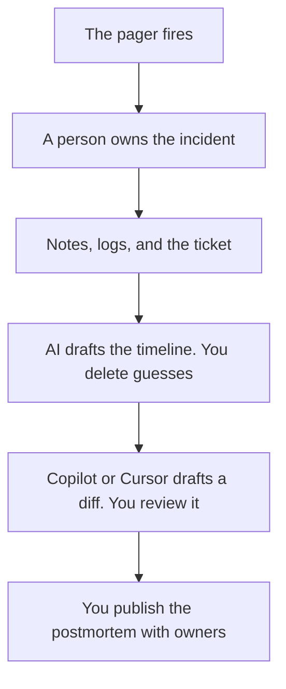

**An SRE team should use AI on the write-up, the bridge notes, and the diff a person will review. It should not use AI to close an incident because a prompt said the graph looked fine.** The pipeline shelf, which is scripts and glue before the pager, is [best AI tools for DevOps teams](/blog/best-ai-tools-for-devops-teams-2026/). This page starts when the pager has already gone off. The write-up workflow is [how to write a postmortem with AI](/blog/how-to-write-a-postmortem-with-ai-2026/). The pre-pager job, a runbook and a fallback matrix from rules a person already wrote, is [best AI tools for AI ops engineers](/blog/best-ai-tools-for-ai-ops-engineers-2026/).

Prices are US list prices excluding tax from directory pages checked October 16, 2026. Fathom's team price was read October 24, 2026. Published October 24, 2026. We did not score incident tools or uptime.

## The moment, then the tool

| The moment | Start here | First paid step | The limit |
|---|---|---|---|
| The timeline and the postmortem | [Claude](/tools/claude/) or [ChatGPT](/tools/chatgpt/) | Claude Pro is $20, or $17 billed annually. ChatGPT Plus is $20 | You paste the notes. The model does not invent the cause |
| The fix in the repo | [GitHub Copilot](/tools/github-copilot/) or [Cursor](/tools/cursor/) | Copilot Pro is $10. Copilot Free is 2,000 completions. Cursor Plus is $8 | A person merges. The seat comparison is [Copilot vs Cursor pricing](/blog/github-copilot-vs-cursor-pricing-2026/) |
| The bridge, if a bot is allowed | [Fathom](/tools/fathom/) | Free lists unlimited recordings. Team is $15 a user annually, minimum 2 | The summary is not the timeline |
| Alert to ticket, on a path you can draw | [Zapier](/tools/zapier/) | Professional is $19.99 a month annually for 750 tasks | A branch you did not draw will not page the right person |
| The wiki page the next on-call will trust | [Notion AI](/tools/notion-ai/) | Business is $20 a seat. Plus at $10 is not the full AI tier | The page is the record. The chat is not |

## During and after

**The doc.** Claude Pro is the long-note seat. Put the template in a Project. ChatGPT Plus is the seat if that is already the team's chat. Go at $8 can hold a short update, not a full timeline. The weekly cousin of this doc is [how to write a status update with AI](/blog/how-to-write-a-status-update-with-ai-2026/). The place the facts are allowed to live is [what a system of record for AI is](/blog/what-is-a-system-of-record-for-ai-2026/).

**The diff.** Copilot is the default when the fix is in GitHub. Business at $19 adds governance and IP indemnity if the company requires them. Cursor Plus at $8 is the editor seat for new customers on The X Subscription. Neither one rolls the change out. The person who approves it is [what human-in-the-loop AI is](/blog/what-is-human-in-the-loop-ai-2026/). A wider edit from the terminal is Claude Code, included with Claude Pro, and there is no Claude Code on Free. The review is [Claude Code review](/blog/claude-code-review-2026/).

**The bridge.** Fathom Free is the recorder if the room accepts a bot. Buy Team when the notes must be shared in folders. Do not buy a meeting tool to "do incident response." It stores what was said. You still decide what was true. The card is [Fathom pricing explained](/blog/fathom-pricing-explained-2026/).

**The page.** Notion Business is worth it when the runbooks already live there. An agent that answers from a stale runbook will sound current. Fix the page first. A docs bot, after the pages are current, is [how to build an FAQ chatbot from docs](/blog/how-to-build-an-faq-chatbot-from-docs-2026/).

**The glue.** Zapier can open a ticket from an alert you trust. It should not remediate production. If the path is fatter and a developer owns it, the two-way is [Make vs n8n for AI](/blog/make-vs-n8n-for-ai-2026/). The three-way is [Zapier vs Make vs n8n](/blog/zapier-vs-make-vs-n8n/).

Reading what an AI system itself did, if the incident is in a model, is [what AI observability is](/blog/what-is-ai-observability-2026/). That is a trace of the model call. It is not a substitute for your service metrics.

## What not to automate first

Do not let an agent declare the incident resolved. Do not let it pick a root cause from a channel full of theories. Do not put customer-data logs into a consumer chat to "summarize the outage." Use the notes you are allowed to paste, on a plan your security review accepts. ChatGPT Business is $20 a user a month billed annually, does not train on business data by default, and needs two or more users. A personal Plus seat is a different promise. The ladder is [ChatGPT Go vs Plus vs Pro](/blog/chatgpt-go-vs-plus-vs-pro-2026/).

The people who write the tests in front of the change are [best AI tools for QA engineers](/blog/best-ai-tools-for-qa-engineers-2026/). The scheduled check of an AI product's own rules, at the product level, is [what AI red teaming is](/blog/what-is-ai-red-teaming-2026/).

## FAQ

### What should an SRE team pay for first?

Claude or ChatGPT, for the postmortem you already struggle to finish, if the notes are allowed in that tool. Copilot Free or Pro, if the pain is the fix in GitHub. Fathom Free, if the bridge is where the timeline gets lost. One of those. Zapier when a ticket is still opened by hand from an alert you trust.

### Can an agent restart a service?

A person can, from a runbook. An agent that restarts production from a prompt is an incident of its own until the action is boring, reversible, and explicitly allowed. Keep it off the first automation.

### Is this different from the DevOps list?

Yes. DevOps on this site is the pipeline and the glue you draw before the pager. SRE here is the incident, the notes, and the reviewed fix. Some tools appear on both lists because a script and a postmortem can share a seat. The job is different.

### Where do error budgets go?

In the doc you already use for them. AI can format a number you calculated. It should not invent the budget or the burn. If you do not have the number, leave it blank.

## Last verified

October 16, 2026 for Claude, ChatGPT, GitHub Copilot, Cursor, Zapier, and Notion. October 24, 2026 for Fathom Team. Published October 24, 2026.

**Sources:** [Claude pricing](https://claude.com/pricing), [GitHub Copilot](https://github.com/features/copilot), [Fathom pricing](https://www.fathom.ai).

*Published by Andrew for [AI Tools Optimizer](https://aitoolsoptimizer.com).*

[Claude](/tools/claude/) is in the [chatbots and assistants directory](/tools/category/chatbots-assistants/). Directory pages may use affiliate links. A purchase through them may earn us a commission at no extra cost to you.
