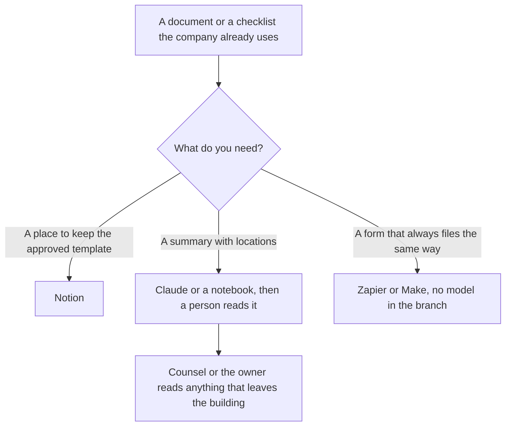

**These tools organize a folder, a checklist, and a summary of a document your company already has. They do not practice law, and this page is not legal advice.** A model that "reviews a contract" is drafting notes a lawyer still has to read. If you need a legal conclusion, an enforceable position, or a customer-facing policy, hire counsel. Do not publish a model's answer as the policy.

Nothing here is a contract lifecycle product. This directory does not list one, and this article does not invent a price for one. The jobs below are the wiki, the source-grounded notebook, the intake route, and a plain-language pass on text counsel already approved.

The document habit is [what RAG is](/blog/what-is-rag-explained-2026/). The long-file habit is [Claude vs Gemini for long documents](/blog/claude-vs-gemini-for-long-documents-2026/). The claim check, which still applies to an internal summary, is [how to fact-check AI writing](/blog/how-to-fact-check-ai-writing-2026/).

Prices are US list prices excluding tax from directory pages checked October 16, 2026. Published October 24, 2026. We did not score contracts, and we did not test "AI lawyers."

## Organize, route, and stop

| Ops job | Tool | First paid step | Stop before |
|---|---|---|---|
| A wiki of templates counsel already approved | [Notion AI](/tools/notion-ai/) | Business is $20/seat/month | Treating the wiki page as the signed agreement |
| A summary of one file, with page numbers | [Claude](/tools/claude/) | Pro is $20/month, or $17 billed annually. Free includes file upload and up to 5 Projects | Asking whether a clause is enforceable |
| A folder of policies, questions only against those files | [Gemini Notebook](/tools/gemini-notebook/) | Free with a Google account. Plus at $4.99 raises limits | Mixing in a web search that is not your policy |
| A team chat seat with admin controls | [ChatGPT](/tools/chatgpt/) Business | $20/user/month billed annually for 2+ users, or $25 monthly | A personal Plus login as the system of record |
| An intake form that files a row and pings a person | [Zapier](/tools/zapier/) or [Make](/tools/make/) | Zapier Professional is $19.99/month billed annually for 750 tasks. Make Core is from $9 billed annually | A model deciding whether to send the file |
| Plain language on a paragraph counsel approved | [Grammarly](/tools/grammarly/) | Pro is $12/member/month billed annually | Editing a legal conclusion you were not given |

## The folder and the summary

[Notion AI](/tools/notion-ai/) Business at $20 per seat is a reasonable home for the clause library as a wiki: the template counsel marked current, the owner, and the date. Plus at $10 is the workspace step without the full agent tier. The page is the memory. A chatbot's memory is not. That distinction is [what AI memory is](/blog/what-is-ai-memory-2026/). The card is [Notion AI pricing explained](/blog/notion-ai-pricing-explained-2026/).

[Claude](/tools/claude/) can turn a file you upload into a table of dates, parties, and sections, with a location for each row. Pro is the usage step for a long packet. Recorded context can reach 1 million tokens depending on the model, which still does not mean a scan was read. Test one figure that appears only in a table. The window article is [what a context window is](/blog/what-is-a-context-window-2026/). Put the file in a Project, and add an instruction the model will still only partly obey: do not give legal advice, quote the page, and list anything you could not find. Then a person reads the table. Projects are [Claude Projects vs ChatGPT Projects](/blog/claude-projects-vs-chatgpt-projects-2026/).

[Gemini Notebook](/tools/gemini-notebook/) is the better surface when the rule is "only these policies." It is free with a Google account. Google AI Pro at $19.99 is the larger limit and the plan that lists Gemini in Gmail and Docs. Keep the notebook private. A question like "what does our uploaded handbook say about the notice period" is an organizing question. A question like "can we do this" is a legal question. Ask the first one here. Ask the second one of counsel. The Workspace seating, for the Docs side, is [Gemini vs ChatGPT for Google Workspace](/blog/gemini-vs-chatgpt-for-google-workspace-2026/).

[ChatGPT](/tools/chatgpt/) Business is the admin seat when a personal account is the wrong place for a contract draft: $20 per user billed annually, no training on business data by default, on the recorded card. Plus at $20 is a writing seat, not a records system. Do not store the only copy of an agreement in a chat.

## The route, with no model in the middle

An intake form that should always create a row, drop the file in a folder, and notify a named person is a workflow. [Zapier](/tools/zapier/) Professional is $19.99 a month billed annually for 750 tasks. [Make](/tools/make/) Core is from $9 a month billed annually. The choice is [Zapier vs Make vs n8n](/blog/zapier-vs-make-vs-n8n/). n8n's prices were shown in euros. This page does not convert them.

Do not put a model in that branch to "decide if legal should see it." The rule is boring on purpose. A document that tells the model to ignore its instructions is [what prompt injection is](/blog/what-is-prompt-injection-2026/). A contract is untrusted text. Log the route. The trace, if you build more than a Zap, is [what AI observability is](/blog/what-is-ai-observability-2026/).

[Grammarly](/tools/grammarly/) Pro at $12 billed annually is for a paragraph someone qualified has already approved and now wants in plainer words. It is not a legal editor. Run it after counsel, not instead.

Onboarding pages that link to a policy, rather than rewriting it, are [how to create onboarding docs with AI](/blog/how-to-create-onboarding-docs-with-ai-2026/). Link the policy. Do not summarize the benefits number from memory.

## FAQ

### Can these tools review a contract?

They can outline a file you upload and point at sections. A person who is allowed to give legal advice still has to review anything you will rely on. This article does not tell you a clause is safe, missing, or market.

### Is ChatGPT Business private enough for drafts?

The recorded Business card includes admin controls and no training on business data by default. Read the current enterprise terms before you upload a deal. A consumer Plus seat is the wrong default for the only copy of a contract. Privacy terms change. The checkout you sign is the source.

### What should a startup buy first?

A wiki for the templates you already use, which is often Notion, and a fixed intake route, which is often Zapier or Make. Add Claude or a notebook when someone is re-reading the same long file every week and will still check the pages. Skip any product marketed as an AI lawyer until counsel asks for it.

### Can AI write our terms of service?

It can produce a document that looks like terms. Do not publish it. Have counsel write or approve the text, then use these tools to file the approved version and link it. A generated policy is not a savings.

## Last verified

October 16, 2026 for Notion, Claude, Gemini, ChatGPT, Zapier, Make, and Grammarly prices, and for Claude's recorded context ceiling. Published October 24, 2026.

**Sources:** [Notion AI](https://www.notion.com/product/ai), [Claude pricing](https://claude.com/pricing), [ChatGPT pricing](https://chatgpt.com/pricing/), [Zapier pricing](https://zapier.com/pricing).

*Published by Andrew for [AI Tools Optimizer](https://aitoolsoptimizer.com).*

[Notion AI](/tools/notion-ai/) is in the [productivity directory](/tools/category/productivity-notes/). Directory pages may use affiliate links. A purchase through them may earn us a commission at no extra cost to you.
