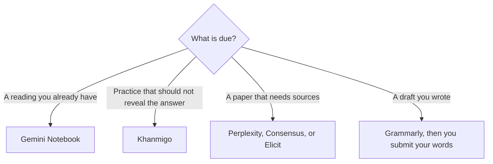

**A student can cover studying, a writing check, and cited research without a $20 chatbot.** Use [Gemini Notebook](/tools/gemini-notebook/) for the readings you were assigned. Use [Khanmigo](/tools/khanmigo/) when you want a tutor that withholds the answer. Use [Grammarly](/tools/grammarly/) Free on what you typed yourself. Add [Perplexity](/tools/perplexity/), [Consensus](/tools/consensus/), or [Elicit](/tools/elicit/) when the job is finding papers, not summarizing a PDF you already have.

Prices are US list prices from vendor pages checked October 16, 2026, except Gemini Notebook's caps, which come from Google's plan table read October 24, 2026. Tax, campus licenses, and app-store prices differ by country. Fit labels describe the job each product is sold for. They are not grades from a study we ran. Your school's academic-integrity rules outrank this page.

## The semester stack

| Job this week | Tool | What is free | Pay when |
|---|---|---|---|
| Quiz yourself on a chapter or lecture PDF | [Gemini Notebook](/tools/gemini-notebook/) | Free with a Google account. 3 Audio Overviews a day on the standard plan | Google AI Plus is $4.99/month and raises the caps |
| Practice a skill without being handed the solution | [Khanmigo](/tools/khanmigo/) | Free for teachers. Learners and families: $4/month or $44/year | You want the tutor on more than a teacher's account |
| Fix grammar in a draft you wrote | [Grammarly](/tools/grammarly/) | Free correctness checks | Pro is $12/member/month billed annually if rewrites are the bottleneck. See [is Grammarly Pro worth it](/blog/is-grammarly-pro-worth-it-2026/) |
| A question that needs a cited web answer | [Perplexity](/tools/perplexity/) | Free, with limited weekly use of top models | Pro is $17/month billed annually. See [is Perplexity Pro worth it](/blog/is-perplexity-pro-worth-it-2026/) |
| Find peer-reviewed papers | [Consensus](/tools/consensus/) or [Elicit](/tools/elicit/) | Consensus: unlimited search, 10 Pro messages and 3 Deep reviews a month. Elicit Basic: unlimited search and chat with papers | Consensus Pro is $12/month on the annual plan ($144/year). Elicit Plus is $11/user/month billed annually |
| Flashcards | [Quizlet](/tools/quizlet/) | Free flashcards, practice, and diagrams | Plus exists. We did not confirm a current USD price |
| Explain a problem, then you rewrite it | [ChatGPT](/tools/chatgpt/) or [Claude](/tools/claude/) | Both have real free plans | Plus or Pro is $20/month. Most courses do not require it |
| Paraphrase a sentence you already understand | [QuillBot](/tools/quillbot/) | 100 words in 2 modes | Premium showed $8.33/month billed annually |

Classroom tools for the person teaching the course are in [best AI tools for teachers](/blog/best-ai-tools-for-teachers-2026/). The seven Notebook workflows, including the free daily caps, are in [how to study with Gemini Notebook](/blog/gemini-notebook-study-workflows/). Writing tools for assignments are in [best AI writing assistants](/blog/best-ai-writing-assistants/).

The [education directory](/tools/category/education/) lists the tutors. Research tools live under [research and search](/tools/category/research-search/).

## Study from the file, then listen once

Gemini Notebook answers from sources you upload and shows citations. On the free Standard plan Google lists 50 sources per notebook, 50 chats a day, and 3 Audio Overviews a day. Spend the audio on the section you missed, not on the whole textbook the night before. Google says Audio Overviews can be inaccurate. Open the citation before you trust a number.

A PDF that should become something you can listen to on a commute has its own walkthrough in [turn a PDF into a podcast](/blog/turn-a-pdf-into-a-podcast-with-ai/). That is a listening pass. It does not replace the quiz loop.

Khanmigo is the different product. Khan Academy prices it at $4/month or $44/year for learners and families, plus tax, and a parent account can cover up to 10 children. It is built to ask questions rather than paste the finished solution. Use it for math and course practice. Use the notebook when the exam is about a packet your professor uploaded.

[Quizlet](/tools/quizlet/) Free still covers flashcards and practice questions. Because the upgrade page did not load in our check, Plus stays out of the budget.

## Research that shows its work

Three free research tools do different jobs:

- **Perplexity** searches the web and attaches citations. Free is enough to test. Pro at $17/month billed annually adds higher limits, file uploads, and model choice. A normal chatbot answer is not this product.
- **Consensus** searches peer-reviewed papers. Free includes unlimited paper search, 10 Pro messages, and 3 Deep reviews a month. Pro is $20/month or $144/year ($12/month). Deep, at $65/month or $540/year, is for people running literature reviews every week, which is past a normal course load.
- **Elicit** Basic is free for unlimited search across the corpus it documents (138 million-plus papers), plus summaries and chat with papers. Plus is $11/user/month billed annually. Pro at $39/user/month annual is the systematic-review tier. A term paper does not need Pro.

Paste the citation into your reference list yourself. If the tool names a paper you cannot open, drop the citation.

## Writing help that still leaves the paper yours

Grammarly Free checks spelling and grammar where you type. Pro is $12/member/month billed annually ($144/year), $60 quarterly, or $30 monthly, and adds full-sentence rewrites, tone, and 2,000 AI prompts. Buy Pro when you already write in the browser every day and the free checker is the thing slowing you down. A $20 assistant is a separate decision, covered in [ChatGPT vs Claude for writing](/blog/chatgpt-vs-claude-for-writing-2026/).

QuillBot's free plan paraphrases up to 100 words. Premium showed $8.33/month on annual billing when we checked, and QuillBot says the checkout can change with location and currency. Paraphrase a sentence you understand. Do not run a whole reading through it and submit the output.

[ChatGPT](/tools/chatgpt/) Free includes unlimited GPT-6 text chats, with limits on uploads and tools. [Claude](/tools/claude/) Free includes chat, file creation, and Artifacts, with usage limits and up to 5 Projects. Go is $8/month and OpenAI says it may include ads. Plus and Claude Pro are both $20/month. Claude Pro is $17/month if you pay $200 for the year. Either paid plan is optional for a student who uses the notebook and a grammar checker.

## Coding, dictation, and design, if the course needs them

[GitHub Copilot](/tools/github-copilot/) Free includes 2,000 completions a month and does not require a card. Verified students can get the Copilot Student plan. We did not record that plan's current limits, so confirm them on GitHub. The paid individual plan, Pro, is $10/user/month. The editor comparison is [Cursor vs Claude Code vs Codex](/blog/cursor-vs-claude-code-vs-codex-2026/), and the wider map is [best AI coding assistants](/blog/best-ai-coding-assistants-2026/).

[Mistral Vibe](/tools/mistral-vibe/) (formerly Le Chat) has a free tier. Verified students at accredited higher-education institutions can get Pro for $5.99/month for up to 12 months, against a list price of $14.99/month excluding tax. That is a cheap general assistant with a coding mode, not a replacement for Copilot inside an IDE.

[Wispr Flow](/tools/wispr-flow/) is dictation. Free covers a weekly word cap. Eligible students with a recognized .edu email can claim a Student plan that includes Pro features on Mac, Windows, and iOS. Where that free route does not apply, Wispr lists student pricing at $7.50/month or $72/year. A .edu address is a US-style campus email. If you do not have one, use the free cap or the regular Pro price of $15/month or $144/year.

[Canva](/tools/canva/) Free is enough for a poster or a slide. K-12 schools can get most premium features through Canva for Education. That is an organization license, not a personal coupon you should assume at a university.

Language apps are separate. [Duolingo](/tools/duolingo-max/) keeps a free core app and does not publish one global price. [Speak](/tools/speak/) offers a 7-day trial and then a subscription whose price is shown in the app, not on a single public rate card. Neither belongs in a fixed semester budget until you see the checkout in your country.

## What to skip

- Paying for ChatGPT, Claude, and Gemini in the same month. One free assistant plus the notebook covers most courses. The price map is [which AI subscription is worth paying for](/blog/which-ai-subscription-is-worth-paying-for/).
- Uploading another student's work, an exam you were told not to share, or identifiable records.
- Any tool that offers to "write the assignment." The name on the paper is yours.
- Quizlet Plus, Duolingo, or Speak at a price this page does not confirm. Read the checkout.

## FAQ

### What is the best free AI for students?

Gemini Notebook for source-based study, Grammarly Free for proofreading, and Perplexity or Consensus for cited research. Khanmigo is $4/month for learners, which is the cheapest tutor in this set with a published USD price.

### Do I need ChatGPT Plus for school?

Usually no. Free ChatGPT and free Claude handle explanations and outlines. Pay $20 only when a weekly limit blocks work your school already allows, and only for one of them.

### Can I use AI on homework?

Only inside the rules for that course. A useful pattern is: you write the draft, a tool checks grammar or quizzes you from the reading, and you can explain every sentence without the tool open.

## Last verified

October 24, 2026 for Gemini Notebook's published caps. October 16, 2026 for the other vendor prices on this page. Campus stores and non-US checkouts can differ.

**Sources:** [Gemini Notebook plans](https://support.google.com/gemininotebook/answer/16213268), [Khanmigo pricing](https://www.khanmigo.ai/pricing), [Grammarly pricing](https://www.grammarly.com/plans), [Perplexity pricing](https://www.perplexity.ai/pro), [Consensus pricing](https://consensus.app/pricing/), [Elicit pricing](https://elicit.com/pricing), [QuillBot Premium](https://quillbot.com/premium), [GitHub Copilot plans](https://github.com/features/copilot/plans), [Mistral Vibe](https://mistral.ai/products/vibe/), [Wispr Flow pricing](https://wisprflow.ai/pricing).

Directory pages such as [Gemini Notebook](/tools/gemini-notebook/) and [Khanmigo](/tools/khanmigo/) may use affiliate links. A purchase through them may earn us a commission at no extra cost to you.
