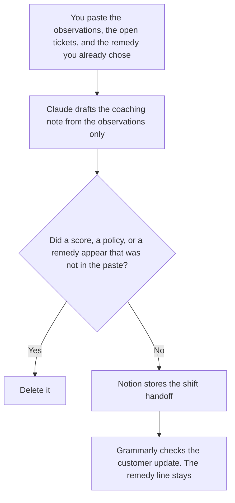

**A support lead should use AI to draft a coaching note from observations the lead already wrote, a shift handoff from facts the shift already logged, and a customer update on a case the lead already decided.** The model does not score an agent, invent a policy, or close a ticket. The queue, the article, and the reply a person sends are [best AI tools for support teams](/blog/best-ai-tools-for-support-teams-2026/). The breach note, the macro change, and the queue rule are [best AI tools for support ops leads](/blog/best-ai-tools-for-support-ops-leads-2026/). The book of accounts is [best AI tools for CS managers](/blog/best-ai-tools-for-cs-managers-2026/). This page is the person who coaches the people on the queue.

The route when an agent run must stop is [what an AI agent escalation path is](/blog/what-is-ai-agent-escalation-path-2026/). The help-desk grid of severity and owner is [how to create a support escalation matrix with AI](/blog/how-to-create-a-support-escalation-matrix-with-ai-2026/).

Claude's prices are the October 24, 2026 read of claude.com/pricing recorded in [Claude pricing explained](/blog/claude-pricing-explained-2026/). Notion and Grammarly prices are from directory pages checked October 16, 2026. ChatGPT's Plus price is the October 24 plan-page figure recorded in [ChatGPT pricing explained](/blog/chatgpt-pricing-explained-2026/). Published October 24, 2026. We did not measure handle time, quality scores, or attrition.

## The lead's week

| The job | Start here | First paid step | The limit |
|---|---|---|---|
| The coaching note, from observations you wrote | [Claude](/tools/claude/) | Pro is $17 a month billed annually, or $20 monthly | No score, no adjective you did not paste |
| The shift handoff the next lead will open | [Notion AI](/tools/notion-ai/) | Business is $20 a seat a month | Plus at $10 is not the full AI tier |
| The customer update, after you decided the remedy | [Grammarly](/tools/grammarly/) | Pro is $12 a member a month billed annually, or $30 monthly | The remedy sentence does not move |
| One short handoff from a paste | [ChatGPT](/tools/chatgpt/) | Plus is $20 a month | No ticket the paste did not name |

A coaching note that says the agent is "below average" has added a score. If you did not write a score, the note does not have one. Quote the observation. The next lead's handoff lists ticket ids you pasted, the owner, and the next step you wrote. If the next step is missing, the line says Next step not set. It does not propose a macro.

The customer update states the remedy you already decided. Grammarly may fix a comma. It may not soften a refund you approved into a "review." Compare that sentence before and after.

## What you are paying for

**Claude Pro** holds the coaching observations in a Project so a later note does not invent a theme. Team standard seats are $20 a seat a month billed annually, or $25 monthly, when the note is a company record, as recorded in [Claude Team pricing explained](/blog/claude-team-pricing-explained-2026/). The review is [Claude review](/blog/claude-review-2026/).

**Notion Business** is the handoff log: shift, open tickets, owner, next step. The invoice is [Notion AI pricing explained](/blog/notion-ai-pricing-explained-2026/).

**Grammarly Pro** is the customer-facing pass. The invoice is [Grammarly pricing explained](/blog/grammarly-pricing-explained-2026/).

**ChatGPT Plus** is one handoff when you do not need the Project. Go is $8 a month on the October 24 plan page. Plus is the seat for a saved note. The ladder is [ChatGPT pricing explained](/blog/chatgpt-pricing-explained-2026/).

A prompt that holds the line:

"Draft the coaching note from the observations I pasted. Draft the handoff from the ticket ids and next steps I pasted. If a next step is missing, write Next step not set. Do not add a score. Do not add a policy. Do not close a ticket."

## What not to automate

Do not let a model rank the team. Do not send the customer update before the lead has decided the remedy. Do not let a handoff mark a ticket waiting on the customer unless a person wrote that status. The lead owns the note. Open stays open until a person changes it in the help desk.

## FAQ

### How is this different from the support-team page?

That page is the queue: the help desk, the bot, and the reply a person sends. This page is the lead's coaching note, the shift handoff, and the update on a case the lead already decided. The same person may send replies on a small team. The templates stay different so a coaching note does not become a macro, and a handoff does not become a deflection rule.

### How is this different from the support-ops-lead page?

That page changes how the queue behaves: a breach note, a macro edit, a queue rule. This page is about the people on the shift. A lead can write a coaching note without changing a macro. An ops lead can change a macro without coaching anyone that day. Link the pages. Do not merge the files.

### How is this different from a CS manager's portfolio?

The CS manager's page is the book of accounts, not the ticket. A support lead's week is still the queue's people and the escalated case. An account plan does not belong in the shift handoff. A ticket id does not belong in a QBR unless a person put it there for a reason they can say.

### Who may send the coaching note?

The lead who wrote the observations. A formatted paragraph is not feedback until that lead sends it. A score the paste did not contain stays out. Next step not set stays until a person writes the step.

## Last verified

October 24, 2026 for Claude and for ChatGPT's plan page, via the posts cited above. October 16, 2026 for Notion and Grammarly. Published October 24, 2026.

**Sources:** [Claude pricing](https://claude.com/pricing), [Notion pricing](https://www.notion.com/pricing), [Grammarly pricing](https://www.grammarly.com/plans), [ChatGPT and Codex pricing](https://learn.chatgpt.com/docs/pricing).

*Published by Andrew for [AI Tools Optimizer](https://aitoolsoptimizer.com).*

[Claude](/tools/claude/) is in the [chatbots and assistants directory](/tools/category/chatbots-assistants/). Directory pages may use affiliate links. A purchase through them may earn us a commission at no extra cost to you.
