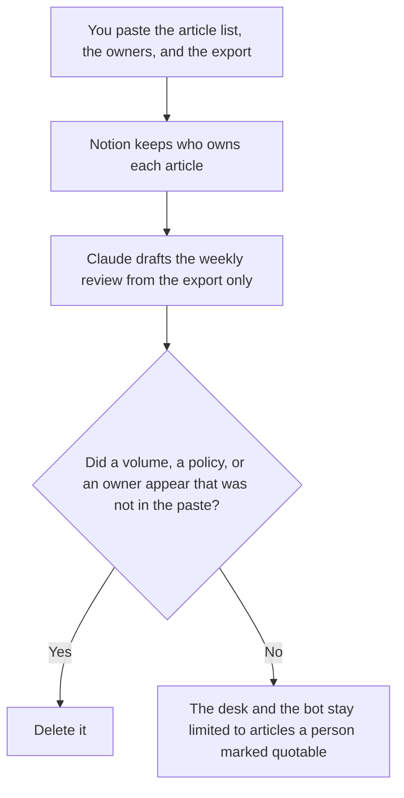

**Support ops should use AI to keep the list of who owns each help article, draft a weekly review from an export a person already pulled, and name which articles a bot may quote.** The model does not change a macro, close a ticket, or invent a deflection rate. The desk, the bot, and the reply a person sends are [best AI tools for support teams](/blog/best-ai-tools-for-support-teams-2026/). The Tuesday change, a breach note or a macro edit, is [best AI tools for support ops leads](/blog/best-ai-tools-for-support-ops-leads-2026/). This page is the operating cadence: owners, sources, and the weekly review.

The paths a bot may offer, once a person has written them, are [how to create a support deflection tree with AI](/blog/how-to-create-a-support-deflection-tree-with-ai-2026/). The articles themselves are [how to build a help center with AI](/blog/how-to-build-a-help-center-with-ai-2026/).

Claude's prices are the October 24, 2026 read of claude.com/pricing recorded in [Claude pricing explained](/blog/claude-pricing-explained-2026/). Notion is the October 16 directory card. Zendesk's seat prices are from zendesk.com/pricing fetched October 24, 2026, as recorded in [Zendesk AI pricing explained](/blog/zendesk-ai-pricing-explained-2026/). Fin's prices are from the outcomes help center fetched October 24, 2026, as recorded in [Intercom Fin pricing explained](/blog/intercom-fin-pricing-explained-2026/). Published October 24, 2026. We did not measure deflection or handle time.

## The operating week

| The job | Start here | First paid step | The limit |
|---|---|---|---|
| Who owns each article the bot may quote | [Notion AI](/tools/notion-ai/) | Business is $20 a seat a month | Plus at $10 is not the full AI tier. An owner you did not name stays Owner not set |
| The weekly review, from an export you pulled | [Claude](/tools/claude/) | Pro is $17 a month billed annually, or $20 monthly | No volume figure that was not in the export |
| The desk the articles have to match | [Zendesk AI](/tools/zendesk-ai/) | Suite Team is $55 an agent a month paid yearly | Support Team at $19 does not include the AI agents, on that page. Automated resolutions can bill on top |
| A bot priced per outcome, if that is the bot you already run | [Intercom Fin](/tools/intercom-fin/) | $0.99 an outcome, inside a $49 monthly base with 50 resolutions | Unused included resolutions do not roll over. The bot quotes articles a person listed |

A review that says deflection "improved" has added a score. If the export does not contain a number, the line says Figure not in the export. The bot source list is a column a person fills: quotable, or not. A blank cell is not quotable. The lead's page is where a macro changes. This page is where the article owner is recorded so that change has someone to ask.

Suite Professional is $115 an agent a month paid yearly on the October 24 Zendesk page. Copilot as an add-on was $50 an agent a month paid yearly. Suite Enterprise was talk to sales. Quote the seat you already run. Do not add a second desk so the weekly review has a panel.

Fin charges at most once per conversation, on the help center read. A Procedure handoff you configured can still be one outcome. This page does not tell you to turn Fin on for every article. The source list comes first.

## What you are paying for

**Notion Business** is the owner list and the quotable flag. The invoice is [Notion AI pricing explained](/blog/notion-ai-pricing-explained-2026/).

**Claude Pro** is the weekly review. Team standard seats are $20 a seat a month billed annually, or $25 monthly, when the review is a company record, as recorded in [Claude Team pricing explained](/blog/claude-team-pricing-explained-2026/). The review page is [Claude review](/blog/claude-review-2026/).

**Zendesk Suite Team** is the desk if tickets already live there. The invoice is [Zendesk AI pricing explained](/blog/zendesk-ai-pricing-explained-2026/).

**Fin** is the outcome meter if that is the bot. The invoice is [Intercom Fin pricing explained](/blog/intercom-fin-pricing-explained-2026/). A smaller chat stack, if you are still choosing, is on the support-team page. This page assumes the choice is made.

A prompt that holds the line:

"Draft the weekly review from the export I pasted. Draft the owner row only from the names I pasted. If an owner is missing, write Owner not set. If a figure is missing, write Figure not in the export. Do not mark an article quotable. Do not change a macro."

## What not to automate

Do not let a model mark articles quotable. Do not send the weekly review with a number the export did not contain. Do not let the bot quote an article whose owner cell is blank. Support ops owns the list. The lead owns the Tuesday edit. The team owns the reply a person sends.

## FAQ

### How is this different from the support-team page?

That page is the buying guide: the desk, the outcome-priced agent, the bot on your docs. This page is the cadence after the desk exists: who owns each article, which ones a bot may quote, and a weekly review from an export. Use that page to choose a vendor. Use this page to run the one you have.

### How is this different from the support-ops-lead page?

That page is the person who changes a breach note, a macro, or a queue rule before the next shift. This page is the function's list and its weekly review. A lead can change a macro without rewriting the owner list. Ops can update an owner without changing a macro that day. Link the pages. Do not merge the files.

### How is this different from a support lead's coaching note?

The support-lead page is the people on the shift: a coaching note, a handoff, a customer update. This page does not rank agents and does not draft that update. A ticket id belongs in the lead's handoff. An article owner belongs here.

### Who may mark an article quotable?

The owner named on the row, or the person your list says may do it. Owner not set stays not quotable. A formatted review is not a change to the help center. The desk still has to match the list after a person edits it.

## Last verified

October 24, 2026 for Claude, for Zendesk's pricing page, and for Fin's outcomes help center, via the posts cited above. October 16, 2026 for Notion. Published October 24, 2026.

**Sources:** [Claude pricing](https://claude.com/pricing), [Notion pricing](https://www.notion.com/pricing), [Zendesk pricing](https://www.zendesk.com/pricing/), [Fin pricing: outcomes](https://fin.ai/help/en/articles/13975800-fin-pricing-outcomes).

*Published by Andrew for [AI Tools Optimizer](https://aitoolsoptimizer.com).*

[Zendesk AI](/tools/zendesk-ai/) is in the [customer support directory](/tools/category/customer-support/). Directory pages may use affiliate links. A purchase through them may earn us a commission at no extra cost to you.
