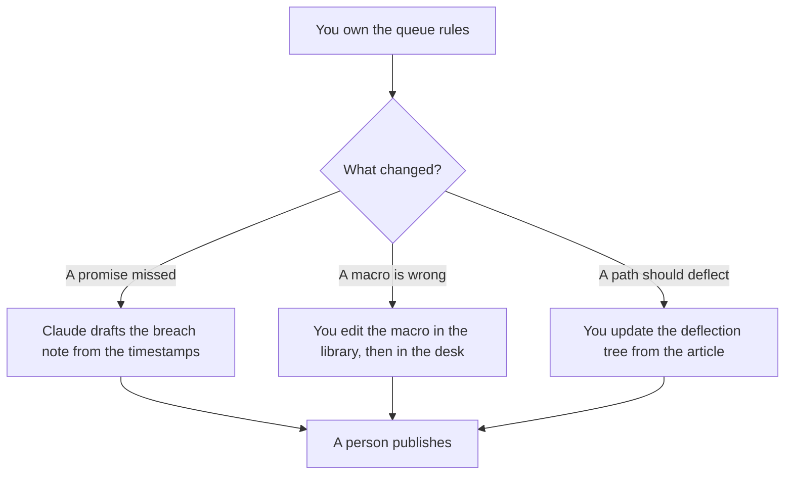

**A support ops lead should use AI to draft the breach note, the macro change, and the queue rule, from clocks and articles the team already approved.** The help desk, the bot, and the reply a person sends are the system: [best AI tools for support teams](/blog/best-ai-tools-for-support-teams-2026/). The book of accounts is [best AI tools for CS managers](/blog/best-ai-tools-for-cs-managers-2026/). This page is the person who changes how the queue behaves on a Tuesday.

The note after a missed promise is [how to create an SLA breach note with AI](/blog/how-to-create-a-sla-breach-note-with-ai-2026/). The paths a bot may offer are [how to create a support deflection tree with AI](/blog/how-to-create-a-support-deflection-tree-with-ai-2026/). The approved replies are [how to write a support macro library with AI](/blog/how-to-write-a-support-macro-library-with-ai-2026/).

Prices are US list prices excluding tax from directory pages checked October 16, 2026. Published October 24, 2026. We did not measure handle time or deflection.

## The lead's week

| The decision | Start here | First paid step | The limit |
|---|---|---|---|
| The wording of a breach note | [Claude](/tools/claude/) | Pro is $20 a month, or $17 billed annually | No credit and no cause you did not paste |
| The macro and the queue rule, in the wiki | [Notion AI](/tools/notion-ai/) | Business is $20 a seat a month | The help desk still has to match the wiki |
| The desk the rule has to land in | [Zendesk AI](/tools/zendesk-ai/) | Suite Team is $55 per agent per month paid yearly | Automated resolutions can bill on top. Do not turn a draft macro on for every ticket |
| The customer sentence, after the facts are frozen | [Grammarly](/tools/grammarly/) | Pro is $12 a member a month billed annually, or $30 monthly | Tone is not a policy change |

The team page is the buying guide for the desk and the bot. Use it when you are choosing Zendesk, Fin, or a docs bot. Use this page when you are the lead who has to change a macro before the next shift. A queue rule that lives only in a chat will be contradicted by the macro in the desk. The wiki and the desk have to say the same thing. A person checks one real ticket after the change.

## What you are paying for

**Claude Pro** drafts the breach note and the explanation of a queue rule. It does not set the SLA. The clocks live in [how to create a support escalation matrix with AI](/blog/how-to-create-a-support-escalation-matrix-with-ai-2026/). The review is [Claude review](/blog/claude-review-2026/).

**Notion Business** holds the macro library and the queue rule the next lead will inherit. The invoice is [Notion AI pricing explained](/blog/notion-ai-pricing-explained-2026/).

**Zendesk Suite Team** is the desk if that is where tickets already are. Support Team at $19 per agent per month paid yearly does not include the AI agents, on the directory card. Copilot is a separate add-on on that card. Price the seat you already run. Do not add a second desk so the lead has an AI panel.

**Grammarly Pro** is the last pass on a customer-facing sentence. If Grammarly deletes the limitation, put the limitation back.

A prompt that holds the line:

"Draft the queue-rule change from the old rule and the new rule I pasted. Show both. Do not add a severity. If the owner of the new rule is missing, write Owner missing and stop."

## What not to automate

Do not auto-close a queue because a model said the article covers it. Do not edit a macro in the desk and forget the library. Do not put a customer's complaint into a prompt the whole company can see. Redact first. That step is [what AI PII redaction is](/blog/what-is-ai-pii-redaction-2026/).

## FAQ

### How is this different from the support team roundup?

That page matches a tool to the queue: the desk, the outcome-priced agent, the docs bot. This page is the lead's changes to rules you already operate. Buy from the team page. Operate from this one.

### How is this different from the CS manager page?

CS managers work the portfolio and the renewal. Support ops leads work the queue, the macro, and the breach clock. A renewal plan does not belong in a macro.

### Can I skip Zendesk if we use another desk?

Yes. The desk line in the table is the system you already have. The lead still needs a wiki for the macro and a chat for the draft. Do not quote Suite Team at $55 if you do not run Zendesk.

### Who may change a macro?

The owner named on the library. A helpful edit from a model is a proposal until that owner accepts it and the desk copy matches.

## Last verified

October 16, 2026 for Claude, Notion, Zendesk, and Grammarly. Published October 24, 2026.

**Sources:** [Claude pricing](https://claude.com/pricing), [Notion pricing](https://www.notion.com/pricing), [Zendesk](https://www.zendesk.com), [Grammarly pricing](https://www.grammarly.com/plans).

*Published by Andrew for [AI Tools Optimizer](https://aitoolsoptimizer.com).*

[Zendesk AI](/tools/zendesk-ai/) is in the [customer support directory](/tools/category/customer-support/). Directory pages may use affiliate links. A purchase through them may earn us a commission at no extra cost to you.
