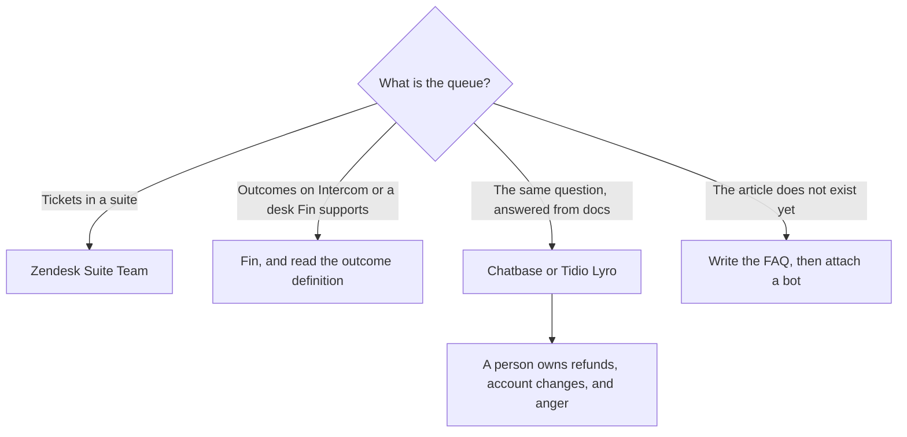

**A support team should buy the tool that matches the queue it already has: the help desk, a bot that quotes the articles, or a draft a person sends.** An agent that resolves a ticket by inventing a policy is a new ticket. This page is the queue. The account plan and the QBR are [best AI tools for customer success](/blog/best-ai-tools-for-customer-success-2026/). The bot category is [best AI chatbots for business](/blog/best-ai-chatbots-for-business-2026/).

Prices are US list prices excluding tax from directory pages checked October 16, 2026. Published October 24, 2026. We did not measure deflection or handle time.

## The support job

| Job | Start here | First paid step | The limit |
|---|---|---|---|
| The ticket desk you already run | [Zendesk AI](/tools/zendesk-ai/) | Suite Team is $55 per agent per month paid yearly, with AI agents and a knowledge base. Support Team at $19 does not include those agents | Automated resolutions can bill on top. Copilot is a $50 per agent yearly add-on on the directory card |
| A resolution priced per outcome | [Intercom Fin](/tools/intercom-fin/) | $49 a month including 50 outcomes, then $0.99 per outcome | A procedure handoff can count. Price a real month before you call it cheaper |
| A bot on articles you maintain | [Chatbase](/tools/chatbase/) | Hobby is $32 a month billed yearly, or $40 monthly, for 700 message credits | Branding removal is a separate add-on. The articles have to be true |
| Live chat for a smaller shop | [Tidio](/tools/tidio/) | Starter is $24.17 a month billed annually, with 100 billable conversations and 50 one-off Lyro conversations | Lyro as a stand-alone agent starts at $32.50 a month for 50 conversations |
| The macro and the help article | [Notion AI](/tools/notion-ai/) | Business is $20 per seat per month | The wiki is not the help desk. Publish the article, then point the bot at it |
| A cleaner reply an agent will send | [Grammarly](/tools/grammarly/) | Pro is $12 per member per month billed annually, or $30 monthly | It edits the sentence. It does not know the policy |

The article step is [how to create FAQ pages with AI](/blog/how-to-create-faq-pages-with-ai-2026/). The bot build is [how to build a knowledge-base chatbot](/blog/how-to-build-a-knowledge-base-chatbot-2026/). Chatbase's credit card is [Chatbase pricing explained](/blog/chatbase-pricing-explained-2026/).

## What the meter is actually counting

Zendesk Suite Team at $55 per agent yearly is the plan that includes AI agents, on the October 16 card. Suite Professional at $115 adds admin and writing tools. Annual billing saves up to 20% on that card. A team that only needed email tickets can stay on Support Team at $19 and skip the agent. Buying Suite "for AI" and then paying per automated resolution is two meters. Write both down.

Fin's $0.99 is per outcome, and the directory defines an outcome as a resolution or a successful procedure handoff. Fifty outcomes are inside the $49 base. One hundred outcomes are the base plus the overage. The example on the directory card is the one to recompute with your own volume. Fin can sit on Zendesk, Salesforce, and other desks. You can pay for both the desk and Fin. Do that on purpose.

Chatbase Hobby at $32 yearly is the small site. Standard is $120 yearly for 4,000 credits. Pro is $400 yearly for 15,000. Extra credits are $40 per 1,000 on the October 16 card. Test the agent on questions you know before it faces a customer. The checks around what it may do are [what AI guardrails are](/blog/what-is-ai-guardrails-2026/). A document that tries to override the bot is [what prompt injection is](/blog/what-is-prompt-injection-2026/).

Tidio Starter is the shop that wants chat and a person in the same inbox. Growth starts at $49.17 a month annually on the directory card. Lyro stand-alone is the path when the help desk is already somewhere else. Flows, the automation add-on, starts at $24.17. A drawn workflow in [Zapier](/tools/zapier/) or [n8n](/tools/n8n/) is the alternative when the path is not a conversation. That choice is [n8n alternatives](/blog/n8n-alternatives-2026/).

## The reply a person still sends

Grammarly on the agent's browser catches the awkward sentence. It will not catch a wrong return window. Paste the macro from Notion, then edit. The editing comparison is [Grammarly vs ChatGPT for editing](/blog/grammarly-vs-chatgpt-for-editing-2026/). [Claude](/tools/claude/) Pro at $20, or $17 billed annually, can draft from the article you paste. The article remains the source. Customer-success notes from the call are a different capture: [how to summarize meetings with AI](/blog/how-to-summarize-meetings-with-ai-2026/).

A small support pod: one desk you already pay for, Chatbase or Lyro only after the top ten articles exist, Grammarly if the writing is the complaint, and a person on anything that moves money. Add Fin when you can define an outcome and you want that meter. The release note that creates tickets should be written before the ticket exists: [how to write release notes with AI](/blog/how-to-write-release-notes-with-ai-2026/).

## FAQ

### What should a support team automate first?

The question that already has a correct article and a boring answer. Order status, password reset, plan names. Leave refunds, cancellations, and angry threads on a person until the article and the approval exist.

### Zendesk or Fin?

Zendesk if the queue is the product you run. Fin if you want a per-outcome agent and you have read what counts as an outcome. Many teams use Fin on top of a desk. Price both, and do not assume Fin replaces the agent seats.

### Is a chatbot enough without a help center?

No. The bot repeats the center. Build the FAQ from real tickets first. A model-only widget will answer in a confident voice and create a second queue.

### Do agents need their own ChatGPT seats?

Only if they draft from sources they paste and a person sends the reply. A shared custom GPT with the macros is the cheaper pattern. The container choice is [ChatGPT Projects vs custom GPTs](/blog/chatgpt-projects-vs-custom-gpts-2026/). Plus is $20. It is not a help desk.

## Last verified

October 16, 2026 for Zendesk, Intercom Fin, Chatbase, Tidio, Notion, Grammarly, and Claude prices in the directory. Published October 24, 2026.

**Sources:** [Zendesk pricing](https://www.zendesk.com/pricing/), [Intercom Fin](https://fin.ai), [Chatbase pricing](https://www.chatbase.co/pricing), [Tidio pricing](https://www.tidio.com/pricing/).

*Published by Andrew for [AI Tools Optimizer](https://aitoolsoptimizer.com).*

[Zendesk AI](/tools/zendesk-ai/) and [Chatbase](/tools/chatbase/) are in the [customer support directory](/tools/category/customer-support/). Directory pages may use affiliate links. A purchase through them may earn us a commission at no extra cost to you.
