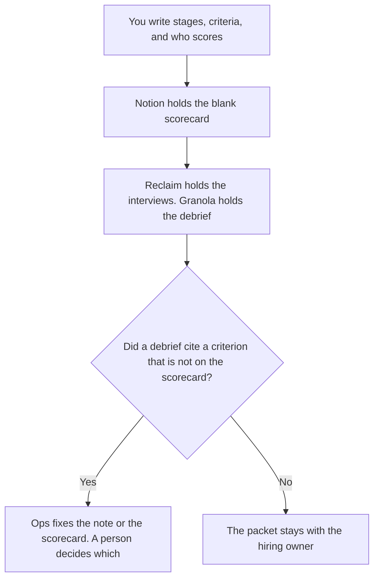

**Talent ops should use AI to format the stage map, the interview loop, and the debrief notes a person already defined.** Sourcing is the recruiter's page. The offer and the policy are HR's. This page is the system that keeps scorecards, calendars, and write-ups from drifting. We did not score who to hire. Nothing here is HR or legal advice.

The blank instrument is [how to create a hiring pipeline scorecard with AI](/blog/how-to-create-a-hiring-pipeline-scorecard-with-ai-2026/). One interview's sheet is [how to create interview scorecards with AI](/blog/how-to-create-interview-scorecards-with-ai-2026/). The role text is [how to write a job description with AI](/blog/how-to-write-a-job-description-with-ai-2026/).

Prices are US list prices excluding tax. Notion, Claude, Granola, ClickUp, and Grammarly are from directory pages checked October 16, 2026. Reclaim is from the pricing page fetched October 24, 2026. Published October 24, 2026.

## The ops job

| The job | Start here | First paid step | The limit |
|---|---|---|---|
| The scorecard library and the stage names | [Notion AI](/tools/notion-ai/) | Business is $20 a seat a month | A stage the model invented does not enter the library |
| A clean draft of a grid you already use | [Claude](/tools/claude/) | Pro is $20 a month, or $17 billed annually | The model formats. It does not rank people |
| The interview loop on a calendar | [Reclaim.ai](/tools/reclaim-ai/) | Starter is $10 a seat a month on the yearly toggle, or $12 monthly | Scheduling is not a score |
| Debrief notes without a bot on the call | [Granola](/tools/granola/) | Business is $14 a user a month | Free history is 30 days. The note is not a rating |
| The tracker, if reqs live in ClickUp | [ClickUp Brain](/tools/clickup-brain/) | From $9 per user a month, on a ClickUp plan | Unlimited is $7 a user yearly. Brain does not decide advance |
| A job post edited for grammar, not for new requirements | [Grammarly](/tools/grammarly/) | Pro is $12 a member a month billed annually | It must not add a requirement. The invoice is [Grammarly pricing explained](/blog/grammarly-pricing-explained-2026/) |

Talent ops owns the hygiene. Recruiters own the slate. That shelf is [best AI tools for recruiters](/blog/best-ai-tools-for-recruiters-2026/). The broader people system is [best AI tools for people ops](/blog/best-ai-tools-for-people-ops-2026/). HR policy is [best AI tools for HR teams](/blog/best-ai-tools-for-hr-teams-2026/). If one person does all four, keep four lists. A scorecard is not a sourcing sequence.

## What you are paying for

**Notion Business at $20 a seat** holds the stage names and the blank grids. A trait the model added, such as an undefined "culture fit," gets deleted before the page is the library. The record rule is [what a system of record for AI is](/blog/what-is-a-system-of-record-for-ai-2026/).

**Claude Pro** turns a messy role note into a grid that follows your columns. It can mark a scorer Missing. It cannot recommend a hire. The review is [Claude review](/blog/claude-review-2026/). The person who accepts the grid is [what human-in-the-loop AI is](/blog/what-is-human-in-the-loop-ai-2026/).

**Reclaim** is the calendar when interviewers already live in Google Calendar or Outlook. Lite is free for one user. A team that needs seats is on Starter. Do not read the vendor's time-saved calculator as a result you measured. The full toggle, including a discount line that disagrees with itself, is [Reclaim.ai pricing explained](/blog/reclaim-ai-pricing-explained-2026/).

**Granola** is for the debrief, not for a score. File quotes against criteria you already listed. A quote that supports no criterion is Untagged.

**ClickUp** is the req tracker when the company already runs there. Brain² is an add-on. The plan underneath is separate. Do not let an AI field set "advance."

**Grammarly Pro** polishes a job description whose requirements you froze. Monthly Pro is $30 on that card. Prefer the annual figure if you will actually pay annual. A rewrite that adds a degree you did not ask for is a different job. Reject it.

A prompt that holds the line:

"Format this stage list into our scorecard columns. Do not add a stage or a trait. Do not mention a candidate. If a scorer is missing, write Missing. Do not recommend who to advance."

## What not to automate

Do not auto-reject applicants. Do not generate a ranking from resumes. Do not let a debrief write its own rating. The bar, the evidence, and the decision are rows a person fills. A manager draft of a later review, which is a different cycle, is [ChatGPT vs Claude for performance reviews](/blog/chatgpt-vs-claude-for-performance-reviews-2026/). That page is also not a hiring decision.

## FAQ

### Is talent ops the same as recruiting?

On this site, recruiters fill the slate. Talent ops keeps the stages, the scorecards, the loop, and the debrief honest. Buy the recruiter page when the job is sourcing. Buy this page when the job is the system around the loop.

### Can AI score the onsite?

It can place notes under criteria you wrote. The mark is a person's. A generated score will be treated as math. It is not math.

### Do we need ClickUp and Notion?

No. The scorecard library needs one home. The req tracker needs one home. They can be the same tool. Two scorecards is the failure mode.

### What about scheduling links only?

If all you need is a link, you may not need a paid Reclaim seat. Lite includes one scheduling link, on the October 24 page. Pay when the loop has enough interviewers that the seat limits are the point.

## Last verified

October 16, 2026 for Notion AI, Claude, Granola, ClickUp, and Grammarly. October 24, 2026 for Reclaim's yearly and monthly Starter prices. Published October 24, 2026.

**Sources:** [Notion pricing](https://www.notion.com/pricing), [Claude pricing](https://claude.com/pricing), [Reclaim.ai pricing](https://reclaim.ai/pricing), [Grammarly pricing](https://www.grammarly.com/plans).

*Published by Andrew for [AI Tools Optimizer](https://aitoolsoptimizer.com).*

[Notion AI](/tools/notion-ai/) is in the [productivity and notes directory](/tools/category/productivity-notes/). Directory pages may use affiliate links. A purchase through them may earn us a commission at no extra cost to you.
