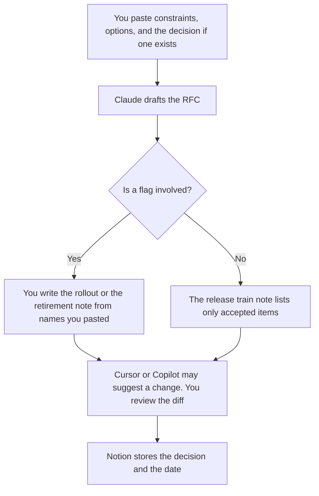

**A technical PM should use AI to draft an RFC from constraints they already accepted, write the flag or release note from a list they pasted, and read a diff without merging it.** The model does not prioritize the roadmap. The spec, the prototype, and the customer meeting are a different job: [best AI tools for product managers](/blog/best-ai-tools-for-product-managers-2026/). The event definition and the adoption date are [best AI tools for product ops analysts](/blog/best-ai-tools-for-product-ops-analysts-2026/). This page is the contract between product and engineering: what the system will do, what it will not do, and which flag dies on which date.

The RFC split is [Claude vs ChatGPT for RFC drafts](/blog/claude-vs-chatgpt-for-rfc-drafts-2026/). The end of a flag is [how to write a feature flag retirement note with AI](/blog/how-to-write-a-feature-flag-retirement-note-with-ai-2026/). The cut list is [how to write a release train note with AI](/blog/how-to-write-a-release-train-note-with-ai-2026/).

Claude's prices are from claude.com/pricing on October 24, 2026. Cursor, Notion, and GitHub Copilot prices are from directory pages checked October 16, 2026. Published October 24, 2026. We did not score roadmaps or delivery.

## The technical PM's week

| The job | Start here | First paid step | The limit |
|---|---|---|---|
| The RFC, with options and an open decision | [Claude](/tools/claude/) | Pro is $17 a month billed annually, or $20 monthly | No requirement that was not in the paste |
| The diff the RFC mentions | [Cursor](/tools/cursor/) | Plus is $8 a month, or $80 a year | You review it. The model does not merge |
| The decision log and the train note | [Notion AI](/tools/notion-ai/) | Business is $20 a seat a month | Plus at $10 is not the full AI tier |
| A contract example in the repo | [GitHub Copilot](/tools/github-copilot/) | Pro is $10 a user a month | Business at $19 is the governance seat on that card |

Product managers on the other page own the PRD and the prototype. Product ops analysts own the metric definition. Technical PMs own the interface, the migration, and the flag. If the work is a user story with no system constraint, you are on the product manager page. If the work is a SQL draft for an event, you are on the analyst page. The SQL habit, when you do need it, is [Gemini vs Claude for SQL drafts](/blog/gemini-vs-claude-for-sql-drafts-2026/).

## What you are paying for

**Claude Pro** is the long RFC in a Project. The review is [Claude review](/blog/claude-review-2026/). ChatGPT Plus at $20, on the October 16 card, is the one-section path on the RFC article. This page starts with Claude because the artifacts have to agree with each other.

**Cursor Plus** is the editor when you read the change the RFC describes. A generated edit that widens an API is a defect until you reject it. The ladder is [Cursor pricing explained](/blog/cursor-pricing-explained-2026/). The internal-tool comparison, if the PM is prototyping a tool rather than specifying one, is [Cursor vs Replit for internal tools](/blog/cursor-vs-replit-for-internal-tools-2026/).

**Notion Business** holds the RFC, the train note, and the flag note in one place. The chat is not the system of record. The invoice is [Notion AI pricing explained](/blog/notion-ai-pricing-explained-2026/).

**GitHub Copilot Pro** is the in-repo assistant when the team already lives in that product. Business at $19 a user a month is the card that lists access controls and IP indemnity. A personal Pro seat does not answer a company review. The invoice is [GitHub Copilot pricing explained](/blog/github-copilot-pricing-explained-2026/).

A prompt that holds the line:

"Draft the RFC section from the constraints I pasted. If the decision is open, write Decision open. Do not add an endpoint, a flag, or a date."

## What not to automate

Do not let a model mark a flag unused. Do not paste a production token so the example compiles. Do not announce a customer-facing change from the train note until the changelog uses the same list. That announcement is [how to write a changelog announcement with AI](/blog/how-to-write-a-changelog-announcement-with-ai-2026/). The line-level change to a prompt the feature depends on is [what an AI prompt diff is](/blog/what-is-ai-prompt-diff-2026/).

## FAQ

### How is this different from the product manager page?

Product managers own the spec, the prototype, and the meeting. Technical PMs own the RFC, the flag, and the contract the engineers will implement. A prototype with no contract will be "done" in three incompatible ways.

### How is this different from product ops?

Product ops owns the event name and the number someone will read. Technical PMs own the behavior the event is supposed to represent. If the dictionary and the RFC disagree, fix the dictionary or the RFC before you publish a chart.

### Do I need Cursor and Copilot?

No. Use the editor the repo already uses. Two assistants on one diff are how an endpoint appears in one suggestion and not the other. Review one diff.

### Who may close the decision?

The owner named on the RFC. A passing build is not a signature. A flag retirement still needs the caller list from a search you ran, on the date you ran it.

## Last verified

October 24, 2026 for Claude. October 16, 2026 for Cursor, Notion, and GitHub Copilot. Published October 24, 2026.

**Sources:** [Claude pricing](https://claude.com/pricing), [Cursor pricing](https://cursor.com/help/account-and-billing/pricing), [Notion pricing](https://www.notion.com/pricing), [GitHub Copilot](https://github.com/features/copilot).

*Published by Andrew for [AI Tools Optimizer](https://aitoolsoptimizer.com).*

[Notion AI](/tools/notion-ai/) is in the [productivity and notes directory](/tools/category/productivity-notes/). Directory pages may use affiliate links. A purchase through them may earn us a commission at no extra cost to you.
