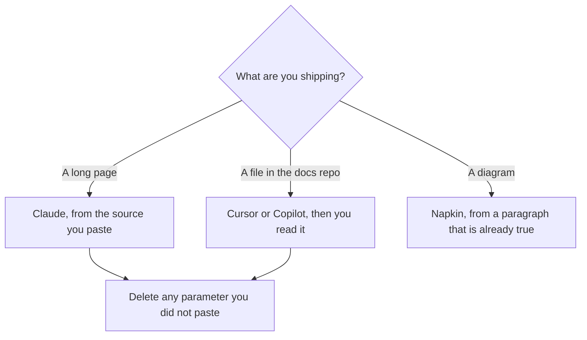

**A technical writer should buy the tool that matches the artifact: the long doc, the page in the docs repo, or the diagram.** A model that invents a parameter is not a docs tool. It is a bug with a friendly tone. This page is the writing week. The general shelf is [best AI writing assistants](/blog/best-ai-writing-assistants/). The team that publishes campaigns instead of references is [best AI tools for content teams](/blog/best-ai-tools-for-content-teams-2026/).

Prices are US list prices excluding tax from directory pages checked October 16, 2026. Published October 24, 2026. We did not score clarity.

## The artifact, then the tool

| Artifact | Start here | First paid step | The limit |
|---|---|---|---|
| A long guide you revise from source | [Claude](/tools/claude/) | Pro is $20, or $17 billed annually. Free includes Projects, with limits | The source has to be in the prompt |
| The page the company will open | [Notion AI](/tools/notion-ai/) | Business is $20 a seat for the full AI tier | Plus at $10 is not that tier |
| A line edit in the editor you type in | [Grammarly](/tools/grammarly/) | $12 a member a month billed annually, or $30 monthly | It does not know the API |
| Docs-as-code in a repository | [Cursor](/tools/cursor/) or [GitHub Copilot](/tools/github-copilot/) | Cursor Plus is $8. Copilot Pro is $10. Copilot Free is 2,000 completions | You read the diff. The tool does not merge the docs |
| A diagram from a paragraph you already wrote | [Napkin AI](/tools/napkin-ai/) | Plus is $9 a person a month. Free includes 500 credits a week | A picture is not a spec |
| A short answer you must paste back | [ChatGPT](/tools/chatgpt/) | Plus is $20. Go is $8 | The docs site is still the system of record |

## The long page

[Claude](/tools/claude/) is the default for a guide, a reference rewrite, or a migration note, because Projects and file upload are on the product, including Free. Pro is the usage step. Max from $100 is capacity, not a style upgrade. The long-document map, if the source is a folder that must stay cited, includes Gemini Notebook: [Claude vs Gemini for long documents](/blog/claude-vs-gemini-for-long-documents-2026/). The summary rule, which is the same rule as a doc, is [Claude vs ChatGPT for summaries](/blog/claude-vs-chatgpt-for-summaries-2026/).

[ChatGPT](/tools/chatgpt/) Plus is the right second seat when you also need a custom GPT for a house style or an image in the same month. It is a poor place to leave the only copy of the docs. Paste the keeper into the repo or the wiki. The writing split is [ChatGPT vs Claude for writing](/blog/chatgpt-vs-claude-for-writing-2026/) and, if the wiki is Notion, [ChatGPT vs Notion AI for writing](/blog/chatgpt-vs-notion-ai-for-writing-2026/).

[Grammarly](/tools/grammarly/) catches the sentence. It will happily leave a wrong flag name alone. Run it after the facts are checked, not instead. The comparison is [Grammarly vs ChatGPT for editing](/blog/grammarly-vs-chatgpt-for-editing-2026/). The fact pass is [how to fact-check AI writing](/blog/how-to-fact-check-ai-writing-2026/). The house style is [how to create a brand voice with AI](/blog/how-to-create-a-brand-voice-with-ai-2026/).

## The repo, the log, and the picture

If the docs are markdown in git, write there. [Cursor](/tools/cursor/) Plus at $8 is the AI editor. [GitHub Copilot](/tools/github-copilot/) Pro at $10 stays in the editor you have. Business at $19 adds admin controls and IP indemnity. The comparison is [Cursor vs GitHub Copilot](/blog/cursor-vs-github-copilot-2026/). A copilot suggests. You accept. The definition is [what an AI copilot is](/blog/what-is-an-ai-copilot-2026/). Do not let an agent rewrite the API reference unattended. The control is [what human-in-the-loop AI is](/blog/what-is-human-in-the-loop-ai-2026/).

The public list of what changed is [how to write a changelog with AI](/blog/how-to-write-a-changelog-with-ai-2026/). The narrative is [how to write release notes with AI](/blog/how-to-write-release-notes-with-ai-2026/). The questions readers already ask are [how to create FAQ pages with AI](/blog/how-to-create-faq-pages-with-ai-2026/). The internal cousin is [how to build an internal wiki with AI](/blog/how-to-build-an-internal-wiki-with-ai-2026/).

[Napkin AI](/tools/napkin-ai/) Plus at $9 turns a paragraph into a diagram. Free's 500 credits a week are the test. Use it after the paragraph is true. A diagram of a guessed architecture will be believed longer than a bad sentence. The review is [Napkin AI review](/blog/napkin-ai-review-2026/). [Figma](/tools/figma/) Professional is $16 a month per Full seat billed annually when the picture has to live in a design file. The review is [Figma review](/blog/figma-review-2026/).

A training video is a different team. If you own it anyway, an avatar plan is [Synthesia alternatives](/blog/synthesia-alternatives-2026/), and footage you recorded is [Descript alternatives](/blog/descript-alternatives-2026/). Most reference docs do not need either.

## FAQ

### What should a technical writer pay for first?

Claude Pro, or even Free, if the pain is long revisions. Copilot Free or Cursor Plus if the pain is the repo. Grammarly if the pain is the sentence and the facts are already right. Notion Business only if Notion is where the docs live. One of those. The second waits until the first is in the weekly publish.

### Can AI write the API reference from the code?

It can draft from code and comments you open. It will describe a parameter that the code does not honor, and it will skip one that the code requires. Diff the draft against the source. A docs pull request is still a pull request.

### Is a wiki enough, or do we need a docs site?

The site is a publishing decision. The rule is the same: one source, an owner, and no second copy in a chat. If a bot will answer customers from the docs, build that only after the pages are current. The how-to is [how to build a knowledge base chatbot](/blog/how-to-build-a-knowledge-base-chatbot-2026/).

### How do I stop the model from smoothing over a breaking change?

Ask for breaking changes as their own list, and paste the old and new behavior yourself. A model asked for a "clean" page will bury the break. The changelog workflow keeps that list blunt on purpose.

## Last verified

October 16, 2026 for Claude, Notion, Grammarly, Cursor, GitHub Copilot, ChatGPT, Napkin, and Figma prices named above. Published October 24, 2026.

**Sources:** [Claude pricing](https://claude.com/pricing), [GitHub Copilot](https://github.com/features/copilot), [Notion pricing](https://www.notion.com/pricing).

*Published by Andrew for [AI Tools Optimizer](https://aitoolsoptimizer.com).*

[Claude](/tools/claude/) is in the [chatbots and assistants directory](/tools/category/chatbots-assistants/). Directory pages may use affiliate links. A purchase through them may earn us a commission at no extra cost to you.
