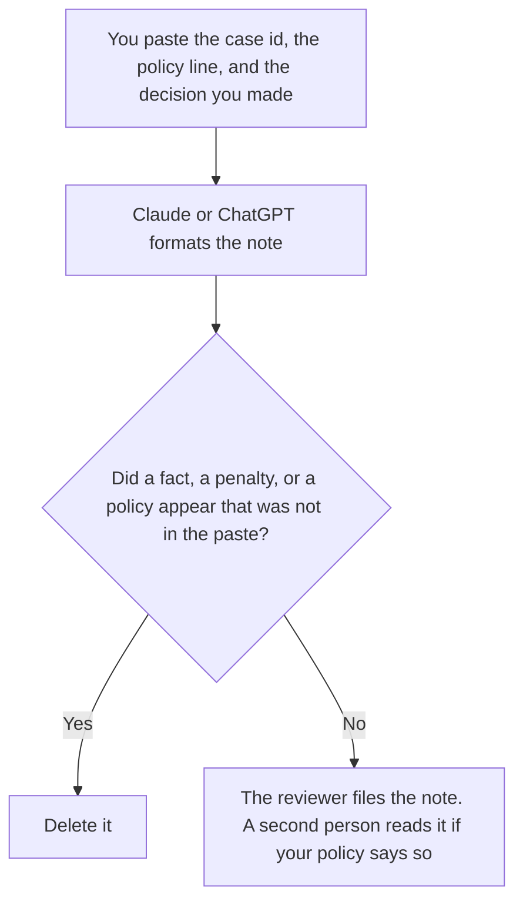

**A trust and safety reviewer should use AI to format a decision note from a case a person already judged, keep a policy line in the words a policy owner already approved, and hand the case to the next owner without adding a fact.** The model does not decide the case, and it does not invent a violation. The rule that blocks a product behavior before a person is asked is [what an AI policy enforcement layer is](/blog/what-is-ai-policy-enforcement-layer-2026/). A cap on abusive traffic is [what an AI abuse rate limit is](/blog/what-is-ai-abuse-rate-limit-2026/).

The neighboring queue for a community, which is not this review desk, is [best AI tools for community ops](/blog/best-ai-tools-for-community-ops-2026/). This page is the written record of a decision. It does not explain how to evade a policy, bypass a filter, or hide a violation.

Claude's prices are from claude.com/pricing on October 24, 2026. Notion, ChatGPT, and Cursor prices are from directory pages checked October 16, 2026. chatgpt.com/pricing returned HTTP 403 on October 24. Published October 24, 2026. We did not score enforcement.

## The reviewer's week

| The job | Start here | First paid step | The limit |
|---|---|---|---|
| The decision note, from a judgment you already made | [Claude](/tools/claude/) | Pro is $17 a month billed annually, or $20 monthly | No new fact. No new policy |
| The page the queue keeps | [Notion AI](/tools/notion-ai/) | Business is $20 a seat a month | Plus at $10 is not the full AI tier |
| One note from a short paste | [ChatGPT](/tools/chatgpt/) | Plus is $20 a month | The case id stays the one you pasted |
| A rule text in the repo, if the product encodes one | [Cursor](/tools/cursor/) | Plus is $8 a month, or $80 a year | You review the diff. The model does not ship a policy |

A note that "fills in" what the user must have meant has decided the case. If the paste says the evidence is incomplete, the note says the evidence is incomplete. The next step is a person, not a smoother paragraph.

## What you are paying for

**Claude Pro** is the shared wording so this week's note uses the same policy line as last week's. Team standard seats are $20 a seat a month billed annually, or $25 monthly, when the note is a company record. The review is [Claude review](/blog/claude-review-2026/). The Team invoice is [Claude Team pricing explained](/blog/claude-team-pricing-explained-2026/).

**Notion Business** holds the queue's written record if that is the wiki. The invoice is [Notion AI pricing explained](/blog/notion-ai-pricing-explained-2026/).

**ChatGPT Plus** is one note from a paste. Business is $20 a user a month billed annually, or $25 monthly, for two or more users, on the October 16 card, when the case file should not train the model by default. The review is [ChatGPT review](/blog/chatgpt-review-2026/).

**Cursor Plus** is only for a rule that already lives in a repo and needs a diff a person reviews. It is not the place you paste a user's private content so the edit "has context." The ladder is [Cursor pricing explained](/blog/cursor-pricing-explained-2026/).

A prompt that holds the line:

"Format the decision note from the case id, the policy line, and the decision I pasted. If the decision is missing, write Decision not made. Do not add a fact. Do not recommend a penalty I did not write."

## What not to automate

Do not ask the model to rule on a case. Do not ask it how a user could avoid the policy. Do not paste more personal data than the note needs. Do not treat a formatted note as the enforcement action. The action is whatever your runbook says a person does after the note is filed.

## FAQ

### How is this different from the community ops page?

Community ops covers the programs and replies a community team sends. This page is a trust and safety decision record: the policy line, the judgment a person made, and the handoff. A community reply can quote a decision. It does not make one.

### How is this different from a policy enforcement layer?

The layer is the product control that blocks or allows a behavior. This page is the writing around a human decision. A layer can require a note. The note does not replace the layer. If nothing in the product enforces the rule, a well-formatted note has not enforced it either.

### Do I need Cursor?

Only if a policy rule is a change in a repository. Most decision notes need Claude or ChatGPT and a page in Notion. A coding seat does not make a judgment more valid.

### Who may close the case?

The reviewer your policy names, and a second person when your policy requires one. A finished paragraph is not a close. A missing decision stays missing.

## Last verified

October 24, 2026 for Claude, including Team seat prices. October 16, 2026 for Notion, ChatGPT, and Cursor. Published October 24, 2026.

**Sources:** [Claude pricing](https://claude.com/pricing), [Notion pricing](https://www.notion.com/pricing), [ChatGPT pricing](https://chatgpt.com/pricing/), [Cursor pricing](https://cursor.com/help/account-and-billing/pricing).

*Published by Andrew for [AI Tools Optimizer](https://aitoolsoptimizer.com).*

[Claude](/tools/claude/) is in the [chatbots and assistants directory](/tools/category/chatbots-assistants/). Directory pages may use affiliate links. A purchase through them may earn us a commission at no extra cost to you.
