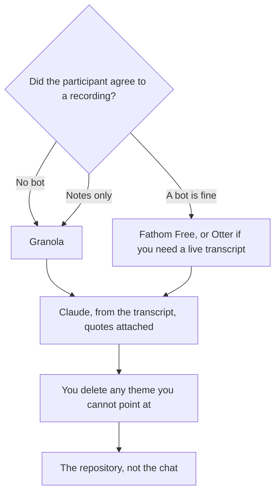

**A UX researcher should buy the tool that matches the artifact: the interview capture the participant agreed to, the synthesis from that transcript, or the picture of a flow you already observed.** A model that invents a quote is not a research tool. It is a finding you cannot defend. This page is the research week. The design file that may follow is [best AI tools for designers](/blog/best-ai-tools-for-designers-2026/). The product partner who will read the note is [best AI tools for product managers](/blog/best-ai-tools-for-product-managers-2026/).

Prices are US list prices excluding tax from directory pages checked October 16, 2026. Published October 24, 2026. We did not score insight quality.

## The artifact, then the tool

| Artifact | Start here | First paid step | The limit |
|---|---|---|---|
| Notes without a bot in a research call | [Granola](/tools/granola/) | Business is $14 a user a month. Basic is free with 30 days of history | You still write the finding |
| A live transcript, and the participant agreed to a bot | [Otter](/tools/otter-ai/) | Free is 300 minutes a month and 30 minutes a conversation. Pro is $8.33 a user annually | Say the bot is there |
| Unlimited recordings, bot allowed | [Fathom](/tools/fathom/) | Free. Premium is $16 a month annually for advanced summaries | The summary can drop a hesitation |
| Synthesis from a transcript you paste | [Claude](/tools/claude/) | Pro is $20, or $17 billed annually | Every theme needs a quote you can find |
| The research repository | [Notion AI](/tools/notion-ai/) | Business is $20 a seat | Plus at $10 is not the full AI tier |
| A flow diagram from notes that are already true | [Figma](/tools/figma/) or [Napkin AI](/tools/napkin-ai/) | Figma Professional Full is $16 a month annually. Napkin Plus is $9 | A diagram is not a finding |

## The interview

Tell the participant what is being captured, and by what, before you start. Consent is the feature. A surprise bot is a different interview.

[Granola](/tools/granola/) does not add a participant. It uses your computer's audio. Basic keeps 30 days of history. Business at $14 removes that cap and adds integrations, including Notion. That is the default for a customer call where a bot would change the answer. The comparison is [Otter vs Granola](/blog/otter-vs-granola-2026/). The card is [Granola pricing explained](/blog/granola-pricing-explained-2026/).

[Fathom](/tools/fathom/) Free is unlimited recordings and summaries when a bot is acceptable. Premium at $16 annually adds advanced summaries and action items. You rarely need the CRM tier for research. Business at $25 annually is a sales feature. The head-to-head is [Fathom vs Fireflies](/blog/fathom-vs-fireflies-2026/).

[Otter](/tools/otter-ai/) is the live transcript. Free's 300 minutes and 30-minute conversation cap are easy to hit in a diary study. Pro at $8.33 a user billed annually raises that to 1,200 minutes and 90 minutes a conversation. The card is [Otter pricing explained](/blog/otter-ai-pricing-explained-2026/). The shelf is [best AI meeting notetakers](/blog/best-ai-meeting-notetakers/).

Read the transcript for the quote you will print. A summary that smooths a contradiction has removed the finding. The habit is [how to summarize meetings with AI](/blog/how-to-summarize-meetings-with-ai-2026/).

## The synthesis and the picture

Paste the transcript, or the quotes you already highlighted, into [Claude](/tools/claude/). Ask for themes that each cite a quote, and a list of themes it could not support. Delete the unsupported ones. Pro is the usage step. The long-document comparison, if the corpus is a folder of studies, includes Gemini Notebook: [Claude vs Gemini for long documents](/blog/claude-vs-gemini-for-long-documents-2026/). The attachment rule is [what AI grounding is](/blog/what-is-ai-grounding-2026/).

[ChatGPT](/tools/chatgpt/) Plus at $20 is the second seat if you also need a diagram or an image in the same month. Do not leave the only copy of the study in the chat. The writing split is [ChatGPT vs Claude for writing](/blog/chatgpt-vs-claude-for-writing-2026/).

[Notion AI](/tools/notion-ai/) Business is the repository if the team already works there. Search across the studies is the reason to pay $20, not a nicer paragraph. The card is [Notion AI pricing explained](/blog/notion-ai-pricing-explained-2026/).

[Figma](/tools/figma/) Professional is $16 a month per Full seat billed annually, with 3,000 AI credits on that seat. Starter is free, with 150 AI credits a day up to 500 a month. Use it for a flow you observed. Do not generate a persona as if it were a participant. The review is [Figma review](/blog/figma-review-2026/).

[Napkin AI](/tools/napkin-ai/) Plus at $9 turns a paragraph into a diagram. Free includes 500 credits a week. Draw it after the paragraph is true. The review is [Napkin AI review](/blog/napkin-ai-review-2026/).

Literature, when the question is "what have papers said," is [Elicit](/tools/elicit/) or [Consensus](/tools/consensus/), not a transcript tool. Elicit Plus is $11 a user a month annually. That aisle is [Perplexity vs Elicit](/blog/perplexity-vs-elicit-for-research-2026/). A case study for marketing, which needs a different permission, is [how to write a case study with AI](/blog/how-to-write-a-case-study-with-ai-2026/).

## FAQ

### What should a UX researcher pay for first?

Granola Basic, if the pain is notes without a bot. Fathom Free, if a bot is fine and you want the recording. Claude Free or Pro, if the pain is synthesis and you will keep quotes. Figma Starter, if the pain is the flow diagram. Notion Business only if Notion is the repository. One of those.

### Can AI write the insights from the recording alone?

It can draft themes. A theme without a quote you can find is not an insight yet. Put the quote under the theme or cut the theme. A participant who said "it depends" is not a participant who loved the feature.

### Is a generated persona acceptable?

As a labeled hypothesis, in a workshop, thrown away if the interviews disagree. As a finding, no. Personas that come from the model and not from the sample will outlive the study. The diagram tools above are for structure, not for inventing people.

### How do I handle a participant who refuses recording?

Take notes. Granola still captures computer audio, so if they refused recording, do not use it either. Your notes are the corpus. Tell Claude only what you wrote down.

## Last verified

October 16, 2026 for Granola, Otter, Fathom, Claude, ChatGPT, Notion, Figma, Napkin, and Elicit prices named above. Published October 24, 2026.

**Sources:** [Granola](https://www.granola.ai/), [Claude pricing](https://claude.com/pricing), [Figma pricing](https://www.figma.com/pricing/).

*Published by Andrew for [AI Tools Optimizer](https://aitoolsoptimizer.com).*

[Granola](/tools/granola/) is in the [meetings and transcription directory](/tools/category/meetings-transcription/). Directory pages may use affiliate links. A purchase through them may earn us a commission at no extra cost to you.
