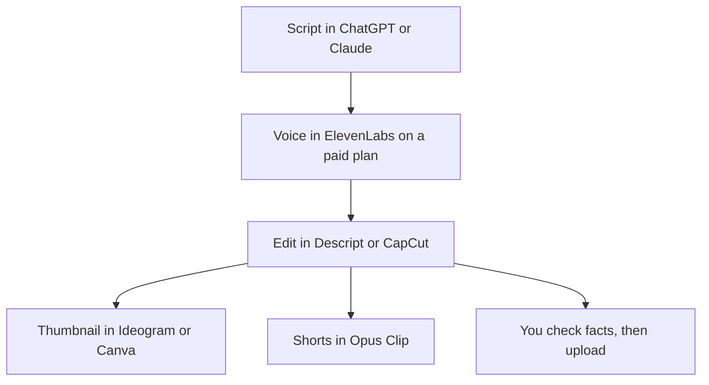

**Buy the tool that removes the bottleneck on the video you already ship every week.** A working channel usually needs a script draft, a voice you can monetize, an editor, a thumbnail with readable words, and a Shorts cut. It does not need a new generator for every step.

Prices are US list prices from vendor pages checked October 16, 2026. Tax and regional app-store prices can differ. Fit labels describe what the product is sold to do. They are not scores from a channel we grew.

Starting from zero, including YouTube's Partner Program rules, is a different article: [how to start a faceless YouTube channel with AI](/blog/start-faceless-youtube-channel-with-ai/). This page is the weekly stack after you already know the series.

## One job, one tool

| Bottleneck | Start here | First paid step |
|---|---|---|
| Outline and a fact list | [ChatGPT](/tools/chatgpt/) or [Claude](/tools/claude/) | Stay on free until a weekly script hits the cap. Plus or Pro is $20/month |
| Narration you will monetize | [ElevenLabs](/tools/elevenlabs/) | Starter is $6/month and is the first plan with a commercial license |
| Cut a talking video by deleting sentences | [Descript](/tools/descript/) | Hobbyist is $16/person/month billed annually for watermark-free 1080p |
| Captions, templates, and a phone edit | [CapCut](/tools/capcut/) | Pro lists at $19.99/month or $179.99/year in the US. The in-app price wins |
| Shorts from a long upload | [Opus Clip](/tools/opusclip/) | Starter is $15/month and removes the watermark |
| Thumbnail words that have to be spelled right | [Ideogram](/tools/ideogram/) | Free is 30 credits a week. Plus is $15/month on yearly billing |
| A thumbnail laid out like a poster | [Canva](/tools/canva/) | Free is enough for many thumbs. Pro is $18/month or $180/year |
| Music you have commercial rights to | [Suno](/tools/suno/) | Pro is $11/month, or $8/month on yearly billing, and includes commercial rights |
| A presenter who is not you on camera | [HeyGen](/tools/heygen/) | Creator is $29/month and removes the watermark |
| B-roll from a prompt | [Runway](/tools/runway/) or [invideo AI](/tools/invideo-ai/) | Runway Standard is $12/month billed annually. invideo Starter is $10/seat/month billed annually |

Voice options are compared in [best AI voice generators](/blog/best-ai-voice-generators/). Generators are in [best AI video generators](/blog/best-ai-video-generators-2026/). The credit math for narration is [ElevenLabs pricing explained](/blog/elevenlabs-pricing-explained-2026/).

## A stack you can price before the next upload

Here is a solo creator who narrates, edits on a computer, and posts two Shorts from each long video.

| Piece | Plan | USD / month |
|---|---|---|
| Script | ChatGPT Free or Claude Free | $0 |
| Voice, commercial | ElevenLabs Starter | $6 |
| Edit | Descript Free while you are under 60 media minutes, otherwise Hobbyist annual | $0 or $16 |
| Shorts without a watermark | Opus Clip Starter | $15 |
| Thumbnail | Ideogram Free or Canva Free | $0 |
| Music, if you need commercial rights | Suno Pro yearly rate | $8 |

That is **$21/month** before an editor upgrade, or **$29/month** with Descript Hobbyist on the annual rate, plus $8 if the bed music has to be licensed through Suno. Suno Free includes 50 credits a day and does not include commercial rights. Do not put Free Suno tracks on a monetized video.

ElevenLabs Free includes 10,000 credits and does not include a commercial license. Starter at $6 is the license, not a quality prize. Creator at $22 is the first tier with Professional Voice Cloning. Read [the ElevenLabs review](/blog/elevenlabs-review-2026/) before you jump to Pro at $99. A clone of a specific person has its own steps in [how to clone a voice with ElevenLabs](/blog/how-to-clone-a-voice-with-elevenlabs/).

## Editing, by the shape of the footage

[Descript](/tools/descript/) is the editor when the video is mostly someone talking and you want the timeline to follow the transcript. Free is 60 media minutes a month and does not require a card. Hobbyist is $16/person/month billed annually or $24 monthly, with 10 media hours, 400 AI credits, and watermark-free 1080p. Creator at $24/person/month annual adds 4K. The plan-by-plan breakdown is the [Descript review](/blog/descript-review-2026/).

[CapCut](/tools/capcut/) is the editor when the job is captions, templates, and a vertical cut, including on a phone. The US reference price for Pro is $19.99/month or $179.99/year. CapCut says the price on the site is a reference and the final price appears after you sign in, and it can differ by region. Believe the number in your account. Details are in the [CapCut review](/blog/capcut-review-2026/).

Use both only if you already do. A channel that lives in one editor should not pay for the other "just in case."

## Shorts, thumbnails, and generated shots

[Opus Clip](/tools/opusclip/) Free includes 60 credits a month, and those clips stop being exportable after 3 days. Starter at $15/month is monthly billing only, with 150 credits and no watermark. Pro is $29/month or $14.50/month billed annually. If you post Shorts every week, Free will fight you. The review is [Opus Clip](/blog/opusclip-review-2026/).

Thumbnails fail when the words are wrong. [Ideogram](/tools/ideogram/) is the generator sold for text in images. Free is 30 credits a week. Plus is $20/month or $15/month if you pay $180 for the year. [Canva](/tools/canva/) is the layout tool when you already know the title and you are placing it on a face or a product. Canva's AI features are reviewed in [Canva Magic Studio](/blog/canva-magic-studio-review-2026/).

[HeyGen](/tools/heygen/) Creator at $29/month is the presenter plan: 1080p and watermark removal. Free is three videos a month, up to one minute each, and it keeps a watermark. Training and course presenters are compared in [HeyGen vs Synthesia](/blog/heygen-vs-synthesia-2026/).

Generated B-roll is optional. [Runway](/tools/runway/) Standard is $12/month billed annually for 625 credits, which Runway equates to about 52 seconds of Gen-4.5. [invideo AI](/tools/invideo-ai/) Starter is $10/seat/month billed annually ($20 monthly) and is a prompt-to-draft tool, not a timeline. The three-way credit comparison for Runway, Kling, and Veo is [Runway vs Kling vs Veo](/blog/runway-vs-kling-vs-veo-2026/). Free tiers that do and do not watermark are in [free AI video generators with no watermark](/blog/best-free-ai-video-generators-no-watermark-2026/).

## A publishing pass that AI does not get to skip

1. Write the claim list before the script. Every number needs a page you can link in the description.
2. Generate the voice on a plan whose license matches the video. Free ElevenLabs is for a private test.
3. Cut the silence and the repeated sentence yourself, even if the editor offers a filler-word button.
4. Read the thumbnail out loud. If a word is misspelled, fix it before you upload.
5. Watch the first three seconds of each Short. A virality score is a sort order.

## FAQ

### What AI tools do YouTubers actually need?

A script assistant you already have for free, a voice plan with a commercial license if you narrate, one editor, and a Shorts tool once you cut clips every week. Thumbnails can stay on a free Ideogram or Canva plan until text or brand layout blocks you.

### Is ElevenLabs required for YouTube?

No. It is the default when you want generated narration and a commercial license, which starts at $6/month. If you record your own voice, skip it and edit in Descript or CapCut.

### Can I use Suno music on YouTube?

Suno includes commercial rights on Pro and Premier, not on Free. Pro showed at $11/month, or $8/month with yearly billing, when we checked. Confirm the license text at checkout before a monetized upload.

## Last verified

October 16, 2026. Plan names and intro prices move. Recheck the vendor page before you subscribe for a year.

**Sources:** [ElevenLabs pricing](https://elevenlabs.io/pricing), [Descript pricing](https://www.descript.com/pricing), [CapCut pricing](https://www.capcut.com/pricing), [Opus Clip pricing](https://www.opus.pro/pricing), [Ideogram pricing](https://ideogram.ai/pricing), [Canva pricing](https://www.canva.com/pricing/), [Suno pricing](https://suno.com/pricing), [HeyGen pricing](https://www.heygen.com/pricing), [Runway pricing](https://runway.com/pricing), [invideo pricing](https://invideo.io/pricing).

Directory pages for these tools may include affiliate links. A purchase through them may earn us a commission at no extra cost to you.
