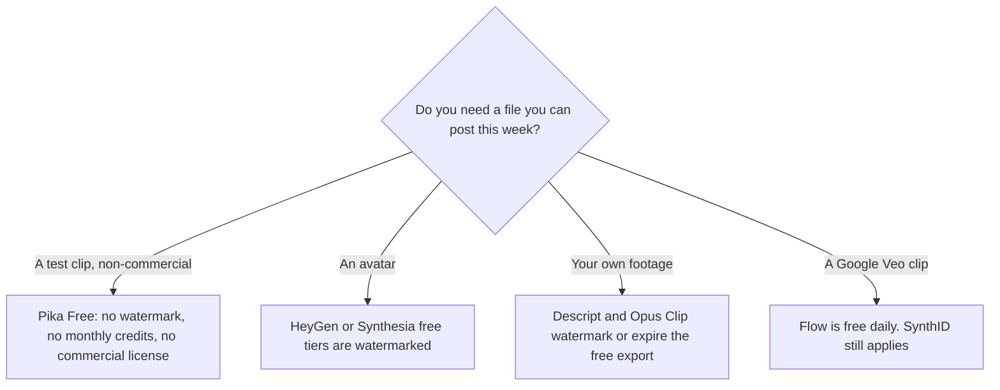

**Only one generator in this directory states that the free plan has no watermark.** [Pika](/tools/pika/) says a free account can use its models with no watermark. That account includes no monthly credits and no commercial license. Several popular "free" video plans do the opposite: they let you generate, then brand the file or expire the export until you pay.

Prices and plan rules below are from vendor pages checked October 16, 2026, plus Google's watermark note for Veo-family outputs as recorded in our Gemini Notebook guide on October 24, 2026. We did not download a test file from every product this week. Where a vendor page did not state a watermark rule, this article does not invent one. "No watermark" here means the vendor said the export is not branded. It does not mean the file is free of an invisible content credential.

The paid landscape is [best AI video generators](/blog/best-ai-video-generators-2026/).

## What each free plan does to the file

| Tool | Free allowance | Watermark, as the vendor describes it | Pay to change that |
|---|---|---|---|
| [Pika](/tools/pika/) | An account, all models, no monthly credits. You buy packs | Pika says Free has no watermark. Commercial use starts on Creator | Creator is $35/month for the commercial license and 3,150 credits |
| [HeyGen](/tools/heygen/) | 3 videos/month, up to 1 minute | Watermark stays until Creator | Creator is $29/month |
| [Synthesia](/tools/synthesia/) | 10 minutes and 500 credits/month | Watermark on Basic | Starter is $29/month billed monthly, shown as $19/month on yearly billing |
| [Descript](/tools/descript/) | 60 media minutes/month, no card | Watermark-free 1080p starts on Hobbyist | Hobbyist is $16/person/month billed annually, or $24 monthly |
| [Opus Clip](/tools/opusclip/) | 60 credits/month. Exports stop working after 3 days | Watermark until Starter | Starter is $15/month, monthly billing only |
| [CapCut](/tools/capcut/) | Templates and basic editing | The pricing page we checked does not publish a watermark rule. Creators do hit a watermark or a locked effect inside the app | Pro lists at $19.99/month or $179.99/year in the US. Read the in-app price |
| [Runway](/tools/runway/) | 125 one-time credits | Not stated on the pricing facts we recorded | Standard is $12/month billed annually |
| [Kling AI](/tools/kling-ai/) | Basic, free, with no monthly credits | Not stated on the pricing facts we recorded | Standard renews at $8.80/month |
| [Google Flow](/tools/google-flow/) | 50 credits/day | Veo, Omni, and Nano Banana outputs include an invisible SynthID watermark. A visible watermark can be turned off by eligible Pro and Ultra users, with exceptions in India, South Korea, and Vietnam | Google AI Plus is $4.99/month |
| [Luma AI](/tools/luma-ai/) | No free plan was listed | Not applicable | Plus is $30/month and includes commercial use |

## Pika is the clean free export, with a thin allowance

Pika's pricing page says every user gets every model, and plans differ by credits and concurrency. Free has no monthly credits. You buy packs. It also says Free has no watermark and no commercial license. Starter is $10/month for 900 credits. Creator is $35/month for 3,150 credits and is where the commercial license starts. Fancy is $95/month. Yearly billing saves up to 20%.

That makes Pika a real answer to "no watermark," and a poor answer to "free monthly production." A free account with nothing to spend still needs a pack before you have a clip. Treat the no-watermark line as a publishing detail, and the pack price as the actual cost. Do not use Free output in ads or client work. The license and the watermark are different rules.

## Avatar tools watermark the free file on purpose

[HeyGen](/tools/heygen/) Free is three videos a month, up to one minute, with Avatar IV. Creator at $29/month is the tier that removes the watermark and adds 1080p, videos up to 30 minutes, and voice cloning, with 600 credits. The review is [HeyGen](/blog/heygen-review-2026/).

[Synthesia](/tools/synthesia/) Basic is 10 minutes and 500 credits a month, and those videos carry a watermark. Starter removes the logo and adds downloads. The yearly price was shown at $19/month against $29 monthly. See the [Synthesia review](/blog/synthesia-review-2026/) and [HeyGen vs Synthesia](/blog/heygen-vs-synthesia-2026/).

If the test is "does this avatar look acceptable," the watermarked file is enough. If the test is "can I post this," it is not.

## Editors and clippers

[Descript](/tools/descript/) Free includes 60 media minutes and does not ask for a card. The watermark-free 1080p export is Hobbyist, at $16/person/month on annual billing. That is an editor for footage you already have, which is why it sits beside generators rather than instead of them. See the [Descript review](/blog/descript-review-2026/).

[Opus Clip](/tools/opusclip/) Free gives you 60 credits, then the clips cannot be exported after 3 days. Starter at $15/month removes the watermark. A content calendar cannot sit on the free plan. See the [Opus Clip review](/blog/opusclip-review-2026/).

[CapCut](/tools/capcut/) is free for basic editing. We did not get a published sentence that says every free export is clean or every free export is branded. The practical check is the one in the [CapCut review](/blog/capcut-review-2026/): export one short on the device you use, and read the paywall if a watermark or a locked effect appears. The US reference price is $19.99/month or $179.99/year, and CapCut says the final price shows up after sign-in.

## Generators whose free pages do not promise a clean file

[Runway](/tools/runway/) Free is 125 credits, once, not a monthly allowance. Standard is $12/month billed annually for 625 credits, about 52 seconds of Gen-4.5 on Runway's own rate. The [Runway review](/blog/runway-review-2026/) covers seconds. It does not claim a watermark policy, and neither does this page.

[Kling AI](/tools/kling-ai/) Basic is free and includes no monthly credits. Standard renews at $8.80/month after a $6.99 first month. See the [Kling review](/blog/kling-ai-review-2026/). No watermark sentence was on the pricing facts we stored.

[Google Flow](/tools/google-flow/) gives everyone 50 credits a day. Veo 3.1 Lite is 10 credits a clip, Fast is 20, and Quality is 100, on the help page we used for the tool profile. Google also documents an invisible SynthID watermark on Veo, Omni, and Nano Banana outputs. Eligible Google AI Pro and Ultra users can turn off a visible watermark, except where Google applies one automatically in India, South Korea, and Vietnam. A daily free clip can still carry SynthID. That is a provenance mark, not a HeyGen-style logo, and it is not a promise of an unmarked file. The model comparison is [Runway vs Kling vs Veo](/blog/runway-vs-kling-vs-veo-2026/).

[Luma](/tools/luma-ai/) did not list a free plan when we checked. Plus is $30/month or $300/year and includes commercial use. It is outside a free-watermark roundup except as the control: some tools do not have a free tier to argue about.

## How to test a watermark in ten minutes

1. Generate the shortest clip the tool allows.
2. Download it, or use the export button the plan actually enables. A preview in the browser is not the file you will upload.
3. Watch the last two seconds and the corners. Then check whether the plan page calls the result commercial.
4. If the only thing wrong is a logo, price the tier that removes it and stop. Do not add a second generator.
5. If you will run ads or client work, read the license. Pika's clean free file is still non-commercial.

## FAQ

### What is the best free AI video generator without a watermark?

Pika is the tool in this directory that says the free plan has no watermark. The same plan has no monthly credits and no commercial license. Budget a credit pack or the $10 Starter plan if you need more than a test, and Creator at $35/month if the clip is commercial.

### Does HeyGen's free plan have a watermark?

Yes. Watermark removal starts on Creator at $29/month. Free is limited to three videos a month, up to one minute each.

### Does Google Flow add a watermark?

Google documents an invisible SynthID watermark on Veo, Omni, and Nano Banana outputs. Turning off a visible watermark is limited to eligible Pro and Ultra users, and not in every country. Flow's 50 daily credits are a real free allowance. They are not a "no watermark" guarantee.

## Last verified

October 16, 2026 for plan prices and the Pika, HeyGen, Synthesia, Descript, and Opus Clip watermark rules. October 24, 2026 for the Google SynthID note cited via our Gemini Notebook plan check. Recheck the vendor page if you are about to publish a client file.

**Sources:** [Pika pricing](https://pika.art/pricing), [HeyGen pricing](https://www.heygen.com/pricing), [Synthesia pricing](https://www.synthesia.io/pricing), [Descript pricing](https://www.descript.com/pricing), [Opus Clip pricing](https://www.opus.pro/pricing), [CapCut pricing](https://www.capcut.com/pricing), [Runway pricing](https://runway.com/pricing), [Kling credit guide](https://kling.ai/pricing), [Google Flow credits](https://support.google.com/flow/answer/16526234), [Google AI subscriptions](https://gemini.google/subscriptions/).

Directory pages may include affiliate links. A purchase through them may earn us a commission at no extra cost to you.
