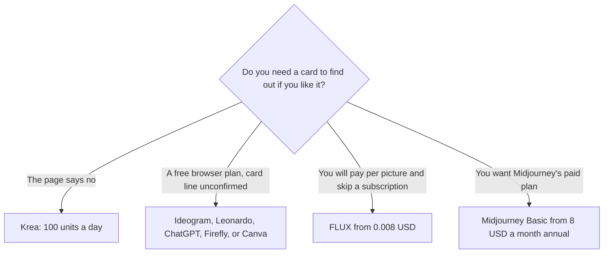

**You can make images in a browser without Midjourney, without Discord, and without paying first.** [Midjourney](/tools/midjourney/) has no free plan. It runs on the web and in Discord, and Basic starts at $10/month or $8/month billed annually. The tools below are the free, website-based options in this directory. One of them, [Krea](/tools/krea/), is the plan that also says no credit card.

Prices were last verified October 16, 2026. This page does not rank which picture looks more like Midjourney. It filters on three practical tests: a $0 generation, a website rather than Discord, and whether the vendor said a card is required. Fit labels are those tests. They are not art scores.

If you are leaving Midjourney because of text, Adobe, or per-image billing, use [Midjourney alternatives](/blog/midjourney-alternatives-2026/). If you are learning prompts, use [the beginner's guide](/blog/ai-image-generators-beginners-guide/). A commercial buying guide is [best AI image generators in 2026](/blog/best-ai-image-generators-2026/).

## The three tests

| Tool | $0 generations | Browser, not Discord | Card, as published |
|---|---|---|---|
| [Krea](/tools/krea/) | 100 compute units a day | Yes | No credit card, stated on the free plan |
| [Ideogram](/tools/ideogram/) | 30 credits a week | Yes | Not stated in our check. Do not assume a card is absent |
| [Leonardo.Ai](/tools/leonardo-ai/) | A free plan for casual use | Yes | Not stated |
| [ChatGPT Images](/tools/dall-e/) | Limited image creation on the free plan | Yes, in ChatGPT | A free account is enough. We did not record a card requirement for Free |
| [Adobe Firefly](/tools/adobe-firefly/) | Limited daily generations | Yes, and in the Firefly mobile apps | An Adobe account. A card requirement for the free tier was not stated |
| [Canva](/tools/canva/) | Limited AI on the free design plan | Yes | Free exists. A card requirement was not stated |
| [FLUX](/tools/flux/) | No free generation on the hosted API | Yes | Pay per image. This fails the free test |
| [Midjourney](/tools/midjourney/) | None | Web and Discord | Every plan is paid |

More generators are in the [image generation directory](/tools/category/image-generation/).

## Krea, the one that clears every test we could verify

[Krea](/tools/krea/) is a multi-model studio: real-time generation, video, upscaling, and an agent. The free plan is 100 compute units a day, with real-time models, the Krea Agent, and Krea 2. The pricing page says no credit card. That is the sentence the rest of this list does not match.

Basic is $9/month or $5/month on yearly billing, with 5,000 units. Krea's own sketch of that allowance is about 64 Nano Banana 2 images or 20 Seedance 2.0 videos. Pro is $35/month or $21/month yearly. Paid plans add a commercial license and unlimited relaxed generations on supported in-house models. If you only needed to know whether the models are worth a subscription, the free daily units are the trial. Stop there until a real project asks for the commercial license.

Krea will not imitate a Midjourney house style on command. It is a different studio that happens to be easy to open.

## Free in the browser, card line unconfirmed

These are worth opening. They are not Discord bots, and they publish a free allowance. Our notes do not include a vendor sentence that says the signup form will not ask for a card. If a form asks, close it. The point of this list is that you should not have to pay to look.

**Ideogram** gives 30 credits a week. It is the free option when the image must contain a real word, which is the job Midjourney is weaker at. Plus is $20/month or $15/month yearly ($180) for 2,400 credits and private generation. Weekly credits reset. They do not roll over into a bank you can save for a launch week.

**Leonardo.Ai** has a free plan aimed at casual use. Essential is $12/month for 8,500 fast tokens. Leonardo is now part of Canva. The full token table is the [Leonardo review](/blog/leonardo-ai-review-2026/). Use it when you want a personal model later. The free plan is for finding out whether the interface fits.

**ChatGPT Images** are included with [ChatGPT](/tools/chatgpt/) Free, with limits. Go at $8/month and Plus at $20/month raise image limits. OpenAI shut down DALL·E 2 and DALL·E 3 in the API on May 12, 2026. The images you make in chat are the newer GPT Image models. The advantage over Midjourney is the follow-up: you can say "change the hat" in the same thread. The limit is the free image cap, which OpenAI describes as limited rather than as a fixed monthly count we can quote.

**Adobe Firefly** gives free users a limited number of daily generations that refresh. Standard is $9.99/month. Firefly is the path when the picture has to live in an Adobe app and you care about Adobe's training-data story. Daily free generations are a taste, not a campaign. The credit math is the [Firefly review](/blog/adobe-firefly-review-2026/).

**Canva** Free includes limited AI inside a design editor, plus a large template library. It is the right free tool when the image is a post or a thumbnail, not a standalone art print. Pro is $18/month or $180/year. See [Canva Magic Studio](/blog/canva-magic-studio-review-2026/).

## What does not belong on a no-card list

**FLUX**, from Black Forest Labs, has no subscription. Hosted images start at $0.008 for FLUX 3 Klein at 768×768, and 1 credit equals $0.01. That is cheaper than Midjourney Basic if you need a handful of pictures. It is not free, and it is not a no-card signup for hosted generation. Some FLUX models are released as open weights you can run yourself, under those models' licenses. A GPU you already own is a different kind of free. Read the license before you assume commercial use.

**Midjourney** itself is the control. There is nothing to "try free" and then cancel. If you want that product, budget Basic. The first month inside the product is [Midjourney for beginners](/blog/midjourney-for-beginners-2026/). Discord is optional. The website is the same generator. Beginners should use the website, which is covered in that guide. Discord is not a workaround for the missing free plan.

## A 20-minute test that does not touch a card

1. Write one prompt you will reuse: subject, setting, light, and "no text" unless you are testing Ideogram.
2. Run it on Krea first, because that free plan states that no card is required.
3. Run the same prompt in Ideogram if the image needs words, and in ChatGPT if you want to edit by talking.
4. Stop when a signup asks for payment details. That tool failed the filter for this article, even if the generation would have been free afterward.
5. Pay only after you have one image you would actually ship, and only for the constraint that blocked you.

## FAQ

### Is there a free Midjourney?

No. Midjourney's plans are paid. Basic is $10/month or $8/month billed annually. The website and Discord are both paid interfaces to that subscription.

### What is the best free alternative that does not need Discord or a credit card?

Krea is the tool whose free plan states all three: daily free units, a website, and no credit card. Ideogram, Leonardo, ChatGPT, Firefly, and Canva are free in the browser. We did not confirm a no-card sentence for those five.

### Is FLUX a free Midjourney alternative?

The hosted API is pay per image, from $0.008, with no monthly fee. That avoids a subscription. It does not avoid paying. Open-weight models can be run on your own hardware under their licenses.

## Last verified

October 16, 2026. Free allowances change, and a signup form can start asking for a card without a pricing-page edit. Recheck before you tell someone the trial is card-free.

**Sources:** [Krea pricing](https://www.krea.ai/pricing), [Ideogram pricing](https://ideogram.ai/pricing), [Leonardo pricing](https://leonardo.ai/pricing/), [ChatGPT pricing](https://chatgpt.com/pricing/), [Adobe Firefly plans](https://www.adobe.com/products/firefly/plans.html), [Canva pricing](https://www.canva.com/pricing/), [FLUX pricing](https://bfl.ai/pricing), [Midjourney](https://www.midjourney.com).

Directory pages may include affiliate links. A purchase through them may earn us a commission at no extra cost to you.
