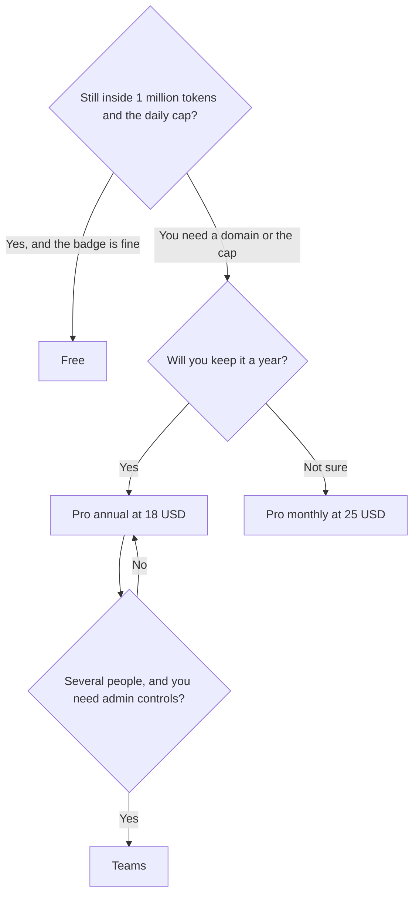

**Bolt.new pricing is a free token pool, then Pro at $25 per month billed monthly or $18 per month billed annually, then Teams at $30 or $27 on those same cycles.** Free includes 1 million tokens a month with a 300,000 token daily cap. Pro starts at 10 million tokens, drops the daily cap, and removes Bolt branding. The annual arithmetic is on the card: $18 times 12 is $216, and $25 times 12 is $300.

Those figures are US list prices from [Bolt's pricing page](https://bolt.new/pricing), read October 24, 2026. The card shows Pro as "$18*/month" with yearly totals of $216 and $300, and Teams as "$27*/month" with yearly totals of $324 and $360. This article reads the lower number as the annual monthly rate and the higher yearly total as twelve months at the monthly rate. Tax can still apply at checkout. The product story is [Bolt.new review](/blog/bolt-new-review-2026/).

An October 16, 2026 directory check had Pro "from $25" billed monthly and "yearly saves up to 28%," without printing the $18. The October 24 page prints both. Twenty-eight percent off $25 is $18. The two reads match.

## The plans

| Plan | Monthly billing | Annual, as a per-month rate | Tokens | What the paywall adds |
|---|---|---|---|---|
| Free | $0 | $0 | 1 million a month, 300,000 a day | Public and private projects, hosting, Bolt branding, 10 MB uploads, 333,000 web requests a month |
| Pro | $25, which is $300 over a year of monthly bills | $18, or $216 for the year | Starts at 10 million a month, no daily cap | Branding removed, custom domain, private sharing, SEO tools, rollover, connectors and MCPs, 100 MB uploads, 1 million web requests |
| Teams | $30 per member, $360 over a year of monthly bills | $27 per member, or $324 for the year | Starts at 10 million per member | Centralized billing, admin controls, org sharing, private NPM registries, design-system knowledge, priority support, SSO |
| Enterprise | Custom, billed by consumption | Custom annual contract | Custom, described as unlimited tokens priced by consumption | SOC 2, SSO, dedicated infrastructure, invoice terms |

Pro annual is $84 less per year than staying on monthly ($300 minus $216). Teams annual is $36 less per member per year than monthly ($360 minus $324). The Teams discount is smaller than Pro's. Buy the annual Pro card when the app is staying up. Stay monthly when the project is a test you might delete.

The compare table lists Teams tokens as "starts at 10 million per member." This article treats the Teams price as per member for that reason, and because the October 16 directory card said $30 per member. If your checkout quotes a flat workspace price, the checkout wins.

## What the tokens are paying for

Bolt's own FAQ, on the page read October 24, says most token use comes from syncing the project files to the model. A larger project spends more tokens per message. The free daily cap, 300,000, can stop you mid-day even when the monthly million is not gone. Pro removes that daily cap.

Paid plans roll unused tokens for one additional month while the subscription stays active. That rollover was also on the October 16 card, dated to a July 1, 2025 change. Free tokens do not get that line. Higher token tiers exist above the 10 million start. The page says Pro "starts at" those prices. A heavier tier costs more. Read the tier you select. This article prices the entry card only.

A custom domain, the removal of Bolt branding, and SEO controls are Pro features. Free includes hosting and, on the October 24 card, databases. Expanded database capacity and a choice of database provider are marked as Pro. Do not assume the free database limits match Pro. The page points at those as paid expansions.

## Bolt next to the other builders

[Lovable](/tools/lovable/) Pro is $25 a month for 100 credits, or $250 a year, on the October 16 card. The units are different. A Bolt token is not a Lovable credit. Lovable's free tier is 5 build credits a day, up to 30 a month, which is a smaller free month than Bolt's 1 million tokens. Unlimited Lovable members share one pool. Bolt Teams is a per-member price with per-member tokens. The switch guide is [Lovable alternatives](/blog/lovable-alternatives-2026/). The three-way is [Lovable vs Bolt vs Replit](/blog/lovable-vs-bolt-vs-replit/).

[v0](/tools/v0/) Plus is $30 per user per month. Use it for UI in a Vercel project. [Replit](/tools/replit/) Starter is free, and its paid dollar pairs are a separate page: [Replit Agent pricing explained](/blog/replit-agent-pricing-explained-2026/). [Cursor](/tools/cursor/) is the editor once a developer owns the repo. Plus is $8 a month on the help page read October 24, 2026.

What a token is, as a unit, is [what AI tokens are](/blog/what-are-ai-tokens-explained-2026/). Bolt's meter is that unit applied to a project sync, which is why a bigger codebase surprises people who budgeted for "a few prompts."

## FAQ

### How much does Bolt.new Pro cost?

$25 per month if you pay month to month, or $18 per month billed annually, which is $216 for the year. The entry Pro card starts at 10 million tokens a month and has no daily cap. Higher token tiers cost more.

### Is Bolt free?

Yes. Free includes 1 million tokens a month, a 300,000 token daily limit, public and private projects, hosting, and Bolt branding. There is no credit card on that plan, according to the pricing page.

### Do tokens roll over?

On paid plans, unused tokens roll over for one extra month while the subscription is active. The October 24 compare table marks rollover as included on Pro, Teams, and Enterprise, and absent on Free.

### Is Teams $27 or $30?

Both, on different cycles. The card shows $27 per month with a $324 yearly total, and a $360 yearly total beside it. $27 times 12 is $324. $30 times 12 is $360. Read the toggle before you send the invoice. Tokens on that row are listed per member.

## Last verified

October 24, 2026, from bolt.new/pricing. Lovable and v0 comparison prices are from directory pages checked October 16, 2026. Published October 24, 2026.

**Sources:** [Bolt.new pricing](https://bolt.new/pricing), [Bolt.new](https://bolt.new).

*Published by Andrew for [AI Tools Optimizer](https://aitoolsoptimizer.com).*

[Bolt.new](/tools/bolt-new/) is in the [coding directory](/tools/category/coding/). Directory pages may use affiliate links. A purchase through them may earn us a commission at no extra cost to you.
