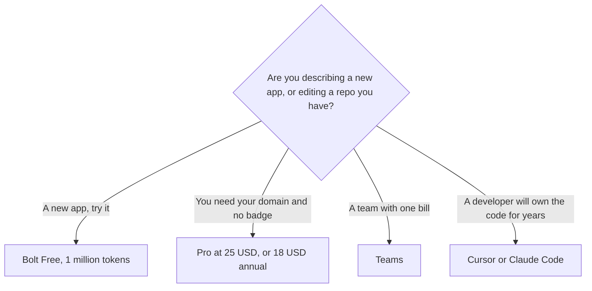

**[Bolt.new](/tools/bolt-new/) is StackBlitz's browser app builder.** You describe a site or a web app, Bolt generates the project, and Bolt Cloud can host it. Pro is $25 a month, or $18 a month when you pay $216 for the year. The free plan is real: 1 million tokens a month, with a 300,000 token daily cap, and Bolt's branding stays on the site.

Those figures were read from Bolt's pricing page on October 24, 2026. The Pro card prints $18 a month and the totals $216 and $300 a year. $300 is twelve months at $25. $216 is twelve months at $18, which is a 28% cut. Teams prints $27 a month and the totals $324 and $360 a year, so the monthly Teams rate is $30. The token table says Teams starts at 10 million tokens per member. We did not build a production app for this review. The three-way builder comparison is [Lovable vs Bolt vs Replit](/blog/lovable-vs-bolt-vs-replit/).

## The plans

| Plan | What the page charges | Tokens and the limits that matter |
|---|---|---|
| Free | $0 | 1 million tokens a month, 300,000 a day. Branding on. 10 MB uploads. 333,000 web requests a month |
| Pro | $25/month, or $18/month billed annually ($216/year) | From 10 million tokens a month, no daily cap, rollover. Branding off. Custom domain. 100 MB uploads. 1 million web requests |
| Teams | $30/month, or $27/month billed annually ($324/year) | From 10 million tokens per member. Central billing, admin controls, SSO on the comparison table |
| Enterprise | Custom | Unlimited tokens, priced by consumption. SOC 2, audit logs, a dedicated manager |

The invoice is [Bolt.new pricing explained](/blog/bolt-new-pricing-explained-2026/).

Bolt's FAQ says most token use is syncing the project to the model, so a larger project spends more tokens per message. "10 million tokens" is not a count of features you can ship. Paid tokens roll over. The page says rollover is included on Pro. Use a week of Free on a real project before you treat the Pro pool as plenty.

## What the builder is for

Bolt is for a founder, marketer, or developer who wants a working web app in the browser and is willing to read the diff. Hosting, a database, and a custom domain are the reasons Pro exists. Free can host, with branding and a lower request cap. If the job is "a landing page I will not maintain," either Bolt or [Lovable](/tools/lovable/) can do it. Lovable's entry paid tier also starts at $25 a month. Finish in the builder you started. Running both on the same page is two bills.

If a developer will own the repository for years, leave the builder. [Cursor](/tools/cursor/) and [Claude Code](/tools/claude-code/) are the editor path, compared in [Cursor vs Claude Code vs Codex](/blog/cursor-vs-claude-code-vs-codex-2026/). [GitHub Copilot](/tools/github-copilot/) is the GitHub-native seat, at $10, reviewed separately. Bolt is a poor substitute for those when the code already exists.

Enterprise is the plan with SOC 2, audit logs, and consumption pricing. A Pro seat does not include that list. Do not describe Pro as the compliance tier because SSO appears on Teams in the comparison table.

## Who should pay

**Stay on Free** until the daily token cap or the Bolt badge is the blocker. **Pay for Pro** when the app needs your domain and you have watched a week of token use. Annual is the cheaper rate if you will still be in Bolt in month two. **Pay for Teams** when more than one person needs an allotment and an admin. **Do not buy Bolt** to avoid reading what the agent changed before you attach payments.

More of the coding shelf is in [best AI coding assistants](/blog/best-ai-coding-assistants-2026/).

## FAQ

### Is Bolt.new free?

Yes. Free includes 1 million tokens a month, a 300,000 token daily limit, public and private projects, and hosting with Bolt branding. No credit card, on the pricing page.

### How much is Bolt Pro?

$25 a month, or $216 a year ($18 a month). The entry paid tier includes 10 million tokens a month, no daily cap, and removal of Bolt branding.

### Do unused tokens roll over?

On Pro, Teams, and Enterprise, the comparison table says unused tokens roll over. Free does not list rollover.

## Last verified

October 24, 2026, from Bolt's pricing page. Token efficiency changes, by Bolt's own FAQ. Recheck the pool if a project starts spending faster than the first week.

**Sources:** [Bolt pricing](https://bolt.new/pricing), [Bolt.new](https://bolt.new).

[Bolt.new](/tools/bolt-new/) is in the [coding directory](/tools/category/coding/). Directory pages may use affiliate links. A purchase through them may earn us a commission at no extra cost to you.
