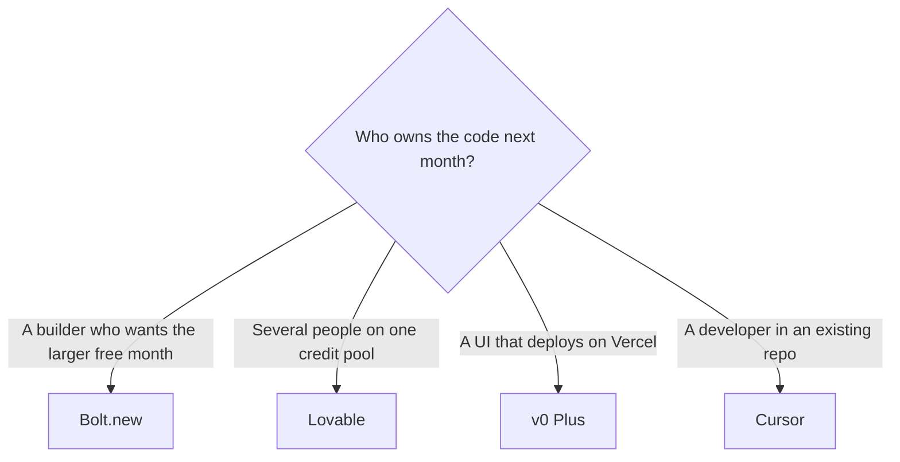

**Choose Bolt.new for a larger free token pool and hosting in the same tab, Lovable when several people should share one credit pool without a per-seat price, and v0 when the UI should land on Vercel.** All three turn a prompt into a web app. The invoices measure different units, so a lower headline price is not a cheaper month until you run the same prompt.

The Replit version of this shelf is [Lovable vs Bolt vs Replit](/blog/lovable-vs-bolt-vs-replit/). Leaving Lovable for any of them is [Lovable alternatives](/blog/lovable-alternatives-2026/). Bolt's card is [Bolt.new pricing explained](/blog/bolt-new-pricing-explained-2026/). v0's card is [v0 pricing explained](/blog/v0-pricing-explained-2026/).

Bolt's prices below are from bolt.new/pricing read October 24, 2026. v0's are from v0.app/pricing the same day. Lovable's are from the directory page checked October 16, 2026. Published October 24, 2026. We did not score the apps these tools generate.

## The meter

| | Bolt.new | Lovable | v0 |
|---|---|---|---|
| What you are building | A hosted web app from chat | A web app from chat, credits shared by unlimited members | UI and full-stack apps that deploy to Vercel |
| Free | 1 million tokens a month, 300,000 a day, Bolt branding | 5 build credits a day, up to 30 a month, plus 20 Cloud credits | $5 one-time credits for new users, 7 messages a day |
| First paid step | Pro $25 month to month, or $18 a month billed annually ($216 a year), from 10 million tokens | Pro $25 a month for 100 credits, or $250 a year | Plus $30 per user per month, with $30 of monthly credits |
| How teammates are billed | Teams is $30 per member month to month, or $27 billed annually, tokens listed per member | Unlimited members on the owner's credit pool | Per user |
| Take the code to an editor | Yes, and you should | Yes, and you should | GitHub sync is on the free card |

## What the dollars buy

Bolt Pro annual is $84 less per year than twelve months at $25 ($300 minus $216). Free still includes hosting, and the October 24 card includes a daily cap that stops you before the monthly million is gone. Pro removes that daily cap and the Bolt badge. A token, as a unit, is [what AI tokens are](/blog/what-are-ai-tokens-explained-2026/). Bolt's own FAQ says a lot of token use is syncing the project to the model, so a bigger project costs more per message. The product page is [Bolt.new review](/blog/bolt-new-review-2026/).

Lovable refuses to charge per seat. Five people prompting on Pro share 100 credits. The directory's October 16 examples put a simple style change near 0.50 credits and a landing page with images near 1.70. Unused monthly credits expire two months after they are issued. Business starts at $50 a month, or $500 a year, for 100 credits, when you need the team and security controls on that card. The review is [Lovable review](/blog/lovable-review-2026/).

v0 Plus matches the seat price to a credit grant: $30 per user and $30 of monthly credits, plus $2 of daily credits on login, on the page read October 24, 2026. Business is $100 per user and, on the lines we could read, still includes $30 of monthly credits. You are paying for training opt-out by default, shared chats, and centralized billing on vercel.com. The free plan's 7-message day is a sketch. The review is [v0 review](/blog/v0-review-2026/).

A Bolt token, a Lovable credit, and a v0 dollar of credits are not interchangeable. Run one prompt you already care about on the free tier of each, and write down what the meter did.

## When the fourth tool is the real answer

[Replit](/tools/replit/) is the cloud IDE on this shelf. Starter is free. The October 24 pricing page showed paid pairs at $20 ($18 billed annually) and $100 ($90 billed annually). Those pairs are explained in [Replit Agent pricing explained](/blog/replit-agent-pricing-explained-2026/). Pick Replit when you want a database, a console, and a publish button more than you want a chat that emits a repo.

[Cursor](/tools/cursor/) is the editor once a developer owns the repository. Plus is $8 a month, or $80 a year, on the help page read October 24, 2026. The ladder is [Cursor pricing explained](/blog/cursor-pricing-explained-2026/). Scaffold in Bolt, Lovable, or v0. Maintain in Cursor. Paying all four every month is how a prototype becomes a platform budget. Founders picking a first build tool can start from [best AI tools for founders](/blog/best-ai-tools-for-founders-2026/).

## FAQ

### Which is cheapest?

Bolt and Lovable both list a $25 monthly Pro. Bolt's annual rate on October 24 was $18 a month ($216 a year). Lovable's annual Pro is $250 a year for 100 credits, about $21 a month if you spread it. v0 Plus is $30 per user. The free months differ more than the paid headlines: Bolt's 1 million tokens is the one to try first if you are still deciding.

### Does v0 charge per teammate?

Yes. Plus and Business are per user. Lovable does not charge per member. Bolt Teams is priced per member on the October 24 card.

### Can I start on v0 and move the code?

The free card lists GitHub sync and deploy to Vercel. Export early. A host is convenient until the person who has to maintain the app cannot read the diff.

### Is this the same choice as Lovable vs Bolt vs Replit?

Same family, different third tool. Use that article when the cloud IDE is the question. Use this one when the question is Vercel and a per-user credit grant.

## Last verified

October 24, 2026 for Bolt's pricing page, v0's pricing page, Replit's price pairs, and Cursor's $8 Plus price. October 16, 2026 for Lovable's plan structure. Published October 24, 2026.

**Sources:** [Bolt.new pricing](https://bolt.new/pricing), [Lovable pricing](https://lovable.dev/pricing), [v0 pricing](https://v0.app/pricing).

*Published by Andrew for [AI Tools Optimizer](https://aitoolsoptimizer.com).*

[Bolt.new](/tools/bolt-new/), [Lovable](/tools/lovable/), and [v0](/tools/v0/) are in the [coding directory](/tools/category/coding/). Directory pages may use affiliate links. A purchase through them may earn us a commission at no extra cost to you.
