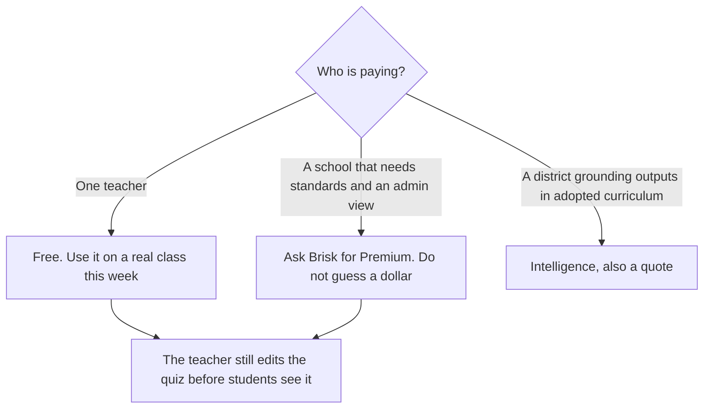

**Brisk Teaching is free for an individual teacher. Premium for schools and Intelligence for districts are custom-priced, and this page does not invent those quotes.** Free includes a Chrome and Edge extension, 20+ tools, and standard models, with self-serve support. Premium moves to 35+ tools, state standards and rubrics, turbo models, unlimited usage, an admin dashboard, and CSM support. Intelligence adds adopted curriculum, pacing, and scope-and-sequence grounding, plus a dedicated CSM.

There is no separate Brisk review on this site yet. The classroom shelf is [best AI tools for teachers](/blog/best-ai-tools-for-teachers-2026/). The other teacher-platform bill is [MagicSchool pricing explained](/blog/magicschool-pricing-explained-2026/). A student tutor with a published family price is [Khanmigo](/tools/khanmigo/), below.

Prices are from Brisk's plans page as recorded in the directory on October 16, 2026. The school rows have no USD figure because Brisk does not publish one there. Published October 24, 2026. We did not score lesson quality. This page is not a privacy certification.

## The three rows

| Plan | Price | Who | What the card adds |
|---|---|---|---|
| Free | $0 | Individual teachers | Chrome and Edge extension, 20+ tools, standard models, self-serve support |
| Premium | Custom | Schools and districts | State standards and rubrics, 35+ tools, turbo models, unlimited usage, admin dashboard, CSM support |
| Intelligence | Custom | Districts | Everything in Premium, plus adopted curriculum, pacing, and scope-and-sequence grounding, and a dedicated CSM |

A year of Free is $0. A year of Premium is whatever the quote says. Multiplying a rumor by the number of teachers is how a budget lies. Ask for the quote in writing, including whether the price is per teacher, per school, or per district, and what "unlimited usage" excludes.

## What Free is for

Free is the plan that matches the product's shape: a button inside Google Docs, Slides, YouTube, PDFs, and the LMS, not a new place to move the class. The directory describes 30+ tools across the product, and the free row as 20+ of them. The gap is part of why a school pays. Do not assume a specific tool is on Free until you see it in the extension.

Use Free to turn a text you already assigned into a quiz or a leveled reading, then edit it. Brisk says materials can be generated in 50+ languages. A translation still needs a speaker of that language before it goes home. Feedback tools such as Glow and Grow are meant to keep a teacher's voice. They are a draft. One personal sentence is the difference between a comment and a template.

Brisk Boost, the student-facing activities, is described as teacher-guided, with admin-controlled access windows on school plans. Treat student access as a school decision, not as a button an individual teacher should open for a whole roster without an administrator.

The directory records a 95 percent Common Sense Privacy Rating as Brisk's own report. That is a claim to read, not a score this site reproduced. School plans mention custom data privacy agreements and rostering. Ask for those documents before student work moves.

## When a published price is the other product

**MagicSchool Plus** is $8.33 per user a month billed annually, or $12.99 billed monthly, for teachers who want that platform's paid individual tier. Free exists there too. The invoice is [MagicSchool pricing explained](/blog/magicschool-pricing-explained-2026/).

**Khanmigo** is free for teachers on its card, and $4 a month or $44 a year for learners and families. That is a tutor tied to Khan Academy, not a Docs extension. Use it when the student is the user. Use Brisk when the teacher is producing materials.

**Quizlet** has a free tier for flashcards. The Plus dollar was not confirmed on the directory card, so this page does not print one. Use it for practice sets, not for a lesson plan inside a Doc.

A district that wants both a teacher extension and a student tutor should budget them as two quotes. One pilot does not include the other.

## FAQ

### Is Brisk really free for teachers?

Yes, on the plans page recorded October 16, 2026, for an individual teacher, via Chrome or Edge. Schools that want the admin and standards rows buy Premium or Intelligence. "Free for teachers" is not "free for the district rollout."

### How much is Premium?

This site does not know. The price is custom. Email the quote to finance with the seat definition and the privacy terms. Do not use a figure from a blog that is not Brisk's.

### Does Free include every tool?

The card says 20+ tools on Free and 35+ on Premium, against a product description of 30+ tools. Those counts are the recorded ranges. Open the extension and see the tool you need. If it is absent, that is the Premium conversation, not a bug you should route around with a personal chatbot full of student work.

### Is Brisk a student chatbot?

Student use is Brisk Boost, described as teacher-guided, with school controls on the paid plans. It is not the same product as a family tutor. If you want a Socratic tutor for a child at home, read Khanmigo's learner price and its own terms.

## Last verified

October 16, 2026, from Brisk's plans page as recorded in the directory. Premium and Intelligence had no public USD price on that check. Published October 24, 2026.

**Sources:** [Brisk plans](https://www.briskteaching.com/plans), [MagicSchool pricing](https://www.magicschool.ai/pricing), [Khanmigo](https://www.khanmigo.ai/).

*Published by Andrew for [AI Tools Optimizer](https://aitoolsoptimizer.com).*

[Brisk Teaching](/tools/brisk-teaching/) is in the [education directory](/tools/category/education/). Directory pages may use affiliate links. A purchase through them may earn us a commission at no extra cost to you.
