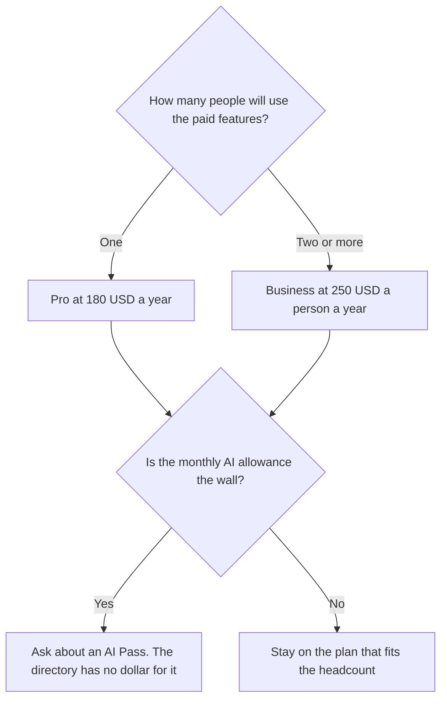

**Canva's AI price is the plan you were already choosing: Free, Pro for one person, or Business per person.** Pro is $18 a month or $180 a year. Business is $25 a person a month or $250 a person a year. Paid plans get a larger monthly AI allowance, Pro at 10 times Free and Business at 20 times Free. Some standard AI tools do not count toward that allowance. Enterprise is custom.

Magic Studio is the AI layer inside those plans, not a fourth subscription with its own sticker on the directory card. The product page is [Canva Magic Studio review](/blog/canva-magic-studio-review-2026/). The editor comparison is [Canva vs Adobe Express for AI design](/blog/canva-vs-adobe-express-for-ai-design-2026/). The interface tool is [Figma AI pricing explained](/blog/figma-ai-pricing-explained-2026/).

Prices are US dollars before tax, from Canva's pricing page as recorded in the directory on October 16, 2026. Published October 24, 2026. We did not score designs.

## The plans

| Plan | What you pay | AI allowance on the card | What you did not get |
|---|---|---|---|
| Free | $0 | Limited | Premium assets, the 10x allowance, a team admin console |
| Pro | $18 a month or $180 a year, one person | 10 times Free | A second person. Pro is one person |
| Business | $25 a person a month or $250 a person a year | 20 times Free, plus AI top-ups | A published Enterprise price |
| Enterprise | Custom | Ask sales | A number this page can quote |
| K-12 and eligible nonprofits | Most premium features free, if you qualify | Confirm with Canva | A discount you can assume for a normal company |

Monthly Pro is $18 × 12 = $216 if you forget to switch. Annual is $180. The $36 gap is the toggle, the same shape as other seats on this site. Business monthly is $25 × 12 = $300 a person, against $250 annual. Quote the billing cycle you will actually leave on.

## What the allowance is

The directory says some standard AI design tools, such as Translate and Magic Write, can be used without counting toward the monthly AI allowance. Other AI features use the allowance. Pro is 10 times Free. Business is 20 times Free. This page does not print Free's raw credit count, because the directory describes the paid plans as multiples and does not give the Free number as a standalone integer. Do not invent "500 credits" to make the multiple look precise.

An AI Pass add-on exists at extra cost. The October 16 card does not print the Pass price. If a salesperson quotes one, write it down. Do not budget a number from a forum.

Background remover, Magic Resize, and Brand Kits are the usual reasons to leave Free, alongside premium templates and assets. Free already includes the editor, 1.6 million-plus templates, and 4.7 million-plus assets. If those are enough, the AI allowance is not a reason to pay.

Five people on Business annual is 5 × $250 = $1,250 a year. Five people cannot share one Pro login. The card says one person.

## The neighbors

[Adobe Express](/tools/adobe-express/) Premium is $9.99 a month with 250 Firefly generative credits. That is a different meter. A year of monthly Express at that rate is not automatically the team plan. Express teams pricing varies on the directory card. If you already pay for Creative Cloud, Express Premium is often included. Check before you add Canva. The Firefly card is [Adobe Firefly pricing explained](/blog/adobe-firefly-pricing-explained-2026/).

[Figma](/tools/figma/) is the interface tool. Professional Full seats start at $16 a month billed annually, with AI credits that are Figma's, not Canva's. Do not buy Canva Business to design a product UI.

[Gamma](/tools/gamma/) Plus is $9 a seat a month when the artifact is a deck and you do not need the Canva template pile. The card is [Gamma pricing explained](/blog/gamma-pricing-explained-2026/). The format choice is [Gamma vs Canva for presentations](/blog/gamma-vs-canva-presentations/).

A pure image studio, if the job is no longer a template, is [Midjourney vs Leonardo](/blog/midjourney-vs-leonardo-2026/).

## Who should pay

Pay for Pro when one person hits background removal, resize, or the free AI limit every week. Pay for Business when a second person needs the same paid features, or you need team admin. Stay on Free when the templates are enough and the AI use is occasional. Ask Canva about education or nonprofit pricing before a school or a charity pays the company rate. Those programs are real on the card. They are not automatic.

## FAQ

### Is Magic Studio a separate subscription?

On the directory card, the AI allowance is part of Free, Pro, and Business. There is an add-on for people who exhaust the allowance. There is not a "Magic Studio plan" with its own published price in the table this site recorded. Buy the Canva plan. Then look at the add-on if the allowance is the thing that ran out.

### Does Pro include a team?

No. Pro is one person. Business is the per-person team price. Sharing a Pro password is not a team plan.

### How many AI images do I get?

The card speaks in multiples of Free, not in a public image count this page can quote. Watch the allowance in the product during a normal week, then decide. A multiple without your own usage is not a budget.

### Is Canva Business the same as Figma Organization?

No. Business is a template-editor team plan at $250 a person a year. Figma Organization is an interface-design plan at a different seat price. The head-to-head is [Figma AI vs Canva Magic Studio](/blog/figma-ai-vs-canva-magic-studio-2026/).

## Last verified

October 16, 2026 for Canva, Adobe Express, Figma, and Gamma prices named above. The AI Pass dollar was not on the card. Published October 24, 2026.

**Sources:** [Canva pricing](https://www.canva.com/pricing/), [Canva](https://www.canva.com), [Adobe Express pricing](https://www.adobe.com/express/pricing).

*Published by Andrew for [AI Tools Optimizer](https://aitoolsoptimizer.com).*

[Canva](/tools/canva/) is in the [design directory](/tools/category/design/). Directory pages may use affiliate links. A purchase through them may earn us a commission at no extra cost to you.
