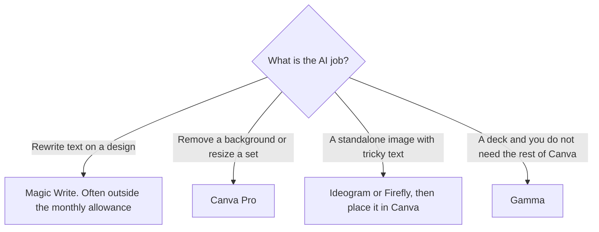

**Canva's AI tools are an allowance inside a design editor, not a separate Magic Studio subscription.** Canva now groups them under Canva AI: Magic Write, image generation, background removal, translation, Magic Resize, and related helpers. Free includes limited AI. Pro is $18/month or $180/year for one person and lists a 10× AI allowance versus Free. Business is $25 per person per month or $250 per person per year and lists 20×.

Prices are US list prices before tax, from Canva's pricing page, checked October 16, 2026. Canva says fair-use limits apply and features change. We did not score design quality. This review is about which AI jobs sit on which plan.

Slide tools that overlap Canva are compared in [Gamma vs Canva for presentations](/blog/gamma-vs-canva-presentations/). This page is the AI layer across posts, docs, video, and print, not the deck bake-off.

## What each plan does to the AI allowance

| Plan | US price | AI allowance, as Canva describes it | The design features people buy with it |
|---|---|---|---|
| Free | $0 | Limited. Some standard tools, including Translate and Magic Write, can be used abundantly without counting toward the allowance | Editor, 1.6M+ templates, 4.7M+ assets |
| Pro | $18/month or $180/year | 10× Canva Free. One person | Premium templates and assets, background remover, resize, translate, 100 GB, Brand Kit |
| Business | $25/person/month or $250/person/year | 20× Canva Free, plus AI top-ups | Team admin, approvals, ad insights, 500 GB, 10% off print |
| Enterprise | Custom | Contract | Security and admin |

The invoice is [Canva Magic Studio pricing explained](/blog/canva-magic-studio-pricing-explained-2026/).

An AI Pass add-on exists for heavier use. We did not record its price, so it is not in the table. K-12 schools and eligible nonprofits can get most premium features free. That is an organization grant. A personal Gmail account does not inherit it.

## Magic Write, images, and the tools that actually change the file

**Magic Write** drafts and rewrites text inside the design. Canva says Translate and Magic Write can be used abundantly without counting toward the monthly AI allowance. If your AI use is headlines and captions, Free may be the whole product. You still edit the claim. Magic Write does not know this month's price or your refund policy.

**Image generation** spends the allowance. Canva is a convenient place to make a background you will crop into a template. It is a weaker place to be your only image model, especially when the picture must contain a spelled-out word. [Ideogram](/tools/ideogram/) Free is 30 credits a week and is built for text. [Adobe Firefly](/tools/adobe-firefly/) Standard is $9.99/month with unlimited standard images. The production comparison is [best AI image generators](/blog/best-ai-image-generators-2026/). Generate the difficult still elsewhere, then drop it into Canva.

**Background Remover and Magic Resize** are the Pro features that show up in real weeks: a product cutout, and one design turned into a story, a post, and a banner. If you are doing that by hand on Free, Pro at $180 a year is the calculation. $180 is $15 a month across the year, against $18 month to month.

**Brand Kit** on Pro stores logos, colors, and fonts for one person. Business is what you buy when a second person must use them under an admin. Pro cannot be shared. A "team" on one Pro login is outside the plan.

**Canva AI 2.0 and connectors** are the newer layer that reaches other tools. Treat connectors as a convenience on top of the allowance, not as a Zapier replacement. Workflow automation is [how to automate work with Zapier and Make](/blog/how-to-automate-work-with-zapier-and-make/).

Pro also includes access to Affinity with AI, on the note in our Canva profile. If you wanted a desktop design suite, confirm what that access includes at signup. This review does not turn that line into a full Affinity license description we did not read.

## Canva versus the tools next to it

| Job | Stay in Canva | Leave Canva |
|---|---|---|
| Social posts, flyers, simple video, a Brand Kit | Pro or Business | |
| A presentation and almost nothing else | Free or Pro can do it | [Gamma](/tools/gamma/) Plus is $9/seat/month if the deck is the whole job. See [presentation makers](/blog/best-ai-presentation-makers/) |
| Commercially framed generative stills inside Adobe | | [Firefly](/tools/adobe-firefly/) or [Express](/tools/adobe-express/) Premium at $9.99/month with 250 credits |
| Interface design | | [Figma](/tools/figma/) Starter is free, with AI credits capped |
| A custom-trained look for a game or a campaign | | [Leonardo](/tools/leonardo-ai/), which Canva owns. See the [Leonardo review](/blog/leonardo-ai-review-2026/) |

Leonardo being part of Canva does not merge the bills. A Leonardo Essential plan at $12/month is a token system. Canva Pro is a design seat. Buy the one you open.

## Who should pay for the AI, not just the templates

**Stay on Free** if you design a few posts a month, Magic Write covers the captions, and you do not need background removal or bulk resize. The template library on Free is already large: 1.6 million-plus templates and 4.7 million-plus assets, by Canva's figures.

**Buy Pro** if you are one person and the week includes cutouts, resizing, premium stock, or a Brand Kit. Try the Pro trial on a real set of sizes before you pay for the year. Canva offers a trial of Pro and Business.

**Buy Business** when a second paid person needs admin, approvals, or the larger allowance. Five people at $250 a year is $1,250 a year. That is the number to put next to "we could share a login," which the Pro terms do not allow.

**Use Education or a nonprofit grant** if you qualify, instead of paying Pro out of pocket. Teachers comparing classroom tools should also read [best AI tools for teachers](/blog/best-ai-tools-for-teachers-2026/). Canva is the layout tool in that stack, not the lesson planner.

## FAQ

### Is Canva Magic Studio a separate product?

Canva markets the AI features under Canva AI. Older pages and tutorials still say Magic Studio or Magic Write. You do not buy a second subscription called Magic Studio. The allowance is part of Free, Pro, or Business.

### How much is Canva Pro?

In the US, before tax, Pro is $18 a month or $180 a year for one person. Business is $25 per person a month or $250 per person a year.

### Does Magic Write use up the AI allowance?

Canva says some standard tools, including Magic Write and Translate, can be used abundantly without counting toward the monthly allowance. Other AI features, including a lot of image generation, do count. Pro lists 10× Free's allowance and Business lists 20×.

## Last verified

October 16, 2026. Recheck [Canva pricing](https://www.canva.com/pricing/) before you move a team onto Business. The in-country price can differ from this US list.

The [Canva](/tools/canva/) directory page may include an affiliate link. A purchase through it may earn us a commission at no extra cost to you.
