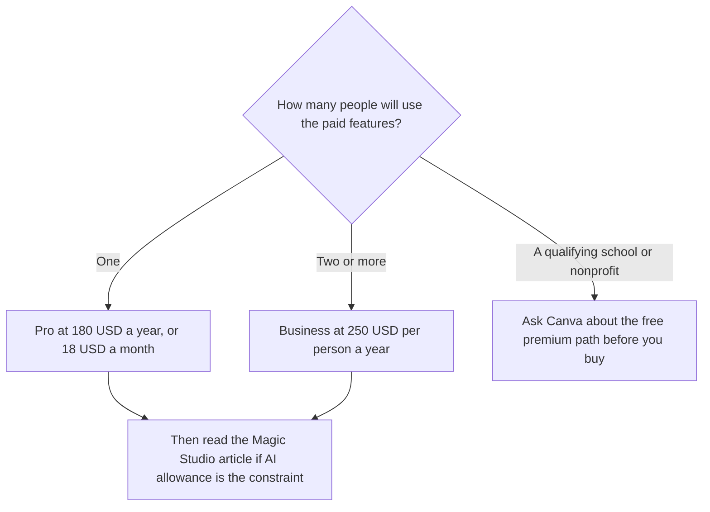

**Canva Pro is $18 a month or $180 a year for one person. Canva Business is $25 per person per month or $250 per person per year. Free is $0. Enterprise is custom.** The mistake is treating Pro as a team plan. The card says only one person can use a Pro account. The AI allowance, Pro at 10 times Free and Business at 20 times Free, is the Magic Studio meter. This page is the seat, the storage, and who is allowed to share.

That AI meter is [Canva Magic Studio pricing explained](/blog/canva-magic-studio-pricing-explained-2026/). The product page is [Canva Magic Studio review](/blog/canva-magic-studio-review-2026/). The other template bill is [Adobe Express pricing explained](/blog/adobe-express-pricing-explained-2026/). The editor comparison is [Canva vs Adobe Express for AI design](/blog/canva-vs-adobe-express-for-ai-design-2026/).

Prices are US dollars before tax, from Canva's pricing page as recorded in the directory on October 16, 2026. A later read of the pricing page on October 24, 2026 did not return a new table, so this article keeps the October 16 record. Published October 24, 2026. We did not score designs. The card says fair-use limits apply and features may change.

## The seats

| Plan | What you pay | Who it covers | Storage on the card |
|---|---|---|---|
| Free | $0 | The person on the account | Not listed as the 100 GB paid figure. Free lists 1.6 million-plus templates and 4.7 million-plus assets |
| Pro | $18 a month or $180 a year | One person | 100 GB |
| Business | $25 per person a month or $250 per person a year | Each person you add | 500 GB, plus team admin, ad insights, and 20 times Free's AI allowance |
| Enterprise | Custom | The organization on that contract | The card says advanced security, admin, and support |
| K-12 and eligible nonprofits | Most premium features at no cost, if you qualify | The eligible organization | Confirm eligibility. It is not a coupon code |

The card says Canva offers a free trial of Pro and Business. A trial is the way to learn whether background removal, Magic Resize, and premium assets are the reason you pay. It is not a second free plan. When the trial ends, the seat rule still applies: Pro does not become a shared login.

Business is also the row the tool page ties to a 10 percent discount on print orders, team approvals, and collaboration controls. If the company needs an admin to own the files, Business is the plan that states company-style controls. Pro is a personal paid seat.

## What you are buying besides the seat

Free includes the editor, 1,000-plus design types, and limited AI use. Pro adds premium templates and assets, background remover, resize, translate, and the larger AI allowance. The directory says Pro expands the library toward 3.6 million-plus templates. Business adds the team tools, 500 GB, and the 20-times allowance. Some standard AI tools, including Translate and Magic Write, do not count toward the monthly AI allowance, on the card. The multiples and the AI Pass add-on are explained in the Magic Studio pricing article. This page does not restate that math as if it were a separate subscription.

An interface file is not a Canva plan. [Figma](/tools/figma/) Professional is $16 a month per Full seat billed annually. A slide link with a different credit meter is [Gamma](/tools/gamma/) Plus at $9 a seat a month. A Firefly-and-Stock file is [Adobe Express](/tools/adobe-express/) Premium at $9.99 a month. Pick the file you are responsible for, then the seat.

Brand kits exist so a team is not retyping colors. On a one-person Pro account, the kit is that person's. The moment a second designer needs the same paid assets under an admin, the card points at Business, not at a shared password on Pro.

## What not to assume

Do not divide $180 by a team and call it the per-person price. That division describes Business, at $250 a person a year, or it describes a policy violation on Pro. Do not assume Enterprise is "Business plus a discount" you can calculate. It is custom. Do not quote the K-12 free path for a company. Eligibility is the school's or the nonprofit's, and the card says eligible not-for-profits can use most premium features free.

## FAQ

### Is Canva Pro a team plan?

No. The October 16 card says Pro is for one person, at $18 a month or $180 a year. Two people who both need premium features are on Business, at $25 per person a month or $250 per person a year.

### Is Canva free?

Yes. Free includes the editor, a large template and asset library, and limited AI. Background removal, Magic Resize, and premium assets are why people start a Pro trial.

### How does the AI allowance relate to this price?

Pro includes 10 times Free's monthly AI allowance and Business includes 20 times, on the card. Some tools do not draw it down. The detail, including extra AI cost, is the Magic Studio pricing article. Paying for Pro does not create a second product called Magic Studio.

### Can a school skip this invoice?

K-12 educational organizations and eligible not-for-profits can get most premium features free, on the card. Confirm that you qualify. A teacher using a personal account for a side project is on Free or Pro, not automatically on the school plan.

## Last verified

October 16, 2026, from Canva's US pricing page as recorded in the directory. October 24, 2026 for a pricing-page read that did not replace that record. Published October 24, 2026.

**Sources:** [Canva pricing](https://www.canva.com/pricing/), [Canva](https://www.canva.com).

*Published by Andrew for [AI Tools Optimizer](https://aitoolsoptimizer.com).*

[Canva](/tools/canva/) is in the [design directory](/tools/category/design/). Directory pages may use affiliate links. A purchase through them may earn us a commission at no extra cost to you.
