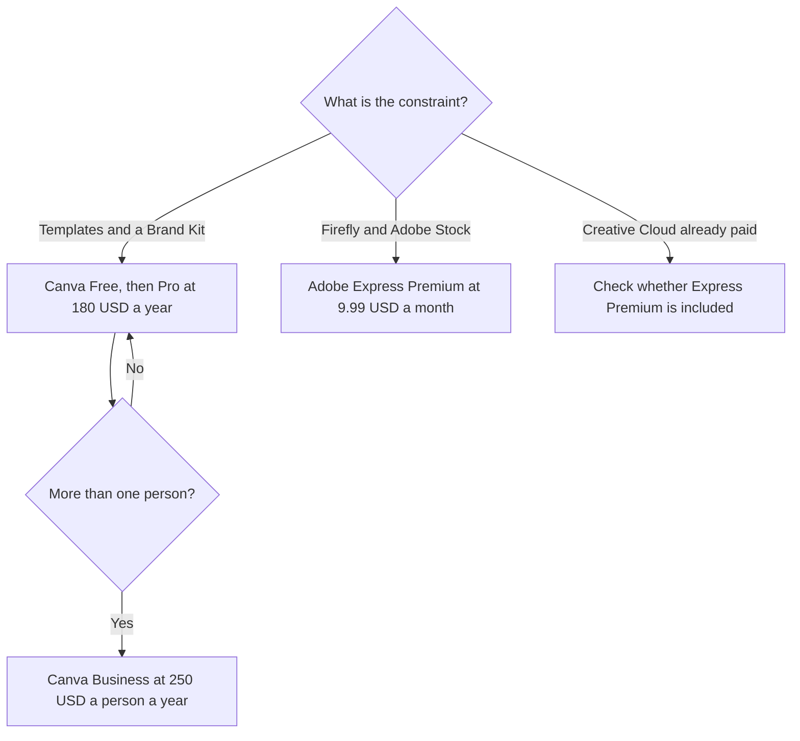

**Choose Canva when the team wants the larger template library, Brand Kits, and a price you can read per person. Choose Adobe Express when you want Firefly in a template editor, Adobe Stock inside the file, or you already pay for Creative Cloud, which often includes Express Premium.** Both are for social posts, flyers, and short videos. Neither is an interface design tool. That job is Figma: [Figma AI vs Canva Magic Studio](/blog/figma-ai-vs-canva-magic-studio-2026/).

The Canva invoice, including Magic Studio allowances, is [Canva Magic Studio pricing explained](/blog/canva-magic-studio-pricing-explained-2026/). The product pages are [Canva Magic Studio review](/blog/canva-magic-studio-review-2026/) and [Adobe Express review](/blog/adobe-express-review-2026/).

Prices are US list prices excluding tax from directory pages checked October 16, 2026. Published October 24, 2026. We did not score designs.

## Which editor to open

| The job | Start here | First paid step | The other tool |
|---|---|---|---|
| Everyday posts, and you want the big template pile | [Canva](/tools/canva/) | Pro is $18 a month or $180 a year for one person | Express, if Firefly's training story is the requirement |
| Firefly images inside a template, plus Stock | [Adobe Express](/tools/adobe-express/) | Premium is $9.99 a month, with 250 generative credits | Canva Pro, if you will not touch Photoshop or Stock |
| You already pay for Creative Cloud | Express Premium, if your plan includes it | Often $0 extra. Confirm your plan | A second Canva seat you do not need |
| A team, with admin | Canva Business, or Express for teams | Canva Business is $25 a person a month or $250 a person a year. Express teams pricing varies on the card | A shared Pro login. Canva says Pro is one person |
| Slides as the only artifact | [Gamma](/tools/gamma/) or Canva | Gamma Plus is $9 a seat | Express, unless the deck is already an Express file |

## The allowances

**Canva.** Free includes the editor, 1.6 million-plus templates, and 4.7 million-plus assets, with limited AI. Pro is one person: premium templates, background remover, resize, 100 GB, and 10 times Free's monthly AI allowance. Business is the team plan: admin tools, 500 GB, and 20 times Free's AI allowance. The directory says some standard AI tools, such as Translate and Magic Write, can be used without counting toward the allowance, and other AI features use it. An AI Pass add-on exists. The directory does not print an AI Pass dollar. Do not invent one. K-12 schools and eligible nonprofits can get most premium features free.

**Adobe Express.** Free includes core tools and a limited number of free daily AI generations. Premium at $9.99 a month adds premium templates, brand kits, 100 GB, and 250 Firefly generative credits a month. The directory says monthly or annual prepaid billing exists and does not print the annual dollar. Quote $9.99 until checkout shows the year price. Teams and Enterprise vary: the card mentions Admin Console and company ownership of assets, not a seat price. K-12 can get Premium features at no cost through Adobe Express for Education. Express Premium is included with Creative Cloud Standard, Creative Cloud Pro, and most single-app plans. If you already pay Adobe, check that before you buy Canva Business for the same posts.

Firefly's commercial-training claim is Adobe's, and the credit math for the standalone Firefly plans is [Adobe Firefly pricing explained](/blog/adobe-firefly-pricing-explained-2026/). Express Premium's 250 credits are the number on the Express card. Heavy image generation can exhaust them. A pure image studio is a different purchase: [Midjourney vs Leonardo](/blog/midjourney-vs-leonardo-2026/).

## How to choose

Start on both free plans with one real post: a size you publish, your logo, your colors. Upgrade the editor where you got stuck. Typical Canva walls are background removal, Magic Resize, and premium assets. Typical Express walls are the daily generation cap and premium templates.

For one person, a year of Canva Pro is $180. A year of Express Premium at $9.99 a month is $119.88 if the monthly price holds for twelve months. That arithmetic is only fair if you stay on monthly Express and the annual Express checkout is not cheaper. The directory did not give the annual Express figure, so do not put $119.88 in a budget as if Adobe printed it. Compare the checkout.

For five people, Canva Business at $250 a person a year is $1,250. Express for teams has no dollar on the directory card. Get the quote. Do not multiply $9.99 by five and call it the team plan. Premium is described as an individual price.

Interface work, components, and developer handoff do not belong in either editor. [Figma](/tools/figma/) Professional is $16 a month per Full seat billed annually, on the directory's starting price. The card is [Figma AI pricing explained](/blog/figma-ai-pricing-explained-2026/).

## FAQ

### Is Adobe Express the same as Firefly?

Express is the template editor. Firefly is the generative model family inside it, and also a separate credit plan. Buying Express Premium gives the 250 credits the Express card lists. It does not automatically mean you bought a large Firefly subscription.

### Which AI design tool looks less like a template?

This page did not score that. Both will look generic if you only swap the headline. Put your logo, type, and colors in a brand kit before you judge the model.

### Can we use the images commercially?

Read the plan you are on. Adobe says, in the directory's summary of its help center, that generative outputs can generally be used commercially unless a feature is marked as a personal-use beta. Canva's rights depend on the asset and the plan. This page is not your license. Open the terms for the asset you will ship.

### What if the team is mixed, some in Photoshop and some not?

Put the Photoshop people on the Creative Cloud plan they already need, and confirm Express is included. Put the social-only people on Canva if that is where the templates already live. Two editors is fine when the files do not have to move. It is expensive when every post is rebuilt twice.

## Last verified

October 16, 2026 for Canva, Adobe Express, Gamma, and Figma prices named above. Published October 24, 2026.

**Sources:** [Canva pricing](https://www.canva.com/pricing/), [Adobe Express pricing](https://www.adobe.com/express/pricing), [Figma pricing](https://www.figma.com/pricing/).

*Published by Andrew for [AI Tools Optimizer](https://aitoolsoptimizer.com).*

[Canva](/tools/canva/) is in the [design directory](/tools/category/design/). Directory pages may use affiliate links. A purchase through them may earn us a commission at no extra cost to you.
