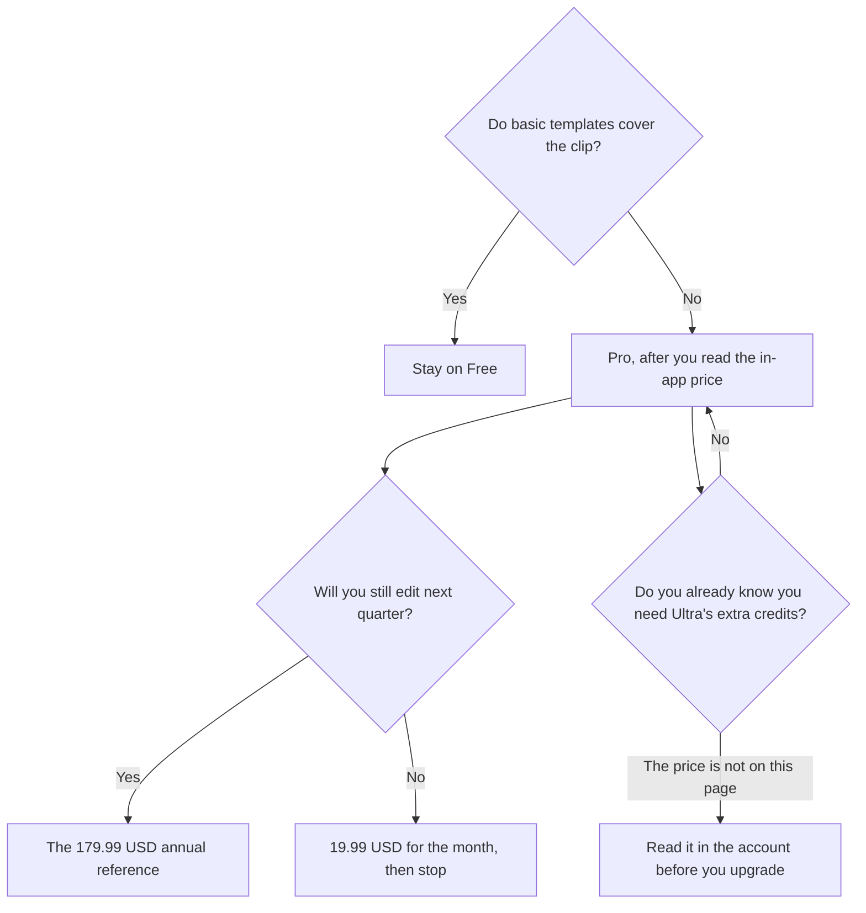

**CapCut pricing, on the US reference card this directory recorded, is a free editor plus Pro at $19.99 a month or $179.99 a year.** Ultra is a higher individual tier with more AI credits, and this page does not print an Ultra price. Teams is per seat and varies. CapCut says displayed prices are for reference. The charge appears after you sign in, and it can differ by platform. Desktop can cost more than mobile. Use the in-app price.

The product page is [CapCut review](/blog/capcut-review-2026/). The podcast split, episode versus clip, is [Descript vs CapCut for podcasts](/blog/descript-vs-capcut-for-podcasts-2026/). The general editor comparison is [Descript vs CapCut](/blog/descript-vs-capcut-2026/).

Prices are US reference prices excluding tax from CapCut's pricing page as recorded in the directory on October 16, 2026. Published October 24, 2026. We did not score export quality. We did not count how many AI credits a specific effect spends.

## The plans we can quote

| Plan | Price on the card | What it adds |
|---|---|---|
| Free | $0 | Templates and basic editing tools |
| Pro | $19.99 a month, or $179.99 a year | Premium templates and Pro features, monthly AI credits, option to buy more credits |
| Ultra | Higher tier. No dollar on this page | Everything in Pro, plus more monthly AI credits and exclusive AI features |
| Teams | Per seat. Varies by region, seats, and billing cycle | Pro features for seats, a brand kit, per-seat AI credits. Annual is described as typically about 20 percent cheaper. Purchase through CapCut Online |

A year of monthly Pro at the reference rate is 12 × $19.99 = $239.88. The annual reference is $179.99. The difference is $239.88 − $179.99 = $59.89. Divide $179.99 by 12 and you get $15.00 to the cent. That arithmetic is the discount. It is not the number your phone will show if the platform price differs. Sign in and read it.

AI video generation spends credits. The directory says paid plans include a monthly allotment and that extra credits can be bought. It does not publish a single credit cost for every model on a page we should turn into "one clip costs X." Generate one clip and read the balance.

## Who should pay

**Someone posting short social video with stock effects.** Free, until a template or an export you need is locked. The directory's best-for line is short-form social, not a podcast transcript edit.

**Someone who wants the premium kit every week.** Pro, on the annual reference if the work will last the year, on monthly if you are testing a channel. Check the desktop price and the phone price separately if you might subscribe in either app.

**Someone generating a lot of AI footage.** Look at Ultra only after Pro's credit balance is the constraint, and only after the in-app Ultra price is a number you can send to finance. This article will not invent it.

**A team that needs a brand kit and shared seats.** Teams, through CapCut Online. The help center, as recorded, lists seat options of 10, 15, or 30, and says the price varies. Ask for the quote. Do not multiply $19.99 by headcount and call it Teams.

## When another editor is the invoice

**The edit is a podcast or an interview you cut by deleting words.** [Descript](/tools/descript/) Hobbyist is $16 a person a month billed annually, with 10 media hours. CapCut is the clip afterward, if you need one. The invoice is [Descript pricing explained](/blog/descript-pricing-explained-2026/).

**The long video must become candidate shorts.** [Opus Clip](/tools/opusclip/) Starter is $15 a month. Free is 60 credits. The invoice is [Opus Clip pricing explained](/blog/opusclip-pricing-explained-2026/).

**You want a full video from a prompt, as a generator rather than an editor.** [Invideo AI](/tools/invideo-ai/) Starter is $10 a seat a month billed annually, or $20 monthly. The directory says a free option was not verified. Confirm it. This is not a CapCut substitute for timeline edits.

A YouTube stack that may use more than one of these is [best AI tools for YouTubers](/blog/best-ai-tools-for-youtubers-2026/).

## FAQ

### Is CapCut free?

Yes, for templates and basic editing, on the card. Premium templates, effects, and AI credits are paid. Free is a real editor. It is not every asset in the app.

### Why does my friend pay a different Pro price?

CapCut says the displayed price is a reference and the final price, taxes, and offers appear after sign-in. The directory also notes desktop pricing can be higher than mobile. Compare the account you will actually bill. Do not argue from a screenshot in another region.

### Does annual Pro include Ultra?

No. Ultra is a separate higher tier on the card. Annual Pro is the $179.99 reference for Pro. Ultra's price is the gap.

### Are AI credits the same as a Pro subscription?

Pro includes a monthly credit allotment and the option to buy more. Running out of credits does not, by itself, tell you to buy Ultra. Buy more credits only if the in-app offer is cheaper than the tier jump for the way you work. Read both numbers in the account.

## Last verified

October 16, 2026, as recorded in the CapCut directory page. Those figures are US reference prices. Your checkout can differ. Published October 24, 2026.

**Sources:** [CapCut pricing](https://www.capcut.com/pricing), [CapCut Teams price help](https://www.capcut.com/help/capcut-teams-price), [Descript pricing](https://www.descript.com/pricing).

*Published by Andrew for [AI Tools Optimizer](https://aitoolsoptimizer.com).*

[CapCut](/tools/capcut/) is in the [video directory](/tools/category/video/). Directory pages may use affiliate links. A purchase through them may earn us a commission at no extra cost to you.
