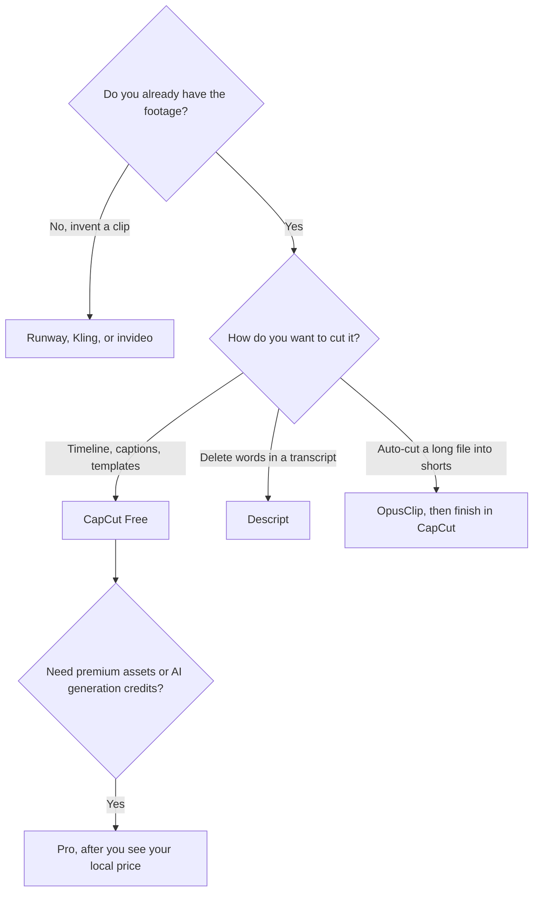

**[CapCut](/tools/capcut/) is a video editor for Windows, macOS, iOS, Android, and the browser, built for short social video.** The free plan includes templates and basic editing. CapCut lists Pro at $19.99 a month or $179.99 a year in the United States. Ultra is a higher individual tier with more monthly AI credits and exclusive AI features. Teams is priced per seat and can be bought only through CapCut Online.

CapCut says the prices on its site are reference prices. The final price, tax, and any offer appear after you sign in, and desktop pricing can be higher than mobile. Treat every number below as a US reference from October 16, 2026, then read your own account. We did not score export quality or run a timed edit against another editor.

If the job is "one long video, many shorts," read the [OpusClip review](/blog/opusclip-review-2026/) after this one. If the job is "delete a sentence and the picture leaves," read the [Descript review](/blog/descript-review-2026/). A full channel workflow is [how to start a faceless YouTube channel](/blog/start-faceless-youtube-channel-with-ai/).

## What is free, and what the subscription adds

| Plan | Reference price | What it is for |
|---|---|---|
| Free | $0 | Templates and basic editing on desktop, mobile, and web |
| Pro | $19.99/month or $179.99/year in the US | Premium templates and effects, plus monthly AI credits |
| Ultra | Higher than Pro. Confirm in your account | More monthly AI credits and exclusive AI features on top of Pro |
| Teams | Varies by region, seats, and billing cycle | Shared space, brand kit, Pro features for every seat. Annual often about 20% less |

The invoice is [CapCut pricing explained](/blog/capcut-pricing-explained-2026/).

Pro at $179.99 a year is about $15 a month, against $19.99 if you pay month to month. That comparison only holds if your account shows those US reference prices. A phone in another country can show a different pair of numbers. Check both the device you edit on and the web account before you subscribe twice.

## AI credits are a second product

Auto captions, templates, and a timeline are the editor. AI video generation sits on monthly credits that paid plans include, using models listed on CapCut's pricing page. Extra credits can be purchased. The pricing page we used does not reduce "Pro" to a guaranteed number of generated seconds. Generate one clip at the resolution you will post, read the credit cost, and multiply.

Teams seats, in CapCut's help center, come in groups of 10, 15, or 30, and the purchase path is CapCut Online. A two-person shop should confirm whether Teams will sell them a small seat count or whether two individual Pro plans are the real option. Annual Teams pricing is described as typically about 20% below monthly.

CapCut is a weak fit for a long documentary grade, a podcast mastered by transcript, or an avatar that was never filmed. It is a strong fit for a vertical video you will caption, template, and post this week.

## Fit score

| Job | Free | Pro | Ultra | Teams |
|---|---|---|---|---|
| Cut a short with basic tools | Strong | Strong | Strong | Strong |
| Premium templates and effects | No | Yes | Yes | Pro features per seat |
| AI video generation credits | No | Monthly allowance | More credits, plus exclusive AI features | Depends on the seat |
| Know the price before sign-in | Reference only | Reference only | Confirm in account | Varies by region and seats |
| Edit by deleting transcript text | Poor fit | Poor fit | Poor fit | Poor fit |

The score records what CapCut publishes. It is not a picture-quality score.

## A practical first export

1. Edit one real short on Free, on the device you will actually use.
2. If the watermark, the locked effect, or the missing template is the only thing in the way, open the paywall on that same device and read the price.
3. Compare it with $19.99 and $179.99. If your number is different, believe your account.
4. If you also need generated B-roll, price those credits separately from the editor subscription.
5. Hand a long podcast to [Descript](/tools/descript/) or a finished long video to [OpusClip](/tools/opusclip/). Bring the short back to CapCut if the last mile is captions and a template.

Generators that start from a prompt are in [best AI video generators](/blog/best-ai-video-generators-2026/). [invideo AI](/tools/invideo-ai/) Starter is $10 per seat per month billed annually when the video is generated rather than edited.

## FAQ

### Is CapCut free?

Yes. Free includes templates and basic editing on desktop, mobile, and web. Premium templates, effects, and AI credits are paid.

### How much is CapCut Pro?

The US reference price is $19.99 a month or $179.99 a year. CapCut says the final price appears after sign-in and can differ by platform and region.

### What is Ultra?

A higher individual plan with more monthly AI credits and exclusive AI features, on top of Pro. Confirm the price in your account. We are not publishing an Ultra dollar figure the pricing summary did not pin down.

### Can a team subscribe?

Yes, through CapCut Online. Price depends on region, seats, and billing cycle. Help docs describe seat options of 10, 15, or 30, and annual billing typically about 20% lower.

## Last verified

October 16, 2026.

**Sources:** [CapCut pricing](https://www.capcut.com/pricing), [CapCut Standard vs Pro](https://www.capcut.com/resource/capcut-standard-vs-pro), [CapCut Teams price](https://www.capcut.com/help/capcut-teams-price), [CapCut](https://www.capcut.com).

[CapCut](/tools/capcut/) is in the [video directory](/tools/category/video/). Directory pages may use affiliate links. A purchase through them can earn us a commission at no extra cost to you.
