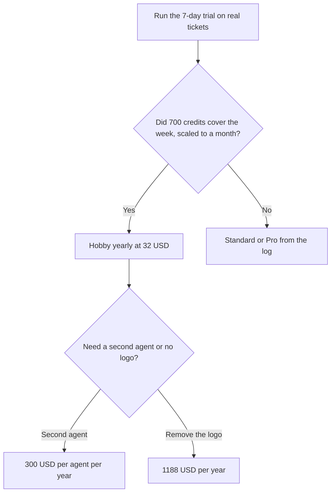

**Chatbase pricing is a monthly message-credit allotment, plus add-ons that do not sit inside the plan card.** Hobby is $40 a month, or $32 a month billed yearly, with 700 message credits. Standard is $150 or $120, with 4,000 credits. Pro is $500 or $400, with 15,000 credits. Auto-recharge is $40 per 1,000 credits, and those top-up credits do not expire.

Prices, credit allotments, training sizes, and the 7-day trial were read from Chatbase's pricing page on October 24, 2026. Yearly billing is 20% off. The product page is [Chatbase review](/blog/chatbase-review-2026/). The build order is [how to build a support chatbot with Chatbase](/blog/how-to-build-a-chatbot-with-chatbase-2026/).

## The plan card

| Plan | Monthly | Yearly, per month | Message credits | Test credits | Members | AI actions per agent | Training size |
|---|---|---|---|---|---|---|---|
| Hobby | $40 | $32 | 700 | 200 | 2 | 5 | 10 MB |
| Standard | $150 | $120 | 4,000 | 500 | 3 | 8 | 20 MB |
| Pro | $500 | $400 | 15,000 | 1,000 | 5 | 12 | 40 MB |
| Enterprise | Custom | Custom | Custom | Custom | Custom | Custom | Custom, plus SSO and a success manager |

One agent is included on the self-serve cards. There is a 7-day trial. The directory page, checked October 16, 2026, matches these yearly and monthly prices and the same credit counts.

## The add-ons that change the year

**Message credits** are consumed when the agent responds. The monthly allotment resets with the plan. Auto-recharge credits, at $40 per 1,000, are the balance Chatbase says does not expire. A Hobby year that also buys one 1,000-credit top-up is $32 times 12, plus $40, which is $424, and that is only if you buy the top-up once. A site that recharges every month adds $480. Model the log. A guess of "a few chats" is how Hobby looks cheap and invoices at Standard.

**Extra agents** are $300 per agent per year. The self-serve plans include one. A second brand, or a separate internal bot, is that line. It is not a second Hobby subscription unless you want a second billing relationship.

**Branding removal** is $1,188 a year for "Remove Powered By Chatbase," on the directory page and the October 24 pricing read. Hobby at $384 a year plus branding removal is $1,572. If the logo is unacceptable, put that number in the first quote. It is larger than the seat.

**AI actions** are capped per agent: 5, 8, or 12 as you move up the cards. An action is the agent doing something, such as a lookup or a workflow, beyond answering from the docs. A refund flow can spend the action cap and the message cap. Test it. The how-to above is the order: content first, then one action, then publish.

Training size is 10 MB, 20 MB, or 40 MB. A help center that does not fit is an Enterprise conversation or a smaller corpus, not a prompt that asks the model to remember the rest. Retrieval from the files you uploaded is [what RAG is](/blog/what-is-rag-explained-2026/).

## A different meter, if credits are the wrong shape

[Intercom Fin](/tools/intercom-fin/) prices outcomes: $0.99 per resolution with a $49 minimum, on the review. [Tidio](/tools/tidio/) Starter is $24.17 for 100 conversations on its review. [Zendesk AI](/tools/zendesk-ai/) is the suite path when the help desk is already Zendesk. Pick the meter finance can audit: credits per message, conversations, or a price per resolution. The category piece is [best AI chatbots for business](/blog/best-ai-chatbots-for-business-2026/).

Chatbase's marketing page lists GDPR, SOC 2 Type II, and HIPAA. HIPAA-eligible and audit logs are on the Enterprise card. A clinic should not launch on Hobby because the word HIPAA appears on a product page. Enterprise is the conversation for a BAA, SSO, and those logs.

## FAQ

### How much does Chatbase cost for a small site?

Hobby is $40 a month or $32 a month billed yearly, with 700 message credits, two members, and one agent. Branding removal and extra agents are separate. The 7-day trial is the way to see whether 700 credits is a week or a month.

### Do unused message credits roll over?

The monthly allotment is monthly. Auto-recharge credits are the ones that do not expire. Read which balance the dashboard is showing before you buy a top-up you do not need.

### Is there a free plan?

The pricing page lists a 7-day trial, not a permanent free tier.

### What happens when credits run out?

The agent stops responding until the next allotment, unless auto-recharge is on. Auto-recharge at $40 per 1,000 is the published refill. Turn it on only after you have seen a week of real traffic, and cap it if the product lets you.

## Last verified

October 24, 2026, from Chatbase's pricing page. The same plan prices and the $40, $300, and $1,188 add-ons are on the directory page checked October 16, 2026. Credit cost per message can change with the model. Recheck the card if a trial week spends faster than you scaled.

**Sources:** [Chatbase pricing](https://www.chatbase.co/pricing), [Chatbase](https://www.chatbase.co).

*Published by Andrew for [AI Tools Optimizer](https://aitoolsoptimizer.com).*

[Chatbase](/tools/chatbase/) is in the [customer support directory](/tools/category/customer-support/). Directory pages may use affiliate links. A purchase through them may earn us a commission at no extra cost to you.
