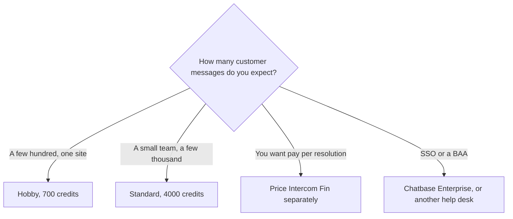

**[Chatbase](/tools/chatbase/) builds an AI agent on your site content and deploys it to chat and other channels, without you writing the bot.** Hobby is $40 a month, or $32 a month billed yearly. The meter is message credits, not a flat "unlimited support" promise. Auto-recharge is $40 per 1,000 credits that do not expire.

Prices, credit allotments, and the 7-day trial were read from Chatbase's pricing page on October 24, 2026. Yearly billing is 20% off. Hobby's yearly discount is $96, which is $8 times 12. We did not measure resolution rate. A support agent is only as good as the help content you connect.

How to think about agents before you pick a vendor is [how to create an AI agent without coding](/blog/how-to-create-an-ai-agent-without-coding/). Business chat, as opposed to a site agent, is [best AI chatbots for business](/blog/best-ai-chatbots-for-business-2026/).

## The plans

| Plan | Monthly | Yearly, per month | Message credits | Members on the card |
|---|---|---|---|---|
| Hobby | $40 | $32 | 700 a month | 2 |
| Standard | $150 | $120 | 4,000 a month | 3 |
| Pro | $500 | $400 | 15,000 a month | 5 |
| Enterprise | Custom | Custom | Custom | SSO, HIPAA-eligible, audit logs, a success manager |

The comparison table also lists test credits (200, 500, and 1,000), one agent on the self-serve cards, and 5, 8, or 12 AI actions per agent as you move up. There is a 7-day trial. Extra message credits via auto-recharge are $40 per 1,000. Those top-up credits do not expire, which is different from the monthly allotment. A month of Hobby that burns through 700 credits and then buys another 1,000 is $32 plus $40 on the yearly plan, not $32.

## What the credit is buying

You point Chatbase at pages and files, write instructions, test, and publish. Higher plans add the helpdesk inbox, voice, and analytics, on the plan cards. The agent can take actions. The count of those actions is capped per agent. If the job is "answer from the help center," Hobby is the experiment. If the job is "do the refund," you are in actions, procedures, and a human handoff. Budget the test, not a launch on day one.

[Intercom Fin](/tools/intercom-fin/) prices outcomes, with a base plan, rather than a monthly credit pack. [Zendesk AI](/tools/zendesk-ai/) and [Tidio](/tools/tidio/) are the other support tools in the directory. Pick the meter you can explain to finance: credits per message, or a price per resolution. Do not pick from a demo conversation.

Chatbase's page says your data is not used to train models and lists GDPR, SOC 2 Type II, and HIPAA. HIPAA-eligible and audit logs are on the Enterprise card, not on Hobby. A clinic should not launch on Hobby because the marketing page mentions HIPAA.

## Who should pay

**Use the trial** on real past tickets before you pick a credit tier. **Pay for Hobby yearly** if 700 credits and two members cover a single site and the trial answers were ones you would send. **Move to Standard or Pro** when the credit log, not a guess, says Hobby ran out. **Talk to Enterprise** for SSO or a BAA. **Skip Chatbase** if you wanted a writing assistant. That is a $20 chat plan, not a support agent.

## FAQ

### How much does Chatbase cost?

Hobby is $40 a month or $32 a month billed yearly, with 700 message credits. Standard is $150 or $120, with 4,000 credits. Pro is $500 or $400, with 15,000 credits. Enterprise is custom.

### Is there a free plan?

The page lists a 7-day trial, not a permanent free tier. Auto-recharge after the monthly credits is $40 per 1,000 credits.

### Do unused credits roll over?

The monthly plan credits are a monthly allotment. The auto-recharge credits are the ones Chatbase says do not expire. Read which balance you are looking at.

## Last verified

October 24, 2026, from Chatbase's pricing page. Credit costs per message can change with the model. Recheck the card if a trial week spends faster than 700.

**Sources:** [Chatbase pricing](https://www.chatbase.co/pricing), [Chatbase](https://www.chatbase.co).

[Chatbase](/tools/chatbase/) is in the [customer support directory](/tools/category/customer-support/). Directory pages may use affiliate links. A purchase through them may earn us a commission at no extra cost to you.
