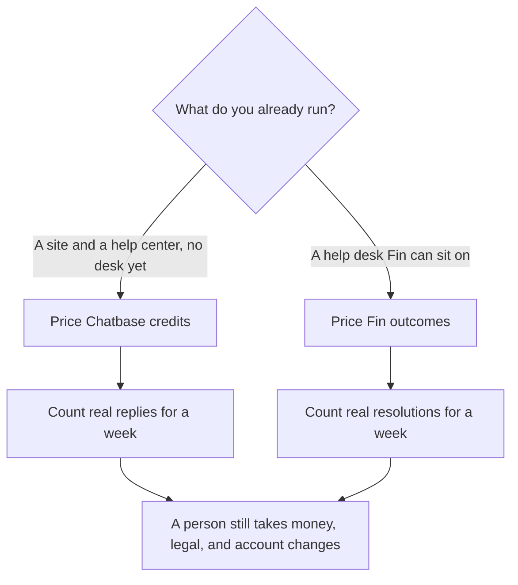

**Chatbase charges for message credits. Intercom Fin charges for outcomes, after a $49 base that includes 50 of them.** Those meters do not convert. A credit is an agent response on the Chatbase card. An outcome, on the Fin card, is a resolution or a successful procedure handoff. A cheap month on one product is not a forecast for the other until you count the thing each vendor bills.

Chatbase's own ladder is [Chatbase pricing explained](/blog/chatbase-pricing-explained-2026/). The Fin product page is [Intercom Fin review](/blog/intercom-fin-review-2026/). The stack around both is [best AI tools for support teams](/blog/best-ai-tools-for-support-teams-2026/) and [best AI chatbots for business](/blog/best-ai-chatbots-for-business-2026/).

Prices are US list prices excluding tax from directory pages checked October 16, 2026. Published October 24, 2026. We did not score resolution quality.

## The two meters

| | Chatbase | Intercom Fin |
|---|---|---|
| What the invoice counts | Message credits when the agent responds | An outcome: a resolution or a successful procedure handoff |
| Entry | Hobby, $32 a month billed yearly, or $40 monthly, for 700 credits | $49 a month, including 50 outcomes |
| Next step | Standard, $120 yearly or $150 monthly, for 4,000 credits | $0.99 for each outcome past the included 50 |
| Higher published step | Pro, $400 yearly or $500 monthly, for 15,000 credits | The same $0.99. There is no larger self-serve tier on this card |
| Add-ons this directory recorded | Extra credits at $40 per 1,000, which do not expire. Extra agents at $300 per agent per year. Branding removal at $1,188 a year | Pause Fin to stop charges, on the recorded example |
| Where it sits | An agent you put on your content | Natively on Intercom, or on Salesforce, Zendesk, Freshdesk, HubSpot, and other desks, on the Fin page |

Chatbase's yearly column is the rate per month, not a lump sum. A year of Hobby at $32 a month is $384. A year of Standard at $120 is $1,440. A year of Pro at $400 is $4,800. Month-to-month is $40, $150, and $500. The actions column on the same table is AI Actions per agent: 5, 8, and 12. Training size is 10 MB, 20 MB, and 40 MB. Extra agents are the $300 line, not that actions column.

Fin's directory example: if Fin resolves 5 tickets in a month, you pay $49, because 5 sits inside the included 50. Additional outcomes are $0.99. Arithmetic on that rule, which is our multiplication and not a second Intercom quote: 100 outcomes are 50 included plus 50 extra, so $49 + $49.50 = $98.50. 200 outcomes are $49 + 150 × $0.99 = $197.50. Use your count. Do not email these sketches as if Intercom printed them for your account.

## Do not convert a credit into an outcome

A Chatbase credit is consumed when the agent responds. A customer who needs three messages can spend three credits and still not be resolved. A Fin outcome bills when the conversation resolves or a procedure hands off. One outcome can be the whole conversation. One outcome can also be a handoff, which means a person still works the ticket.

So Hobby's 700 credits are not 700 resolutions, and Fin's 50 included outcomes are not 50 credits. If your week shows 200 resolutions and each one took a single bot message, Chatbase's volume fits inside Hobby's 700 and Fin's arithmetic is the $197.50 sketch above. That "if" is the whole comparison. Measure it. A team that chats for eight turns before a resolution will burn credits long before an outcome meter would have noticed.

Branding removal at $1,188 a year is $99 a month on top of whichever Chatbase plan you picked. A Hobby team that needs the badge gone is not on a $32 invoice anymore. $384 + $1,188 = $1,572 for the year, before extra credits. Price the badge before you call Hobby the cheap plan.

## The desk underneath

This comparison does not price a full Intercom help desk seat. The Fin page records the outcome meter and says Fin can run on Intercom or on another desk. It does not print an Intercom suite price. If that seat is on your quote, add it. Fin at $49 is not a substitute line for the human inbox.

[Zendesk AI](/tools/zendesk-ai/) is one desk people already have. Suite Team is $55 per agent per month paid yearly, and automated resolutions can bill on top. [Tidio](/tools/tidio/) Starter is $24.17 a month billed annually, with Lyro as the AI layer, on the directory card. Neither number is a Chatbase credit or a Fin outcome. The build, if you are training the bot on articles you control, is [how to build a knowledge base chatbot](/blog/how-to-build-a-knowledge-base-chatbot-2026/). The articles themselves are [how to create FAQ pages with AI](/blog/how-to-create-faq-pages-with-ai-2026/).

Whatever you buy, a person has to own refunds, legal answers, and account changes. That step is [what human-in-the-loop AI is](/blog/what-is-human-in-the-loop-ai-2026/). The log of a bad answer is [what AI observability is](/blog/what-is-ai-observability-2026/). [Notion AI](/tools/notion-ai/) Business at $20 a seat is a place the source articles can live. It is not a customer-facing bot.

## FAQ

### Which is cheaper, Chatbase or Fin?

For a handful of resolutions, Fin's $49 minimum can be the whole bill, and Chatbase Hobby is $32 yearly or $40 monthly whether or not anyone visits. For a high volume of short resolved chats, Fin's $0.99 keeps adding and Chatbase stays on a credit pack until you buy more at $40 per 1,000. Count your unit. Then multiply.

### Does Fin include 50 free resolutions every month?

It includes 50 outcomes in the $49. They are not free. Five resolutions still cost $49 on the recorded example. Outcomes past 50 cost $0.99 each.

### Can I remove Chatbase branding on Hobby?

Yes, with the add-on at $1,188 a year, on the October 16 card. The plan price does not include it.

### Are these prices the whole support stack?

No. Seats for the humans, the help desk, and any phone channel are extra. This page is the AI meter only.

## Last verified

October 16, 2026 for Chatbase, Fin, Zendesk, and Tidio prices named above. The $98.50 and $197.50 figures are arithmetic on Fin's published $49 plus $0.99 rule, not a separate quote. Published October 24, 2026.

**Sources:** [Chatbase pricing](https://www.chatbase.co/pricing), [Intercom Fin](https://www.intercom.com/fin), [Zendesk pricing](https://www.zendesk.com/pricing/).

*Published by Andrew for [AI Tools Optimizer](https://aitoolsoptimizer.com).*

[Chatbase](/tools/chatbase/) and [Intercom Fin](/tools/intercom-fin/) are in the [customer support directory](/tools/category/customer-support/). Directory pages may use affiliate links. A purchase through them may earn us a commission at no extra cost to you.
