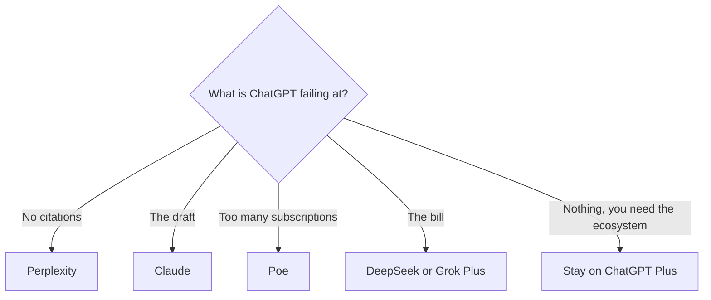

**Replace ChatGPT only for the job it is bad at for you: citations, a writing voice, a bundle you already pay for, or a price.** A leaderboard of model names will not tell you whether to cancel Plus. The alternatives below are the ones with directory pages, and several of them are not "another ChatGPT."

Prices are US list prices excluding tax, from vendor pages checked October 16, 2026, published here on October 24, 2026. A live refetch of the pricing URLs that day did not return numbers. The head-to-head among the three biggest general assistants is [ChatGPT vs Gemini vs Claude](/blog/chatgpt-vs-gemini-vs-claude-2026/). This page exists so the shortlist is wider than those three. Plan details for OpenAI's own ladder are [ChatGPT Go vs Plus vs Pro](/blog/chatgpt-go-vs-plus-vs-pro-2026/). The product page is [ChatGPT review](/blog/chatgpt-review-2026/).

## Pick by the failure, not by the logo

| The failure | Try | First paid step |
|---|---|---|
| Answers with no sources you can open | [Perplexity](/tools/perplexity/) | Free for limited weekly use of top models. Pro is $17/month billed annually |
| Long writing that has to stay in a voice | [Claude](/tools/claude/) | Pro is $20/month, or $17 on annual billing. Max starts at $100 |
| You live in Google's apps | [Gemini](/tools/gemini/) | Google AI Plus is $4.99/month. The free plan needs a Google account |
| You want GPT, Claude, Gemini, and Grok in one login | [Poe](/tools/poe/) | Subscriptions start at $4.99/month. Higher tiers were not fully priced on the public pages we checked |
| You want a very cheap or free chat, and an API with a posted token price | [DeepSeek](/tools/deepseek/) | The chat app is free. API input from $0.15 per million tokens off-peak on a cache miss |
| You already pay for X, or you code in [Cursor](/tools/cursor/) | [Grok](/tools/grok/) | Plus is $8/month, or $80/year, on The X Subscription |
| You write inside Microsoft 365 | [Microsoft Copilot](/tools/microsoft-copilot/) | Free with a Microsoft account. Microsoft 365 Personal is $9.99/month |
| You want the assistant inside Meta's apps | [Meta AI](/tools/meta-ai/) | The assistant is free with a Meta account. Muse, a separate agent, lists a $20/month Power plan |

[ChatGPT](/tools/chatgpt/) itself, so the comparison has a denominator: Free is $0 and includes text chats with usage guardrails. Go is $8. Plus is $20. Pro is $100, $200, or $500. Business is $20 per user per month on annual billing for two or more users, or $25 monthly. Plus is the plan most people are trying to replace. If you are on Free, an alternative is a preference, not a savings.

## What each alternative refuses to be

**Perplexity is a research tool with a chat box.** Every answer is supposed to come with sources. Pro adds Perplexity Computer, model choice, and premium data sources such as PitchBook and Statista. Max is $167/month billed annually, which is a heavy-research plan, not a writing plan. If your complaint about ChatGPT was "it invented a citation," start here, on the free tier, before you buy Max. The buying guide is [is Perplexity Pro worth it](/blog/is-perplexity-pro-worth-it-2026/). More options in that aisle are [Perplexity alternatives](/blog/perplexity-alternatives-2026/).

**Claude is the writing and careful-editing alternative.** The free plan includes chat, files, and artifacts. Pro is the working plan. Max is for people who hit Pro's limits, not for people who want a more literary adjective. The writing comparison is [ChatGPT vs Claude for writing](/blog/chatgpt-vs-claude-for-writing-2026/). The tier above Pro is [Claude Pro vs Max](/blog/claude-pro-vs-max-2026/).

**Poe is a switchboard.** You spend compute points on bots. Free points reset daily and do not roll over. Subscribers can buy more points at $30 per million. Expensive bots burn points. Poe is the right bill when you would otherwise pay for three assistants to compare one answer. It is the wrong bill when you need ChatGPT's projects, memory, and product surface every day. We could not confirm Poe's higher subscription prices from the public help pages. Check the in-app price.

**DeepSeek is the price alternative.** The consumer chat is free on the web and in the apps. The API posts a token rate, including $0.15 per million input tokens off-peak on a cache miss. That is a developer number. It does not mean the chat product is a full substitute for Plus features such as a particular image tool or a company admin console. Read [DeepSeek review](/blog/deepseek-review-2026/) before you move a workflow.

**Grok is the bundle alternative.** Plus at $8 is cheaper than ChatGPT Plus and shares a usage pool with Cursor. Premium at $30 is 4x Plus usage and includes [Grok Bot](/tools/grok-bot/). Buy it when the bundle is real. Skip it when you do not use X or Cursor and you wanted citations. See [Grok review](/blog/grok-review-2026/).

**Gemini and the two free assistants** are distribution, not a second brain. Gemini is the one that belongs next to Google's apps, and Google AI Plus at $4.99 is the cheapest paid step in this table. Microsoft Copilot belongs next to Microsoft 365. Meta AI belongs next to Meta's apps. Use the one that is already in the window where you work. Do not pay for a fourth general chatbot on top of all three.

## A sane stack, not a collection

One paid general assistant is enough for most people. Add a second only for a missing control:

- ChatGPT Plus for the general work, Perplexity free or Pro for anything you will publish as fact.
- Claude Pro for the writing, ChatGPT Free for a quick second opinion.
- Grok Plus if it already includes the editor you code in, and then you do not also need a separate chatbot seat.

The map of "which single subscription" is [which AI subscription is worth paying for](/blog/which-ai-subscription-is-worth-paying-for/).

## FAQ

### What is the best free ChatGPT alternative?

For cited answers, Perplexity's free plan. For writing, Claude's free plan. For a no-fee chat app, DeepSeek. For an assistant you already have, Gemini, Microsoft Copilot, or Meta AI. "Best" is the one whose failure mode you can live with. Free plans limit usage, models, or both.

### Is Claude better than ChatGPT?

For a long draft, many writers prefer Claude, and the writing comparison is linked above. For images, voice, custom GPTs, and [Codex](/tools/openai-codex/), ChatGPT's product page lists more of that surface. We are not publishing a quality score from a private bake-off.

### Is Grok included with X?

Paid Grok plans are The X Subscription, which also covers X and Cursor. There is a free Grok tier with limited usage. Plus is $8 if you want the paid pool.

### Should I use Poe instead of three subscriptions?

Yes, if you mostly compare models and you can live with points. No, if you depend on one assistant's projects, memory, or company admin. Add up a month of points on the bots you actually open before you cancel the single subscription that already fits.

## Last verified

October 16, 2026 for prices. Published October 24, 2026. Pricing pages did not return a fresh fetch that day. Poe's higher tiers need an in-app check.

**Sources:** [ChatGPT pricing](https://chatgpt.com/pricing/), [Claude pricing](https://claude.com/pricing), [Perplexity pricing](https://www.perplexity.ai/hub/pricing), [Poe purchases FAQ](https://help.poe.com/hc/en-us/articles/19945140063636-Poe-Purchases-FAQs), [DeepSeek](https://www.deepseek.com), [Grok and X Subscription pricing](https://docs.x.ai/x-subscription/pricing).

These assistants are in the [chatbots directory](/tools/category/chatbots-assistants/) and the [research directory](/tools/category/research-search/). Directory pages may use affiliate links. A purchase through them may earn us a commission at no extra cost to you.
