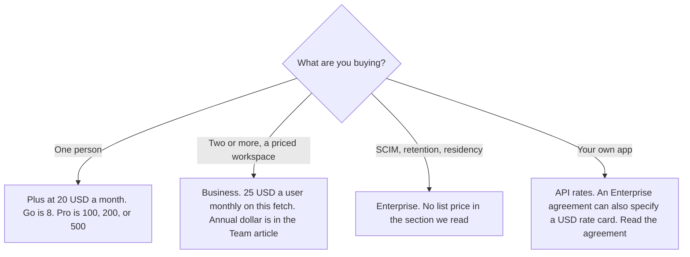

**ChatGPT Enterprise does not have a public seat price in the section of learn.chatgpt.com/docs/pricing fetched October 24, 2026.** That section lists priority processing, SCIM, encryption key management, user analytics, domain verification, role-based access, audit logs, the Compliance API, and data retention and residency controls. The priced workspace on the same page is Business. The full seat ladder, from Free through Business, is [ChatGPT pricing explained](/blog/chatgpt-pricing-explained-2026/). The Business row by itself is [ChatGPT Team pricing explained](/blog/chatgpt-team-pricing-explained-2026/).

The API meter is a different bill: [OpenAI API pricing explained](/blog/openai-api-pricing-explained-2026/). Published October 24, 2026. We did not score answers. A sales quote can name a dollar. This page will not invent one. The seat-ladder article, from this URL the same day, recorded Enterprise and Edu as contact sales.

## What the October 24 page puts on Enterprise

| Item | What this fetch shows | What it does not show |
|---|---|---|
| Seat price | No dollar in the Enterprise section we read | A list price you can put on a purchase order |
| Controls named in prose | Priority request processing. SCIM, EKM, user analytics, domain verification, and RBAC. Audit logs and the Compliance API. Data retention and data residency controls | That Business includes that list. Business is described with admin controls, SAML SSO, and MFA |
| Usage shape | Flexible pricing: no fixed rate limits, usage scales with credits. Without flexible pricing: the same per-seat usage limits as Plus for most features | A single message cap |
| Referrals | Not currently available for ChatGPT Enterprise | A referral credit you can budget |
| GPT-6.1 Sol | Off by default for Enterprise and Edu until an admin enables it | A reason to assume the model is on |

The page says Enterprise and Edu plans with flexible pricing have no fixed rate limits, and usage scales with credits. Plans without flexible pricing have the same per-seat usage limits as Plus for most features. Plus is $20 a month on that page. Those sentences describe limits. They are not a seat price.

It also says a small subset of Enterprise customers should keep using a legacy rate card until migrated, and that if your agreement specifies usage-based billing in USD, you use the Enterprise USD rate card and the agreement. This article does not copy that card. Ultrafast mode is tied to Pro at $500 and to eligible Enterprise or Edu plans. Eligibility is not a dollar.

Business, on this fetch, is the workspace with a secure dedicated space, SAML SSO, MFA, and no training on business data by default. The monthly price on the page is $25 a user a month, for two or more users, when billed monthly. The annual price of $20 a user a month is the figure recorded the same day in the Team article. Five Plus seats are not Enterprise because the security list sounds attractive.

## What sits next to Enterprise

**Business Premium and Dots.** The Dots page read October 24 lists Enterprise among the plans where dots roll out, off until an admin enables them. That page did not print an Enterprise seat price either. The invoice is [OpenAI Dots pricing explained](/blog/openai-dots-pricing-explained-2026/).

**Claude Enterprise**, if you are comparing the other assistant's company plan, is priced on claude.com/pricing the same day at $20 a seat a month plus usage at API rates, billed annually. That is Anthropic's sticker, not a ChatGPT number. The invoice is [Claude Enterprise pricing explained](/blog/claude-enterprise-pricing-explained-2026/).

**Notion Enterprise** is a sales conversation on the October 16 card. Notion Business, the priced AI seat, is $20 a seat a month. That $20 is a wiki. It is not ChatGPT Enterprise. The invoice is [Notion AI pricing explained](/blog/notion-ai-pricing-explained-2026/).

## What not to assume

Do not quote ChatGPT Enterprise at $20 or $25. Those are Business figures. Do not treat "no training by default," which the page states for Business, as the Enterprise retention control. Retention and residency are named on the Enterprise list. Do not add API token prices to a guessed seat. The page says API token prices are separate from subscription usage, and it also says an Enterprise agreement may specify its own USD rate card.

## FAQ

### How much is ChatGPT Enterprise?

The plan page fetched October 24, 2026 does not print a seat price in the Enterprise section we read. The same-day seat-ladder article recorded Enterprise and Edu as contact sales. Use the quote. Do not reuse the Business price.

### How is Enterprise different from Business?

This fetch puts SAML SSO and MFA on Business, and puts SCIM, EKM, domain verification, RBAC, audit logs, the Compliance API, and retention and residency controls on Enterprise. Business has a published monthly price. Enterprise, in the section we read, does not.

### Do Enterprise seats match Plus limits?

Only on the line for plans without flexible pricing: the page says those plans have the same per-seat usage limits as Plus for most features. Flexible pricing is a different line: no fixed rate limits, usage scales with credits. Read which one your agreement is.

### Does Enterprise include the API?

The API is a separate meter. The page also says some Enterprise agreements bill usage in USD on an Enterprise rate card. That card is the agreement. It is not the Plus seat, and it is not printed here.

## Last verified

October 24, 2026, from learn.chatgpt.com/docs/pricing. chatgpt.com/pricing returned HTTP 403 in the seat-ladder article the same day. The Business annual dollar is that article's record. Claude's comparison price is from claude.com/pricing on October 24. Published October 24, 2026.

**Sources:** [ChatGPT and Codex pricing](https://learn.chatgpt.com/docs/pricing), [Meet dots](https://learn.chatgpt.com/docs/dots), [Claude pricing](https://claude.com/pricing), [OpenAI API pricing](https://developers.openai.com/api/docs/pricing).

*Published by Andrew for [AI Tools Optimizer](https://aitoolsoptimizer.com).*

[ChatGPT](/tools/chatgpt/) is in the [chatbots and assistants directory](/tools/category/chatbots-assistants/). Directory pages may use affiliate links. A purchase through them may earn us a commission at no extra cost to you.
