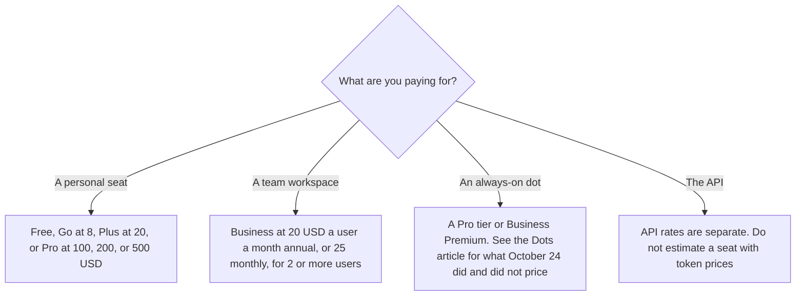

**ChatGPT's paid seats, on the plan page we could read on October 24, 2026, are Go at $8 a month, Plus at $20, Pro at $100, $200, or $500, and Business at $20 a user a month billed annually for two or more users, or $25 monthly.** Free is $0. That page is learn.chatgpt.com/docs/pricing. It prices Codex and ChatGPT Work inside those ChatGPT plans. chatgpt.com/pricing returned HTTP 403 the same day, so this article does not pretend to have re-read the consumer marketing page.

The directory card checked October 16, 2026 matches those seat prices and adds plan notes the Codex page does not fully restate. Where the two disagree, this article says which page said it. A second assistant's ladder is [Claude pricing explained](/blog/claude-pricing-explained-2026/). The always-on agent inside eligible ChatGPT plans is [OpenAI Dots pricing explained](/blog/openai-dots-pricing-explained-2026/).

Published October 24, 2026. We did not score answers. Prices below exclude any tax the checkout adds. We did not see a tax line.

## The seats, and where each number came from

| Plan | Price we can cite | Source |
|---|---|---|
| Free | $0 | learn.chatgpt.com/docs/pricing, October 24, 2026 |
| Go | $8 a month | Same page |
| Plus | $20 a month | Same page |
| Pro | $100, $200, or $500 a month. Ultrafast mode is named on the $500 tier | Same page |
| Business | $20 a user a month billed annually, 2 or more users. $25 a user a month billed monthly | Same page |
| Enterprise and Edu | Contact sales on that page | Same page. No list price |

The October 24 page says ChatGPT Work and Codex are included in Free, Go, Plus, Pro, Business, Edu, and Enterprise, and that they share usage. It says Plus and Pro can buy credits after the included limit. It says image generation is not available on the Free plan, in the section on how image generation counts toward Codex usage, and that image generations use included limits 3 to 5 times faster on average than similar turns without image generation. That sentence is on the Codex pricing page. The October 16 directory card says Free includes limited image creation in ChatGPT. Those are different surfaces. This article does not collapse them into one image quota.

Go may include ads, on the October 16 card. The October 24 Codex page's Go line does not discuss ads. Business, on both the October 24 page and the October 16 card, is the workspace with admin controls and no training on business data by default. The October 24 page also names SAML SSO and MFA on Business.

## What the October 16 card still adds

**Plus,** on that card, is the professional seat: advanced reasoning, projects, scheduled tasks, custom GPTs, and expanded Codex. The October 24 page says Plus includes Codex on the web, CLI, IDE extension, and iOS, plus cloud integrations such as code review and Slack, and credits.

**Pro** is three prices, not a single "Pro means unlimited" line. The October 24 page says Pro plans currently have no five-hour limit, in the usage section we read, and that limits still depend on model, size, and cloud versus local work. Do not budget as if every Pro tier were the same.

**A dot** is not on the Free, Go, or Plus lines of the Dots page we could read. Eligibility is in the Dots article. Business Premium's dollar price was not on the pages that returned 200 on October 24. The October 16 directory card lists Business Premium at $125 a user a month billed monthly, or $100 annually. Cite that card's date if you put $125 on a purchase order, and re-check before you pay.

**Gemini** Google AI Plus is $4.99 a month and Pro is $19.99, on the October 16 card, if you are comparing a Google seat rather than buying ChatGPT. The invoice is [Gemini pricing explained](/blog/gemini-pricing-explained-2026/). The review of the product, separate from this bill, is [ChatGPT review](/blog/chatgpt-review-2026/).

## What not to assume

Do not add API token prices to a Plus seat and call the sum the plan. The October 24 page says API token prices are separate from subscription usage. Do not assume Free and Plus include the same tools because the seat table looks simple. Do not treat a 403 on chatgpt.com/pricing as a price change. It means we could not read that URL.

## FAQ

### How much is ChatGPT Plus?

$20 a month, on learn.chatgpt.com/docs/pricing fetched October 24, 2026. The October 16 directory card says the same. chatgpt.com/pricing returned HTTP 403 that day.

### Is there a cheaper paid plan?

Go is $8 a month on that October 24 page. The October 16 card says Go may include ads. Read the checkout you are shown.

### How much is Business?

$20 per user per month billed annually, for two or more users, or $25 per user per month billed monthly, on the October 24 page. That is the Business plan on that page. It is not the Business Premium figure on the October 16 Dots card.

### Does Plus include Dots?

The Dots page we read on October 24 lists Pro 100, Pro 200, Pro 500, Business Premium, and Enterprise. It does not list Plus. See the Dots article before you assume an agent is included.

## Last verified

October 24, 2026 for learn.chatgpt.com/docs/pricing. chatgpt.com/pricing returned HTTP 403 that day. October 16, 2026 for the directory card, including the Go ads note and the Business Premium figure. Published October 24, 2026.

**Sources:** [ChatGPT and Codex pricing](https://learn.chatgpt.com/docs/pricing), [ChatGPT pricing](https://chatgpt.com/pricing/), [Meet dots](https://learn.chatgpt.com/docs/dots), [Claude pricing](https://claude.com/pricing).

*Published by Andrew for [AI Tools Optimizer](https://aitoolsoptimizer.com).*

[ChatGPT](/tools/chatgpt/) is in the [chatbots and assistants directory](/tools/category/chatbots-assistants/). Directory pages may use affiliate links. A purchase through them may earn us a commission at no extra cost to you.
