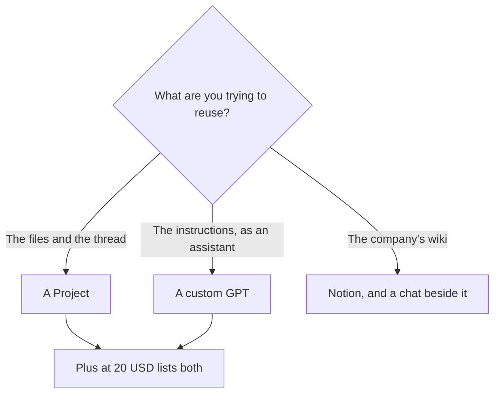

**Use a ChatGPT Project when the work is a pile of chats and files that belong together. Use a custom GPT when the work is a reusable assistant with instructions you want to open again, or hand to someone else.** Projects are a folder with memory of the effort. A custom GPT is a starting point that begins a new chat as that assistant.

Both show up on the Plus line of the directory card checked October 16, 2026. Plus is $20 a month. Go is $8 and is described there as more messages, uploads, images, and memory. The card lists projects, custom GPTs, and scheduled tasks as Plus additions. If a Go or free account shows one of the buttons, use it. Budget Plus when you need the plan that names both. The ladder is [ChatGPT Go vs Plus vs Pro](/blog/chatgpt-go-vs-plus-vs-pro-2026/). The product page is [ChatGPT review](/blog/chatgpt-review-2026/).

Published October 24, 2026. We did not score answer quality inside either container.

## What each one holds

| | Project | Custom GPT |
|---|---|---|
| What it is | A group of chats, files, and instructions for one ongoing effort | An assistant with its own instructions, and optional knowledge files |
| The next session | You continue a chat already in the folder, or start another chat that can see the project files | You open the GPT and start a chat as that assistant |
| Who it is for | You, and teammates if the workspace plan allows sharing | You, a link you send, or a listing, depending on the sharing control |
| Instructions | Apply to the work inside the project | Apply every time someone opens that GPT |
| A good fit | A product spec, a client, a course, a codebase you keep pasting | A weekly status draft, a brand voice, a support macro you want others to run |
| A weak fit | A one-off question | A six-month archive of source files you need to keep browsing |

Instructions you rely on are still [what a system prompt is](/blog/what-is-a-system-prompt-2026/), whether they sit on the project or on the GPT. They guide the model. They do not block a document that says something else. That limit is [what prompt injection is](/blog/what-is-prompt-injection-2026/).

## How to pick for a real week

**A spec that grows.** Put the notes, the rejected scope, and the latest draft in a Project. Each new chat should see those files so you stop re-attaching them. The writing workflow after the notes exist is [how to draft a product spec with AI](/blog/how-to-draft-a-product-spec-with-ai-2026/).

**A format you repeat.** A custom GPT that knows the release-note headings, the banned words, and two examples will beat a Project you have to re-explain. Paste one finished example. That is [what few-shot prompting is](/blog/what-is-few-shot-prompting-2026/). The release-note steps are [how to write release notes with AI](/blog/how-to-write-release-notes-with-ai-2026/).

**Notes that are the system of record.** A Project is a working set. It is a poor wiki. If the team lives in Notion, the AI seat is [Notion AI](/tools/notion-ai/). The comparison is [Notion AI vs ChatGPT for notes](/blog/notion-ai-vs-chatgpt-for-notes-2026/). Notion Business is $20 per seat per month on the October 16 card. ChatGPT Plus is also $20, and it does not become the wiki.

**[Claude](/tools/claude/)'s version of a project.** Anthropic's container is the other column if the writing or the long file is the reason you are here. The side-by-side is [Claude Projects vs ChatGPT Projects](/blog/claude-projects-vs-chatgpt-projects-2026/).

Business is $20 per user per month billed annually, or $25 monthly, for two or more users, on the October 16 card. Move the Project or the GPT into Business when an admin has to control sharing and data settings. Pro at $100 and up is a usage buy, which the Go-versus-Plus article separates from the feature list.

## FAQ

### Do I need Plus for both?

The directory card checked October 16, 2026 puts projects and custom GPTs on Plus at $20. Go at $8 is the cheaper step for messages and uploads. Check the account you have. If the control is missing, Plus is the plan that lists it.

### Can a custom GPT see every chat in a Project?

Treat them as separate containers. Put the files the assistant needs on the GPT. Put the running thread in the Project. If a file must be in both, you are maintaining two copies, and one of them will go stale.

### Which one is better for a team?

A custom GPT when many people should start from the same instructions. A Project when a few people are continuing the same body of work. Business is the plan that adds admin controls around either one.

### Will either one stop the model from inventing a price?

No. Paste the price and the date, and tell it to leave a blank when the source is missing. The check is [how to fact-check AI writing](/blog/how-to-fact-check-ai-writing-2026/).

## Last verified

October 16, 2026 for ChatGPT plan prices and for which features the directory lists on Plus. Notion's $20 Business seat is from the same directory check. Published October 24, 2026.

**Sources:** [ChatGPT pricing](https://chatgpt.com/pricing), [OpenAI](https://openai.com).

*Published by Andrew for [AI Tools Optimizer](https://aitoolsoptimizer.com).*

[ChatGPT](/tools/chatgpt/) is in the [assistants directory](/tools/category/chatbots-assistants/). Directory pages may use affiliate links. A purchase through them may earn us a commission at no extra cost to you.
