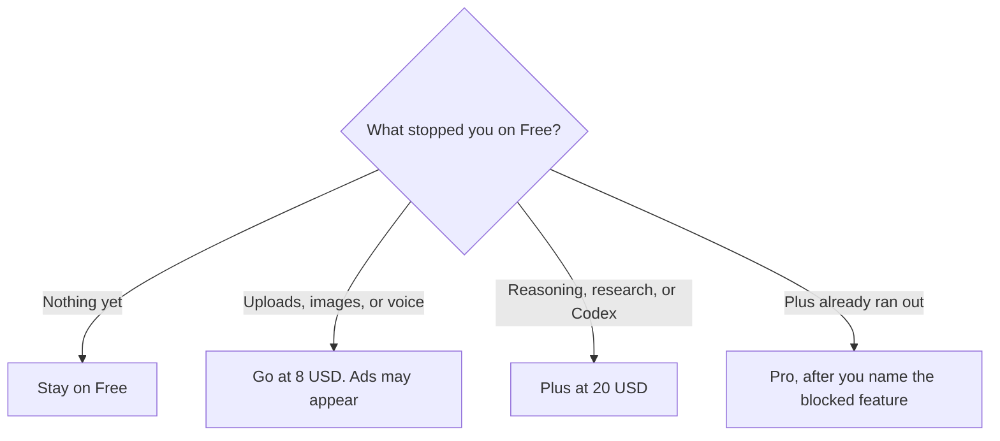

**[ChatGPT](/tools/chatgpt/) is OpenAI's general assistant: chat, files, images, research, and coding tools including [Codex](/tools/openai-codex/), sold as a monthly subscription with a free tier.** The plan ladder is a separate article, [ChatGPT Go vs Plus vs Pro](/blog/chatgpt-go-vs-plus-vs-pro-2026/). This review is whether ChatGPT is the assistant to start with, and which published job each tier is for.

Prices below are US list prices. The feature matrix was read from OpenAI's plans page on October 24, 2026. Plus at $20 is the price in OpenAI's pricing documentation we checked October 16, 2026, and in the January 16, 2026 Go announcement, which still describes Plus as the $20 plan beside Go. Go at $8 and the line that the plan may include ads are on the current Go help article and on that plans page. Pro at $100, $200, or $500 is on the Pro tiers help article. Tax and regional storefronts can differ. We did not score answer quality.

How it sits next to the other two assistants is [ChatGPT vs Gemini vs Claude](/blog/chatgpt-vs-gemini-vs-claude-2026/). The writing-only cut is [ChatGPT vs Claude for writing](/blog/chatgpt-vs-claude-for-writing-2026/).

## What you are buying

| Plan | US price we will quote | The job OpenAI's plan materials describe |
|---|---|---|
| Free | $0 | Everyday text chats, with tool limits. Abuse guardrails apply |
| Go | $8/month | Higher limits on uploads, images, voice, and data analysis. The plan may include ads. No annual billing |
| Plus | $20/month | Advanced reasoning, deeper research, Codex, and ChatGPT Work on desktop, web, and mobile |
| Pro | $100, $200, or $500/month | More capacity. Ultrafast models are on the $500 tier. Monthly only |
| Business | Per user, 2 or more | Admin controls. Confirm the live seat price. October 16 docs listed $20/user/month annual or $25 monthly |

The invoice is [ChatGPT pricing explained](/blog/chatgpt-pricing-explained-2026/).

OpenAI does not publish a fixed message count. Context sizes are on the plans page and are approximate, because instructions and the model's own work share the window. Do not buy a tier because a screenshot named a model. Buy the row you will use next week.

## What the product is for

Use ChatGPT when the work is mixed. A morning can be a draft, a spreadsheet question, an image, and a coding task, and OpenAI sells one subscription for that mix. Codex and ChatGPT Work are the reason a developer looks at Plus. Office and Google Sheets extensions move from limited on Go to included on Plus, which is the spreadsheet case in [best AI for Excel and Google Sheets](/blog/best-ai-for-excel-and-google-sheets-2026/).

Use something else when the job is narrow:

| The job | Start here |
|---|---|
| A cited answer you will open | [Perplexity](/tools/perplexity/). The workflow is [how to use Perplexity as a research desk](/blog/perplexity-review-2026/) |
| Long writing, with a separate usage pool | [Claude](/tools/claude/). Capacity is [Claude Pro vs Max](/blog/claude-pro-vs-max-2026/) |
| Gmail, Docs, and storage in one bill | [Gemini](/tools/gemini/) |
| Code inside GitHub | [GitHub Copilot](/tools/github-copilot/). See the [Copilot review](/blog/github-copilot-review-2026/) |

Free is a real product, not a demo that expires. It is the wrong place to run a workday that depends on reasoning or an agent. Go is the wrong upgrade if an ad in the product is unacceptable, or if the missing feature is reasoning. Plus is the default paid seat for work. Pro is a capacity purchase. The $500 tier is the only one OpenAI's materials tie to Ultrafast models. Do not skip Plus to "try" it.

Business is the team product. The October 16 pricing documentation said Business does not train on business data by default. The October 24 plans page confirms Business exists and is priced per user. Send a team the live seat price, not a remembered number. Teachers have a separate offer, ChatGPT for Teachers, described as free for verified U.S. K–12 educators through June 2027. That is not a global discount on Plus. Classroom choices are in [best AI tools for teachers](/blog/best-ai-tools-for-teachers-2026/).

## Who should pay

**Stay on Free** if caps are rare. **Pay for Go** if tool limits are the blocker and you can accept that ads may appear. **Pay for Plus** if ChatGPT is how you research, reason, or code most days. **Pay for Pro** only after Plus stopped a task you would have finished. **Do not stack** Plus on top of Claude Pro for the same writing job. The rule for one subscription is [which AI subscription is worth paying for](/blog/which-ai-subscription-is-worth-paying-for/).

## FAQ

### Is ChatGPT free?

Yes. Free includes everyday text chats, with limits on tools and with abuse guardrails. Go, Plus, and Pro are the paid individual plans.

### Does Go include ads?

OpenAI's pricing page says the plan may include ads, and the Go help article says OpenAI may test ads on Go. Plus is not described as an ad plan.

### Is there an annual discount?

Not on Go, Plus, or Pro, on the plans FAQ we read. Annual billing is described for Business and Enterprise. If a checkout offers a year of Plus, read it against that FAQ.

## Last verified

October 24, 2026, for the plans-page matrix, Go, and Pro tier prices. Plus at $20 and the Business seat price are from OpenAI's pricing documentation checked October 16, 2026. Recheck Business before you quote a team.

**Sources:** [ChatGPT plans and pricing](https://chatgpt.com/pricing/), [ChatGPT and Codex pricing documentation](https://learn.chatgpt.com/docs/pricing), [About ChatGPT Pro tiers](https://help.openai.com/en/articles/9793128-about-chatgpt-pro-tiers).

[ChatGPT](/tools/chatgpt/) is in the [chatbots directory](/tools/category/chatbots-assistants/). Directory pages may use affiliate links. A purchase through them may earn us a commission at no extra cost to you.
