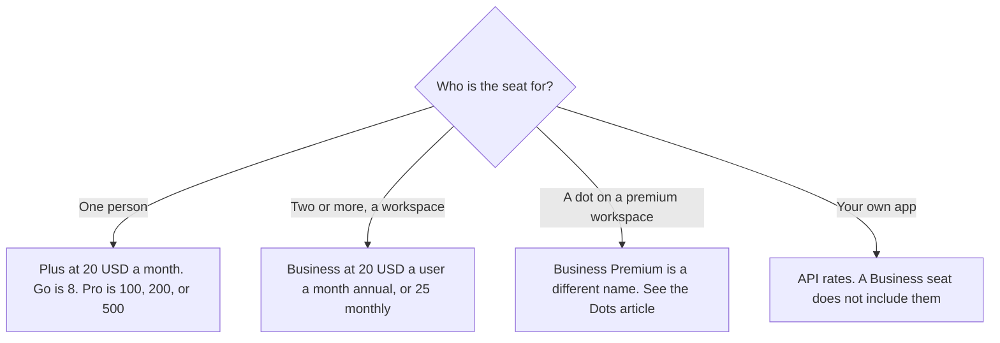

**On learn.chatgpt.com/docs/pricing fetched October 24, 2026, the workspace plan is named Business, at $20 a user a month billed annually for two or more users, or $25 a user a month billed monthly.** The page does not list a separate sticker named Team. If an older invoice says Team, match it to the current Business row and then read checkout. This article is that workspace decision. The full seat ladder, from Free through Pro, is [ChatGPT pricing explained](/blog/chatgpt-pricing-explained-2026/).

The API meter is a different bill: [OpenAI API pricing explained](/blog/openai-api-pricing-explained-2026/). A dot on a higher workspace tier is [OpenAI Dots pricing explained](/blog/openai-dots-pricing-explained-2026/). Published October 24, 2026. We did not score answers. The October 16 directory card uses the same Business dollars.

## What Business includes on the October 24 page

| Item | What that page says | What it does not say |
|---|---|---|
| Price | $20 a user a month, billed annually, for 2 or more users. $25 a user a month billed monthly | A plan named Team, with its own dollar |
| Workspace | A secure workspace with admin controls, SAML SSO, and MFA | That a personal Plus seat has those controls |
| Training | No training on your business data by default | That every connected product inherits the sentence |
| Codex | ChatGPT and Codex across desktop and mobile, with larger virtual machines for cloud chats | That the API key path is included. The page prices an API key separately |
| Above Business | Enterprise and Edu are contact sales, and the page lists SCIM, audit logs, retention, and residency on that tier | A list price for Enterprise |

Plus is $20 a month on the same page, for one person. Five Plus seats are five personal subscriptions. They are not a workspace with SAML SSO because the arithmetic looks similar to five Business seats at the annual rate. Business is the row that names the admin controls. The page also says ChatGPT Work and Codex are included in Business and share usage with the plan. It says you can extend usage with credits. It does not print a single message cap you can put in a spreadsheet. The usage section says estimates for Plus and Standard Business are not fixed message limits.

## The names that sit next to Business

**Business Premium** is the name on the October 24 Dots page, which lists dots rolling out to Pro tiers, Business Premium, and Enterprise. That page did not print a Business Premium dollar. The October 16 directory card lists Business Premium at $125 a user a month billed monthly, or $100 annually. Cite that card's date if you put $125 on a purchase order. Do not describe the $20 Business row as the dot plan.

**Claude Team**, if you are comparing a workspace on the other assistant, is a named Team plan: standard seats at $20 a seat a month billed annually, or $25 monthly, on claude.com/pricing the same day. That is Claude's sticker, not a ChatGPT discount. The invoice is [Claude Team pricing explained](/blog/claude-team-pricing-explained-2026/).

**Notion Business** is $20 a seat a month on the October 16 card if the brief lives in Notion. That $20 is a wiki seat. It is not a ChatGPT workspace. The invoice is [Notion AI pricing explained](/blog/notion-ai-pricing-explained-2026/).

**The API key** on the October 24 Codex plan page is its own row: you pay API pricing, and cloud features such as GitHub code review are not on that key. A Business seat and an API key are two purchases when you use both.

## What not to assume

Do not quote a ChatGPT Team price from this article. Quote Business, and say the October 24 page used that name. Do not treat "no training by default" as a substitute for your own retention rule. Do not add a token price to the $20 seat. The page says API token prices are separate from subscription usage.

## FAQ

### How much is ChatGPT Team?

The plan page fetched October 24, 2026 does not price a plan named Team. It prices Business at $20 per user per month billed annually, for two or more users, or $25 per user per month billed monthly. Confirm the name on your invoice at checkout.

### Is Business the same as five Plus seats?

Plus is $20 for one person. Business is $20 per user at the annual rate, with a two-user minimum, and the page puts admin controls, SAML SSO, and MFA on Business. The similar dollar is not the same product.

### Does Business include Dots?

The Dots page read October 24 lists Business Premium, not the Business row priced at $20. Read the Dots article before you assume an always-on agent is included.

### Does Business include the API?

The API is a separate meter. The Codex page shows an API key row that pays API rates. The workspace article you are reading does not add those rates to the seat.

## Last verified

October 24, 2026, from learn.chatgpt.com/docs/pricing. chatgpt.com/pricing returned HTTP 403 in the seat-ladder article the same day, so this article uses the plan page we could read. Business Premium's dollar is the October 16 directory card. Published October 24, 2026.

**Sources:** [ChatGPT and Codex pricing](https://learn.chatgpt.com/docs/pricing), [Meet dots](https://learn.chatgpt.com/docs/dots), [Claude pricing](https://claude.com/pricing), [OpenAI API pricing](https://developers.openai.com/api/docs/pricing).

*Published by Andrew for [AI Tools Optimizer](https://aitoolsoptimizer.com).*

[ChatGPT](/tools/chatgpt/) is in the [chatbots and assistants directory](/tools/category/chatbots-assistants/). Directory pages may use affiliate links. A purchase through them may earn us a commission at no extra cost to you.
