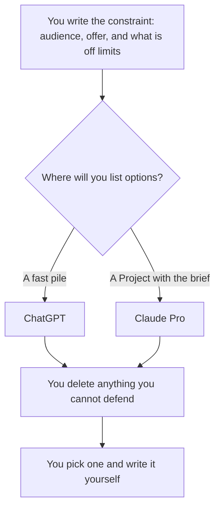

**Use ChatGPT when you want a pile of options inside the chat you already pay for, including a custom GPT you reuse for the same kind of brainstorm. Use Claude when the brainstorm has to stay inside a long brief, a Project, and a document you will keep.** Both can list ideas. You still throw most of them away. A list is not a decision.

The writing comparison, which is the draft after you have chosen, is [ChatGPT vs Claude for writing](/blog/chatgpt-vs-claude-for-writing-2026/). The email comparison, which is one message you will send, is [ChatGPT vs Claude for email](/blog/chatgpt-vs-claude-for-email-2026/). The three-way with Gemini is [ChatGPT vs Gemini vs Claude](/blog/chatgpt-vs-gemini-vs-claude-2026/).

Prices are US list prices excluding tax from directory pages checked October 16, 2026. Published October 24, 2026. We did not score which model has better ideas.

## Which brainstorm matches which seat

| The session | Start here | First paid step | Leave this for later |
|---|---|---|---|
| Ten titles, ten angles, one sitting | [ChatGPT](/tools/chatgpt/) Go or Plus | Go is $8. Plus is $20 | Claude Max |
| A brief you will reuse with the same constraints | [Claude](/tools/claude/) Pro, in a Project | $20 a month, or $17 billed annually ($200 up front) | A second subscription "for creativity" |
| The ideas should become a page the team edits | [Notion AI](/tools/notion-ai/) Business | $20 a seat. Plus at $10 is not the full AI tier | Plus as if it were the brainstorm tool |
| You need sources before you invent a market | [Perplexity](/tools/perplexity/) | Pro is $17 a month billed annually. Monthly costs more. The card does not print the monthly dollar | Treating a brainstorm as research |
| The line you keep, after you choose | [Grammarly](/tools/grammarly/) | Free for grammar. Pro is $12 a member a month billed annually | Asking it for the strategy |

## What you are paying for

**ChatGPT.** Free includes text chat. Go is $8 and adds usage. It may include ads. Plus is $20 and adds projects, custom GPTs, and higher limits. Pro starts at $100. For a weekly brainstorm, Plus is the seat if you want a custom GPT that already knows your constraints. Go is enough for an occasional list. Do not buy Pro because a brainstorm feels important. The ladder is [ChatGPT Go vs Plus vs Pro](/blog/chatgpt-go-vs-plus-vs-pro-2026/).

A custom GPT is a saved setup, not a truth. Put the off-limits list in the instructions: no invented statistics, no competitor claims you did not paste, no "guaranteed" results. One example of a brainstorm you liked, with the private bits removed, is [what few-shot prompting is](/blog/what-is-few-shot-prompting-2026/).

**Claude.** Free includes chat, files, and Projects with limits. Pro is the seat most people mean. Max at $100 or $200 is for people who already hit Pro. The directory records Team and does not print a Team price. A long brief belongs in a Project so the next session does not restart from a blank chat. That container is [Claude Projects vs ChatGPT Projects](/blog/claude-projects-vs-chatgpt-projects-2026/). Saved chat notes are [what AI memory is](/blog/what-is-ai-memory-2026/). The brief file beats memory.

The review is [Claude review](/blog/claude-review-2026/). The heavy-use split is [Claude Pro vs Max](/blog/claude-pro-vs-max-2026/).

**After the list.** Perplexity is how you check a market claim before it becomes a slide. The cost against Plus is [Perplexity Pro vs ChatGPT Plus cost](/blog/perplexity-pro-vs-chatgpt-plus-cost-2026/). Grammarly polishes the one line you kept. It will not know whether the idea is allowed. The card is [Grammarly pricing explained](/blog/grammarly-pricing-explained-2026/).

A prompt that holds the line:

"Here is the audience, the offer, and the facts I am allowed to use. Give me 12 options. For each, one sentence and why it might fail. Do not invent numbers, quotes, or customer names. Mark any option that needs a fact I did not provide."

## How to choose

If you already pay for one of them, brainstorm there for a week. Add the second when a specific session fails: the brief is too long for the chat you have, or you want a custom GPT for a repeating format. Paying $20 and $20 to compare adjectives is a hobby.

The idea you keep still needs a check before it ships. That pass is [how to fact-check AI writing](/blog/how-to-fact-check-ai-writing-2026/). The person who picks is [what human-in-the-loop AI is](/blog/what-is-human-in-the-loop-ai-2026/).

A newsletter that starts as a brainstorm is a later workflow: [how to create a newsletter with AI](/blog/how-to-create-a-newsletter-with-ai-2026/). Do not send the brainstorm list to subscribers.

## FAQ

### Which one is more creative?

This page did not measure that. Constraints you paste, and how hard you cut, change the list more than the logo. Run one real brief in the free tier of each if you pay for neither.

### Should I ask for 100 ideas?

Ask for a dozen you can read. A hundred-item list is a way to avoid choosing. If you need more, run a second pass on the two you would actually ship.

### Can I brainstorm in a team channel and let it post?

Keep the list in the draft. A channel bot that posts unreviewed ideas will eventually announce a feature you do not sell. Business ChatGPT, at $20 a user a month billed annually for two or more users, is an admin boundary. It is not an approval.

### What about images in the brainstorm?

ChatGPT Plus can generate images on the same seat. That is a sketch, not a brand system. A production image plan is [Midjourney vs FLUX](/blog/midjourney-vs-flux-2026/). Do not buy an image subscription to name a campaign.

## Last verified

October 16, 2026 for ChatGPT, Claude, Notion, Perplexity, and Grammarly prices named above. Published October 24, 2026.

**Sources:** [ChatGPT pricing](https://chatgpt.com/pricing), [Claude pricing](https://claude.com/pricing), [Perplexity pricing](https://www.perplexity.ai/hub/pricing).

*Published by Andrew for [AI Tools Optimizer](https://aitoolsoptimizer.com).*

[ChatGPT](/tools/chatgpt/) is in the [chatbots and assistants directory](/tools/category/chatbots-assistants/). Directory pages may use affiliate links. A purchase through them may earn us a commission at no extra cost to you.
