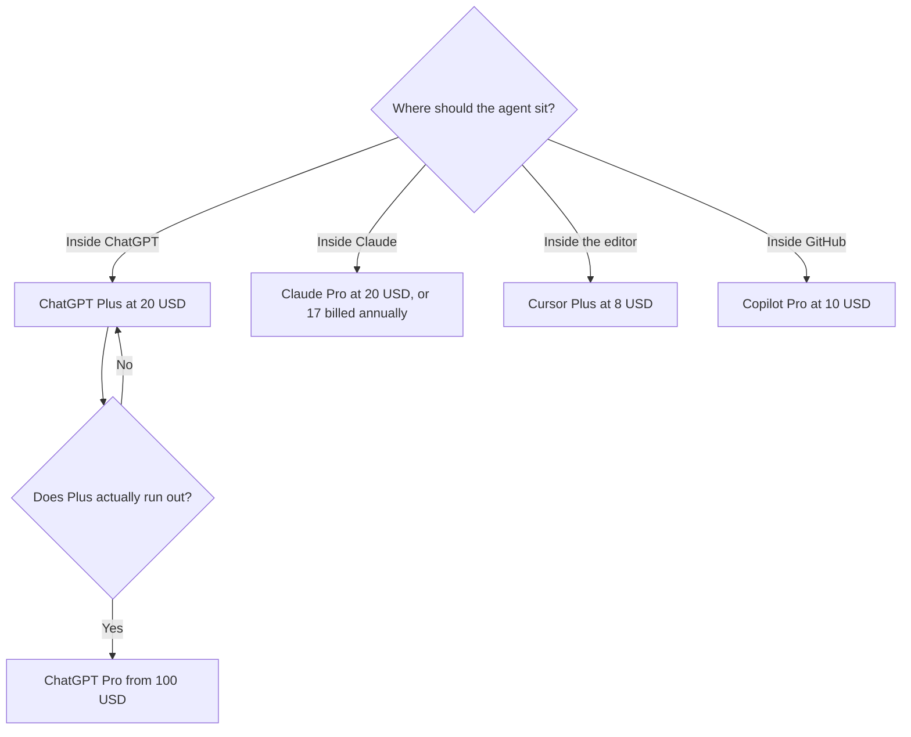

**Use ChatGPT Plus when the coding agent should live in the same $20 seat as the rest of your ChatGPT work. Use Claude Pro when you want Claude Code and you already want Claude for long documents.** Both are $20 a month before annual billing. Neither one is a reason to skip reading the diff.

The editor-versus-agent comparison is [Cursor vs Claude Code vs Codex](/blog/cursor-vs-claude-code-vs-codex-2026/). The writing comparison, which is a different job, is [ChatGPT vs Claude for writing](/blog/chatgpt-vs-claude-for-writing-2026/). The shelf of assistants is [best AI coding assistants](/blog/best-ai-coding-assistants-2026/). We did not publish a coding score.

Prices are US list prices. ChatGPT's Codex rows were recorded October 24, 2026 from OpenAI's plan material. Claude's prices are from the directory check on October 16, 2026. Published October 24, 2026.

## The coding decision

| Your week | Start here | Why |
|---|---|---|
| You already live in ChatGPT, and the code task is one of several | [ChatGPT](/tools/chatgpt/) Plus, which includes [Codex](/tools/openai-codex/) | One bill. Web, CLI, IDE, iOS, code review, and Slack on the Plus row |
| You want a terminal agent and Claude's writing in the same seat | [Claude](/tools/claude/) Pro, which includes [Claude Code](/tools/claude-code/) | Pro is the first Claude plan with Claude Code. Free Claude does not include it |
| You live in an editor and want Tab plus an agent | [Cursor](/tools/cursor/) | Plus is $8/month on The X Subscription. A different pool from either chat plan |
| The team is standardized on GitHub and wants a simple seat | [GitHub Copilot](/tools/github-copilot/) | Pro is $10/user/month with $15 of credits |
| Plus or Pro limits already stop a workday | ChatGPT Pro, or Claude Max | Capacity. Not a quality badge |

## What each $20 plan includes for code

**ChatGPT Plus at $20** is the recorded row for meaningful Codex: web, CLI, IDE extension, iOS, code review, and Slack. Models on that row include GPT-6.1 Sol and GPT-6 Luna. Credits can extend usage. Free is quick tasks on GPT-6 Luna at Standard speed, subject to rollout. Go at $8 is lightweight tasks and may include ads. Do not buy Go for Codex. The ladder is [ChatGPT Go vs Plus vs Pro](/blog/chatgpt-go-vs-plus-vs-pro-2026/).

**ChatGPT Pro at $100, $200, or $500** is more usage. The recorded note says no five-hour limit, and Ultrafast is on the $500 tier. Fast mode spends included usage at 2.5×, Ultrafast at 8×. Leaving Ultrafast on is how a large Pro tier disappears. Business is $20 per user per month billed annually, for two or more users, or $25 monthly, with SSO and no training on business data by default.

**Claude Pro is $20 a month, or $17 billed annually ($200 up front).** Anthropic's own coding note, recorded on the Claude Code page, calls Pro a fit for short sprints in small codebases. Max 5× at $100 is the everyday-larger-codebase step and includes $100 a month in API credits. Max 20× at $200 is the power-user step. Usage is shared with Claude chat. A writing-heavy day and a coding-heavy day draw the same pool. The capacity article is [Claude Pro vs Max](/blog/claude-pro-vs-max-2026/). A first week in the terminal is [Claude Code for beginners](/blog/claude-code-for-beginners-2026/).

**There is no free Claude Code.** Free Claude still includes files and code execution in chat, with usage limits and up to five Projects. That is enough to ask about a snippet. It is not the agent.

## Cursor and Copilot, so you do not buy two agents by accident

[Cursor](/tools/cursor/) Plus at $8 is the editor. Premium at $30 is 4× Plus usage. The multiple is not a count of agent runs. Legacy Pro at $20 still exists for current subscribers. Switching off a legacy plan is permanent, on Cursor's help note recorded in the three-way. The invoice is [Cursor pricing explained](/blog/cursor-pricing-explained-2026/).

[GitHub Copilot](/tools/github-copilot/) Free is 2,000 completions a month. Pro at $10 is the seat that is easy to explain. Business at $19 adds pooled credits and IP indemnity. If the only gap is completions inside GitHub, Copilot can be the whole purchase. The card is [GitHub Copilot pricing explained](/blog/github-copilot-pricing-explained-2026/).

Owning ChatGPT Plus and Claude Pro is reasonable when one person truly splits writing and a second coding style. It is waste when the second seat was bought "to compare" and one of them is unopened. Run the same bug through the free or base paid tier you already have before you add the other $20.

## What neither plan does for you

The model can propose a patch. You merge it. Tool use against a repository is still [tool use](/blog/what-is-tool-use-in-llms-2026/): a wrong file, a wrong test, a fluent explanation. Review the diff. A reasoning tier helps when the bug crosses files. It does not replace the test. That tier, and when it is wasted on a rename, is [what a reasoning model is](/blog/what-is-ai-reasoning-models-2026/).

Claude's recorded context can reach 1 million tokens depending on the model. That is not permission to paste the repository every turn. A coding tool that selects files will spend less than a dump. The limit is [what a context window is](/blog/what-is-a-context-window-2026/).

## FAQ

### Is ChatGPT Plus enough for coding?

For Codex access, Plus is the first plan the recorded matrix treats as the real coding seat. Free and Go are for short tasks. Move to Pro when Plus limits, not a blog post, stop the workday.

### Is Claude Code included with Claude Pro?

Yes. It is not a separate subscription. It is not on the free Claude plan. Max is the capacity step at $100 or $200 after Pro limits are the blocker.

### Which one writes better code?

This page does not score that. Run one bug you already understand. Keep the assistant whose diff you had to edit less. The other differences that are documented are where the agent runs and which subscription you were going to pay for anyway.

### Should a team buy Business?

ChatGPT Business at $20 per user billed annually is the admin seat: SSO and no training on business data by default, on the recorded card. Claude Team is listed per seat for 2 to 150 people, without a dollar figure in this directory. Do not invent one. Read the checkout.

## Last verified

October 24, 2026 for ChatGPT Codex plan rows, from the Cursor versus Claude Code versus Codex article's recorded matrix. October 16, 2026 for Claude, Cursor, and Copilot list prices. Published October 24, 2026.

**Sources:** [ChatGPT pricing](https://chatgpt.com/pricing/), [Claude pricing](https://claude.com/pricing), [GitHub Copilot](https://github.com/features/copilot).

*Published by Andrew for [AI Tools Optimizer](https://aitoolsoptimizer.com).*

[Claude Code](/tools/claude-code/) and [Codex](/tools/openai-codex/) are in the [coding directory](/tools/category/coding/). Directory pages may use affiliate links. A purchase through them may earn us a commission at no extra cost to you.
